# Gluttony × Lust：工业视觉检测系统求职向架构全解

## 0. 先读这一章：你应该怎样使用本文

### 0.1 本文对应的源码快照

本文以 2026-07-30 工作区中的以下版本为准：

| 项目 | 仓库位置 | 当前提交 | 核心定位 |
|---|---|---:|---|
| Gluttony | `D:\code\Gluttony` | `84297f7` | Python 训练/导出 + C++/Qt 检测、持久化与 TCP 服务端 |
| Lust | `D:\code\OnePiece\Qt\Lust` | `4f79035` | C++/Qt 相机采集、参数控制、图像显示与 TCP 客户端 |

项目还在演进中。本文会明确区分三类内容：

- **代码现状**：源码已经实现、可以从具体类和函数中验证。
- **设计意图**：代码结构表达出的目标，但实现可能还不完整。
- **求职改进项**：面试时应该主动承认并能提出落地方案的不足。

### 0.2 两个项目一句话是什么

最短版本：

> Lust 从工业相机采集图像并通过自定义 TCP 协议发送；Gluttony 使用 OpenVINO 执行 PatchCore 异常检测，把原图、热力图和结构化结果可靠落盘，再把 OK/REVIEW/NG 结果按帧序号返回 Lust。

30 秒面试版本：

> 这是一个 C++/Qt 工业视觉闭环项目。采集端 Lust 用接口、工厂和上下文屏蔽相机厂商差异，通过生产者—消费者队列解耦相机回调与显示/传输；检测端 Gluttony 用自定义 40 字节帧协议解决 TCP 粘包拆包，用独立推理线程和“只保留最新帧”的背压策略控制实时性，再由独立 SQLite 线程和原子文件写入保存批次。模型由 Python 侧使用 Anomalib/PatchCore 训练并导出为 OpenVINO 或 ONNX，C++ 侧通过 OpenVINO Runtime 部署。

### 0.3 建议阅读顺序

1. 先读第 1 章，建立两个进程和三条数据链的整体地图。
2. 再读第 2、3 章，分别理解 Gluttony 和 Lust。
3. 用第 4、5 章把网络协议与完整时序串起来。
4. 用第 6 章理解当前质量、缺口和改进优先级。
5. 最后用第 7、8 章补齐知识点并准备面试表达。

### 0.4 源码导航约定

本文中的 Gluttony C++ 路径默认相对于：

```text
D:\code\Gluttony\clients\Gluttony
```

Lust C++ 路径默认相对于：

```text
D:\code\OnePiece\Qt\Lust\Lust
```

Python 训练端路径默认相对于：

```text
D:\code\Gluttony
```

### 0.5 本章面试问答

**问题：为什么把系统拆成 Lust 和 Gluttony 两个进程，而不是写在一个程序里？**

参考答案：

> 两个进程对应两种变化速度和两类责任。Lust 靠近硬件，处理相机 SDK、采集线程、曝光增益等设备参数；Gluttony 靠近算法和数据，处理模型加载、推理、结果展示与持久化。分进程后，相机 SDK 崩溃不会直接污染检测端地址空间，检测模型升级也不要求重新修改相机抽象层；两端只通过版本化协议耦合，更适合以后把采集端部署在产线工控机、检测端部署在另一台算力设备。

可能追问：**分进程的代价是什么？**

参考回答：

> 代价是要自己解决序列化、TCP 消息边界、断线、超时、背压、协议兼容和分布式状态一致性。当前项目已经处理了固定头部、长度校验、请求序号、超时集合和流开始/结束，但还缺少自动重连、CRC/TLS、协商式版本升级和跨进程指标监控。

---

# 第一篇：先建立全局心智模型

## 1. 总体架构

### 1.1 系统边界与职责

系统不是简单的“一个相机界面 + 一个检测界面”，而是三个技术层共同组成的闭环：

1. **离线模型生产层**：Python + Anomalib + PatchCore，负责数据集、建库、评估和模型导出。
2. **在线采集层**：Lust，负责相机抽象、采集、显示、参数编辑和图像发送。
3. **在线检测与数据层**：Gluttony，负责协议解析、OpenVINO 推理、结果回传、批次状态和持久化。

#### 总体架构图

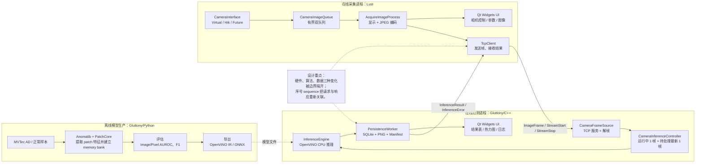

### 1.2 三条真正的数据链

面试时不要笼统地说“数据从相机到模型”。这个系统有三条不同的链：

| 数据链 | 起点 | 终点 | 关键保证 |
|---|---|---|---|
| 模型链 | Python 配置/数据集 | `.xml/.bin` 或 `.onnx` | 同样的输入尺寸、输出名和预处理契约 |
| 实时帧链 | Lust 相机线程 | Gluttony 推理线程 | TCP 边界、序号关联、容量限制、最新帧背压 |
| 结果持久化链 | 推理结果 | SQLite + PNG + JSON manifest | 事务、原子文件写、状态机、异常恢复 |

#### 端到端实时链路图

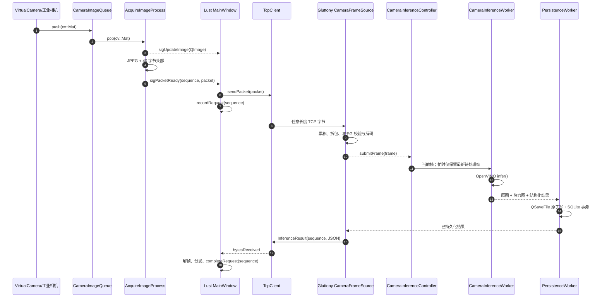


关键顺序是：**Gluttony 在持久化成功后才回传成功结果**。这意味着 Lust 收到 `InferenceResult` 时，可以把它理解为“检测完成且服务端已经接管结果”，而不仅是“模型算完了”。

### 1.3 线程与事件循环

Qt 中“对象在哪个线程创建”和“槽在哪个线程执行”比“代码写在哪个类”更重要。

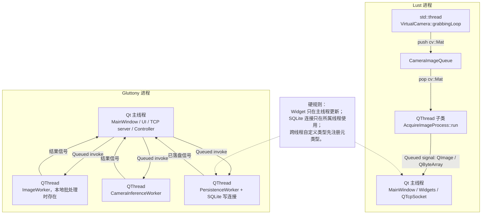

为什么 Gluttony 要把推理和数据库拆成两个工作线程？

- OpenVINO 推理是 CPU 密集或设备等待，不能阻塞 UI 事件循环。
- PNG 编码、模型哈希、磁盘写入和 SQLite 事务也可能卡顿。
- 两类工作生命周期不同：推理线程可以随模型/批次重建，持久化线程贯穿应用生命周期。

### 1.4 模块地图

下表是全文的“索引”。“模块”按可独立解释、可独立测试、可独立替换的职责划分。

| 项目 | 模块 | 主要目录/类 | 一句话职责 |
|---|---|---|---|
| Gluttony | Python 训练与导出 | `src/gluttony`、`scripts` | 把正常样本变成可部署的 PatchCore 模型 |
| Gluttony | 应用壳与状态编排 | `main.cpp`、`MainWindow` | 启动数据库、装配 UI、协调本地和 TCP 两种模式 |
| Gluttony | 推理核心 | `InferenceEngine` | QImage 预处理、OpenVINO 推理、阈值分级和热力图 |
| Gluttony | 本地批处理 | `ImageWorker` + 状态机 | 数据库领取一项、推理、逐项提交、暂停/恢复 |
| Gluttony | TCP 接收与协议 | `Transport/*` | 单客户端服务、粘包拆包、图像解码、响应编码 |
| Gluttony | 实时背压 | `CameraInferenceController` | 忙时用最新帧替换旧待处理帧 |
| Gluttony | 数据库迁移 | `Migration*`、`DatabaseBootstrapper` | 嵌入迁移、校验 checksum、事务升级和启动恢复 |
| Gluttony | 运行时持久化 | `PersistenceWorker`、Repositories | SQLite 状态机、PNG、manifest、清理任务 |
| Gluttony | 结果/UI/日志 | `ViewWidget` 等 | 输入、参数、表格、热力图、指标和日志 |
| Lust | 应用壳与操作面板 | `MainWindow`、`ControlWidget` | 装配三栏 UI，协调相机、TCP 和流控制 |
| Lust | 相机抽象与工厂 | `CameraInterface`、`CameraFactory`、`CameraContext` | 隔离厂商 SDK，按元信息创建相机 |
| Lust | 虚拟相机与图像队列 | `VirtualCamera`、`CameraImageQueue` | 模拟采集并用有界队列解耦生产消费 |
| Lust | 采集与显示 | `AcquireImageProcess`、`ViewWidget`、`GraphicsView` | 从队列取图，一份帧同时用于显示与网络 |
| Lust | 参数系统 | `ParseUiJson`、Model/Delegate/Editors | 用 JSON 元数据动态生成不同类型编辑器 |
| Lust | 事件通知 | `ListenerManager` | 同步相机连接/拉流状态给多个面板 |
| Lust | 请求协议与 TCP | `FrameProtocol`、`ImagePacketEncoder`、`TcpClient` | JPEG 封包并进行有界异步发送 |
| Lust | 响应与请求跟踪 | Decoder/Dispatcher/Tracker | 解响应、按类型分发、序号关联、超时清理 |

### 1.5 总体架构模块面试问答

**问题：这个项目最能体现“架构设计”的地方是什么？**

参考答案：

> 第一是边界：相机厂商差异被 `CameraInterface` 和工厂隔离，模型训练与 C++ 部署通过模型文件隔离，两个进程通过协议隔离。第二是异步链路：相机生产、采集消费、网络、推理和持久化各自有容量与生命周期。第三是可靠性：TCP 使用固定头部和长度校验，实时推理采用最新帧背压，数据库用状态机、事务、迁移和启动恢复，文件用 `QSaveFile` 原子提交。

可能追问：**这算微服务吗？**

参考回答：

> 不建议包装成微服务。它更准确地说是两个桌面/边缘进程组成的分布式工业视觉管线。虽然有进程边界和网络协议，但没有服务发现、弹性伸缩、统一配置中心等典型微服务基础设施。面试中准确命名比堆概念更加分。

**问题：为什么实时链路要“持久化后再回响应”？**

参考答案：

> 因为成功响应代表的业务语义可以更强：不仅推理完成，而且结果已经落盘。这样客户端收到成功后，即使服务端马上崩溃，结果仍有恢复基础。代价是响应延迟包含磁盘与事务耗时，所以后续若追求极低延迟，可以拆成 `InferenceAccepted` 和 `PersistenceCommitted` 两阶段事件，或者采用内存日志/消息队列。

可能追问：**如果持久化失败怎么办？**

参考回答：

> 当前代码走 `InferenceError`，错误码包括 `PERSISTENCE_FAILED`，并减少 in-flight 计数，避免批次永远无法收尾。更完整的工业实现还应区分可重试和不可重试错误、设置有限重试队列、磁盘水位告警，并把失败帧放入隔离区而不是只返回错误。

### 1.6 第一章结束：面试官视角复盘

**问题：请你从数据流而不是 UI 页面介绍项目。**

参考答案：

> 离线侧用正常样本建立 PatchCore memory bank 并导出 OpenVINO/ONNX。在线侧 Lust 的相机线程把帧放进有界队列，采集线程取出同一帧用于显示和 JPEG 编码，加上包含 sequence、时间戳、尺寸和 payload 长度的 40 字节头部，经 TCP 发给 Gluttony。Gluttony 累积字节并拆包，校验 JPEG 后交给最新帧推理控制器；OpenVINO 输出 score、anomaly map 和 mask，生成分级、热力图和面积。持久化线程原子保存图片并在事务中更新批次计数，成功后使用原 sequence 回传结果。Lust 解码响应并从待处理请求表中完成对应项。

可能追问：**其中哪几个点是为“无限长运行”准备的？**

参考回答：

> 相机队列有固定容量；TCP payload、接收缓存、发送缓存和待处理请求数都有上限；实时推理最多保留一个待处理最新帧；每帧完成后从请求跟踪表删除；SQLite 每项单独提交而不是把整个批次放内存；历史结果使用表和文件，而不是长期把所有大图保存在 UI 对象里。当前仍需补充日志轮转修复、监控指标和长稳压测。

---

# 第二篇：Gluttony——训练、检测与数据可靠性

## 2. Gluttony 总览

Gluttony 不是单一的“推理界面”，而是一个包含模型生产、桌面应用、网络服务和数据系统的组合项目。

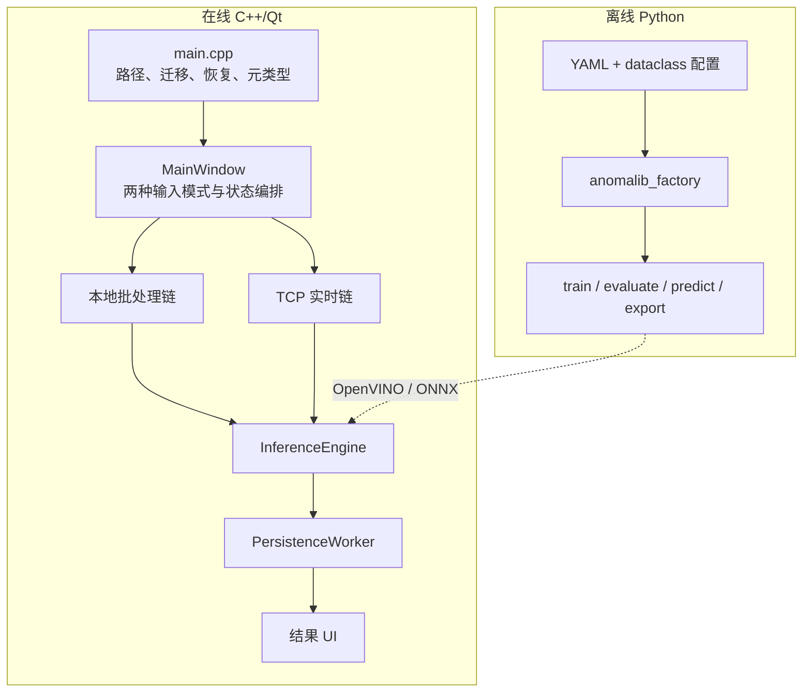

### 2.0.1 总览面试问答

**问题：Gluttony 为什么同时包含 Python 和 C++？**

参考答案：

> Python/Anomalib 适合数据集实验、PatchCore 训练评估和模型导出；C++/Qt/OpenVINO 适合桌面交互、网络、设备侧部署和数据持久化。两者通过版本化模型与预处理契约连接，使训练迭代不把 Python 运行时带进生产 GUI。

可能追问：**这个边界最容易出什么问题？**

参考回答：

> 最危险的是 silent numerical mismatch：颜色、resize、mean/std、layout 或输出名不一致时 C++ 仍能运行但结果错误。因此需要导出 manifest、model hash、golden tensor 和跨框架输出回归，而不只是验证模型文件能加载。

---

## 2.1 模块：应用启动、UI 装配与顶层状态编排

### 2.1.1 为什么 `main.cpp` 不只是创建窗口

Gluttony 的启动顺序体现了“先保证数据基础设施，再开放业务 UI”：

1. 创建 `QApplication`，安装全局 Qt 日志处理器。
2. 设置稳定的应用名和版本号。
3. 用 `DataBasePaths` 计算数据库与批次目录。
4. 从 Qt Resource 读取内嵌 SQL 迁移。
5. 用 `DatabaseBootstrapper` 打开 SQLite、执行迁移、校验外键并恢复中断任务。
6. 注册跨线程信号需要的自定义元类型。
7. 创建 `MainWindow`，最后进入 `a.exec()` 事件循环。

真实代码位于 `clients/Gluttony/main.cpp`：

```cpp
QApplication a(argc, argv);
LogMessage::getInstance().installMessageHandler();
QCoreApplication::setApplicationName(QStringLiteral("Gluttony"));

const auto dataBasePaths = DataBasePaths::createDefault(&DBErrorMessage);
const auto embeddedMigrations =
    MigrationCatalog::loadEmbeddedMigrations(&migrationResourceError);
const auto bootstrapReport = DatabaseBootstrapper::initialize(
    dataBasePaths->dataBaseFilePath(),
    QStringLiteral("gluttony.bootstrap"),
    embeddedMigrations.value(),
    &bootstrapErrorMessage);

MainWindow w(
    dataBasePaths->dataBaseFilePath(),
    dataBasePaths->managedRunsRoot());
```

如果数据库启动失败，程序直接返回，不创建一个“看起来能用、实际无法保存”的窗口。这属于 **fail fast**。

### 2.1.2 `MainWindow` 是协调器，不是算法类

`MainWindow` 持有 UI、网络入口、推理控制器、持久化线程和状态变量。它不应该亲自执行耗时算法；它的价值是把信号和状态转换连起来。

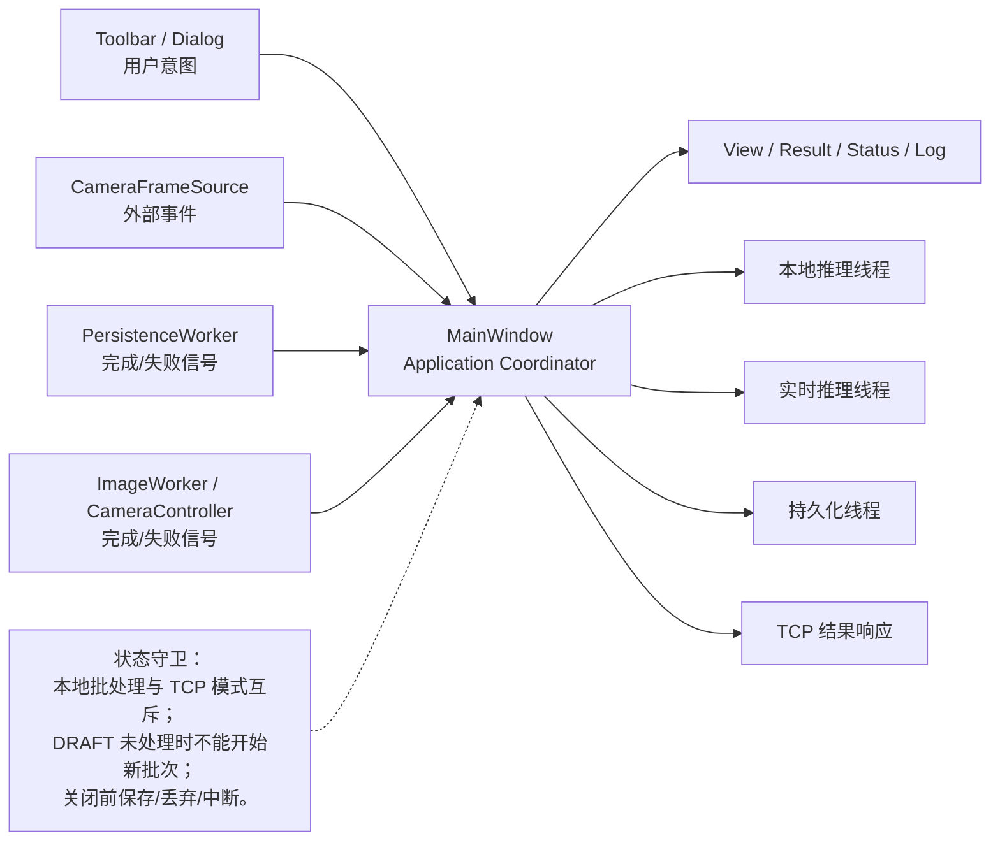

顶层存在两套相关状态：

- `InputMode`：`NONE / SINGLEIMAGE / FOLDER`，描述本地输入来自哪里。
- `DetectionStatus`：`IDLE / PREPARING / RUNNING / PAUSEREQUEST / PAUSED / FINALIZING`，描述本地批处理的生命周期。

实时 TCP 侧还用一组布尔量和序号表达状态：

- 服务是否启用、客户端是否连接、流是否活跃。
- 当前 `cameraStreamSequence` 和当前持久化批次绑定的 `cameraRunStreamSequence`。
- 推理、落盘、批次收尾是否仍有 in-flight 工作。

这还不是一个形式化状态机类，但已经具备状态机思想：**事件只有在满足守卫条件时才触发转换**。

### 2.1.3 为什么本地模式和 TCP 模式互斥

`onImageSelected`、`onFolderSelected` 和 `onStartActionTriggered` 都检查 `cameraTcpEnabled || cameraClientConnected`。这样做的原因不是技术上绝对不能并行，而是当前 UI、统计字段和单个 `InferenceEngine` 的语义还没有完全隔离。

求职表达应该是：

> 当前版本主动限制为单业务模式，优先保证状态一致性。如果要并行，我会把本地批次和实时流分别封装成 `LocalInspectionSession` 与 `CameraInspectionSession`，让它们拥有独立统计、模型实例、取消令牌和展示通道，再由更薄的 MainWindow 订阅两个 session。

### 2.1.4 本模块面试问答

**问题：为什么不在 `main.cpp` 里直接 `MainWindow w; w.show();`？**

参考答案：

> 因为 UI 打开意味着应用对用户承诺“可以工作”。Gluttony 的核心业务依赖数据库结构和持久化目录，所以启动前先验证路径、迁移、外键和恢复状态。这样失败点集中、错误可解释，也避免运行一半才发现数据库不可用。

可能追问：**启动迁移会不会卡 UI？**

参考回答：

> 迁移发生在窗口创建前，确实会增加冷启动时间。当前迁移量较小，换来的是业务开始前的一致状态。若数据量和迁移耗时增大，可以使用启动页显示进度，但仍不能在迁移完成前允许写业务；也可以把大规模数据回填设计成可恢复的后台迁移任务。

**问题：`MainWindow` 是否职责过重？**

参考答案：

> 是。它当前既处理 UI 状态，又协调网络、批次、推理、持久化和关闭流程，是可工作的“应用协调器”，但已经接近 God Object。演进方向是提取本地批次 session、相机 session 和 batch manager service，让 MainWindow 只做视图绑定。

可能追问：**怎么拆而不破坏现有功能？**

参考回答：

> 先从无 UI 的状态和命令开始：把 `beginNewRun/requestNextItem/finishActiveRun` 移入 `LocalInspectionSession`，保持原信号名称；再把 `beginCameraPersistenceSession/tryFinalize...` 移入 `CameraInspectionSession`。MainWindow 仍连接信号更新控件。每次只移动一个状态闭环，并用现有测试加 session 级测试。

---

## 2.2 模块：Python 训练、评估、预测与导出

### 2.2.1 配置如何流动

`configs/patchcore_mvtec.yaml` 是单一配置入口，`src/gluttony/config.py` 把松散字典转换成冻结的 dataclass：

```python
@dataclass(frozen=True)
class AppConfig:
    project: ProjectConfig
    dataset: DatasetConfig
    model: ModelConfig
    trainer: TrainerConfig
    export: ExportConfig

    @property
    def run_dir(self) -> Path:
        return self.project.output_dir / self.dataset.category
```

冻结配置的好处是训练中途不会被某段代码意外修改；类型化字段也比到处访问 `dict["model"]["layers"]` 更容易重构和补全。

### 2.2.2 工厂层为什么存在

`anomalib_factory.py` 集中创建 `MVTecAD`、`Patchcore` 和 `Engine`，并用 `try/except TypeError` 兼容 Anomalib API 版本变化。

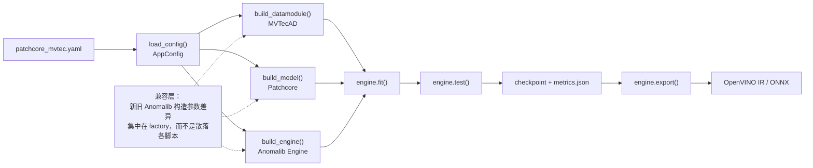

脚本职责：

| 脚本 | 输入 | 输出 |
|---|---|---|
| `prepare_dataset.py` | MVTec 类别压缩包 | 标准 `train/test/ground_truth` 目录 |
| `train_patchcore.py` | YAML + 数据集 | checkpoint、测试指标、run summary |
| `evaluate.py` | checkpoint | `evaluation.json` |
| `predict_image.py` | 单图 + checkpoint | OK/NG、score、heatmap、overlay、JSON |
| `export_model.py` | checkpoint | OpenVINO/ONNX/Torch 导出物和 manifest |
| `verify_openvino_export.py` | `.xml` 或 `.onnx` | Runtime 输入输出信息与可编译性验证 |

### 2.2.3 PatchCore 在这里到底“训练”了什么

PatchCore 通常不对 backbone 做从零反向传播。项目配置使用：

- backbone：`wide_resnet50_2`
- 中间层：`layer2`、`layer3`
- coreset 比例：`0.01`
- 最近邻数：`9`

训练阶段大致是：

1. 用 ImageNet 预训练网络提取正常图像的局部 patch 特征。
2. 将多层特征对齐、拼接为局部描述子。
3. 用 coreset sampling 留下有代表性的正常特征，形成 memory bank。
4. 推理时计算测试 patch 到正常 memory bank 的最近邻距离。
5. 距离越大，越可能异常；空间距离图还原为 anomaly map。

这很适合“正常样本多、缺陷样本少且缺陷类型无法穷举”的工业场景。

### 2.2.4 当前训练模块的求职风险

- `try/except TypeError` 能兼容版本，但也可能吞掉真实参数错误；更稳妥的是锁定依赖版本并按版本显式适配。
- 当前配置默认 CPU、`num_workers=0`、一个类别，主要用于跑通闭环，不代表最终性能配置。
- Python 预处理与 C++ 预处理必须完全一致。当前 C++ 仅做 `/255`，是否还需 mean/std 归一化必须用导出模型契约验证。
- 训练指标文件存在，但简历不能只写“准确率高”；应给出数据类别、指标定义、阈值和硬件上的延迟。

### 2.2.5 本模块面试问答

**问题：PatchCore 为什么适合工业缺陷检测？**

参考答案：

> 工业现场常见类别极不平衡：正常品容易收集，真实缺陷稀少且未来缺陷无法全部枚举。PatchCore 只需要正常样本建立局部特征库，测试 patch 如果远离正常特征分布就判异常；它还能输出像素级异常热力图，便于解释和定位。

可能追问：**coreset 比例越小越好吗？**

参考回答：

> 不是。比例小会降低 memory bank 的内存和最近邻查询成本，但可能丢掉正常分布的细节，造成误检。它是速度、内存和覆盖率之间的权衡，应通过验证集和目标硬件延迟共同选择，而不是固定写 0.01。

**问题：为什么导出后还要单独验证 OpenVINO？**

参考答案：

> “导出文件生成”不等于“部署契约正确”。验证脚本确认 Runtime 能读取和编译模型，并列出输入输出名、类型和 shape。C++ 端硬编码使用 `pred_score`、`anomaly_map`、`pred_mask`，所以导出物的输出契约必须在交付前验证。

可能追问：**如何保证 Python 和 C++ 推理一致？**

参考回答：

> 建立 golden set：固定若干输入图，保存 Python 侧预处理后 tensor、score、mask 和 anomaly map；C++ 侧逐项比较 shape、数值误差、分级和热力图尺寸。还要把色彩顺序、缩放插值、归一化、阈值和输出名写入模型 manifest，不能只靠双方“约定俗成”。

---

## 2.3 模块：`InferenceEngine`——OpenVINO 推理核心

### 2.3.1 模型加载契约

`InferenceEngine::loadModel` 不是什么模型都接受，它验证：

- 文件存在，后缀为 `.xml` 或 `.onnx`。
- 只有一个输入。
- 输入是静态四维 NCHW。
- 通道数为 3，元素类型为 `float32`。
- 高和宽是静态值。
- 当前固定编译到 `CPU`。

验证通过后才替换成员 `model`、`compiledModel`、输入尺寸和路径，避免加载失败破坏旧的可用状态。

### 2.3.2 一张图如何变成结果

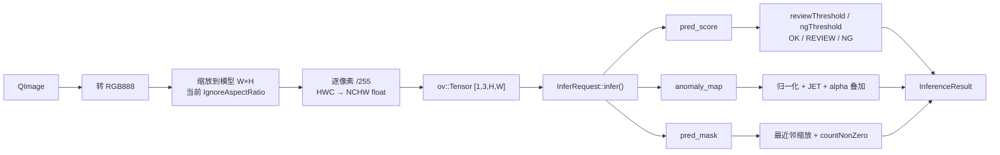

核心代码：

```cpp
inputData[0 * inputWidth * inputHeight + pixelIndex] = red;
inputData[1 * inputWidth * inputHeight + pixelIndex] = green;
inputData[2 * inputWidth * inputHeight + pixelIndex] = blue;

inferRequest.infer();
result->score =
    inferRequest.get_tensor("pred_score").data<const float>()[0];
```

分级不是二分类，而是三段：

```cpp
if (score < reviewThreshold)      OK;
else if (score < ngThreshold)    REVIEW;
else                             NG;
```

`REVIEW` 是很工业化的设计：在模型不确定区域引入人工复核，而不是强迫所有样本二选一。

### 2.3.3 热力图与缺陷面积

`anomaly_map` 被 min-max 归一化到 0~255，再使用 `COLORMAP_JET` 着色，并按 `heatmapAlpha` 与原图混合。

`pred_mask` 被最近邻插值到原图尺寸，然后用 `countNonZero` 计算缺陷像素面积。最近邻用于 mask 是正确方向，因为标签不应该像自然图像那样被线性插值成模糊边界。

需要诚实说明的局限：

- 每张图单独 min-max 会增强视觉对比，但不同图片的颜色强度不可直接横向比较。
- `defectArea` 是像素数，不是毫米平方；要转物理面积需要相机标定或像素当量。
- `IgnoreAspectRatio` 可能拉伸目标，若训练预处理不是同样策略，会产生域偏移。
- 输出 tensor 名称是硬编码，模型版本变化时容易运行期失败。

### 2.3.4 本模块面试问答

**问题：为什么 QImage 要复制成 NCHW？**

参考答案：

> QImage 的 RGB888 内存通常是逐行 HWC 排列，而模型输入声明为 `[N,C,H,W]`。因此要把每个像素的 R/G/B 分别写入三个连续通道平面，并把 `uchar` 映射成模型要求的 float。若模型输入是 NHWC 或 U8，处理方式会不同，不能假设所有模型一致。

可能追问：**这段逐像素循环如何优化？**

参考回答：

> 先保证正确，再考虑复用输入 buffer、使用 OpenCV `convertTo`/`blobFromImage`、SIMD 或 OpenVINO PrePostProcessor。最重要的是用 profile 证明预处理是瓶颈，并保证优化后数值与训练侧一致。还可以复用 `InferRequest`，避免每帧重新创建。

**问题：为什么有 REVIEW，而不是只有 OK/NG？**

参考答案：

> 工业决策成本不对称。把低分判 OK、高分判 NG，中间不确定区交给人工复核，可以用一定人工成本换取更低漏检和误杀。两个阈值应由业务成本、验证集 ROC/PR 和产线节拍共同确定。

可能追问：**如何把像素面积换成真实面积？**

参考回答：

> 如果目标平面和相机几何稳定，可以通过标定得到每像素毫米数，面积约为缺陷像素数乘以横纵像素当量；若存在透视或曲面，需要单应性、深度或局部尺度映射。还要说明 mask 后处理和标定误差。

---

## 2.4 模块：本地图片/文件夹批处理与工作线程

### 2.4.1 为什么不是一次把文件夹全读进内存

创建批次时，`PersistenceWorker::createRunFromSource` 只枚举文件元信息并插入 `inspection_item`，状态是 `PENDING`。真正处理时每次只领取一条：

```text
claimNext(PENDING → PROCESSING)
    ↓
ImageWorker 加载这一张图并推理
    ↓
persistSuccess / persistFailure
    ↓
继续 claimNext
```

这使内存规模接近 O(1)，并让崩溃恢复有明确落点。

### 2.4.2 状态机与串行流水

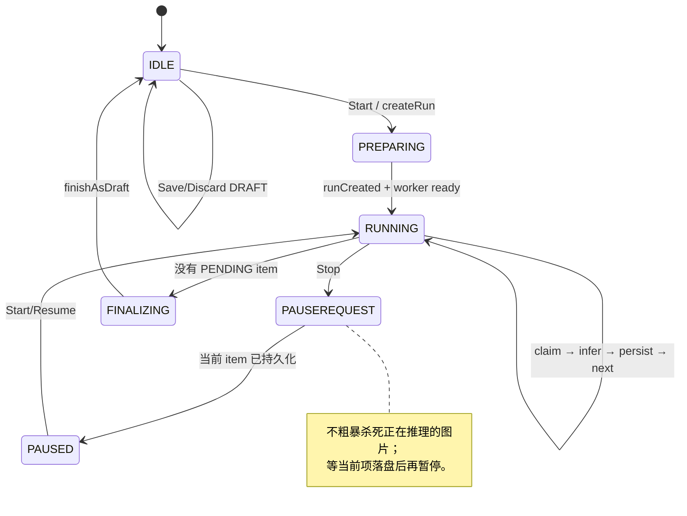

`claimInFlight`、`itemInFlight`、`persistenceInFlight`、`finishInFlight` 保证同一阶段只发出一个异步请求。`requestNextItem()` 的守卫条件是这条串行链的关键。

### 2.4.3 `ImageWorker` 的职责边界

`ImageWorker` 在独立 `QThread` 所属线程中：

1. 加载自己的 `InferenceEngine`。
2. 按路径加载单张 `QImage`。
3. 执行推理。
4. 只通过 `sigTaskFinished/sigTaskFailed` 返回结果。

它不更新 UI、不写数据库，也不决定下一项是谁。这种边界让推理工作单元易测，也避免 SQLite 连接跨线程。

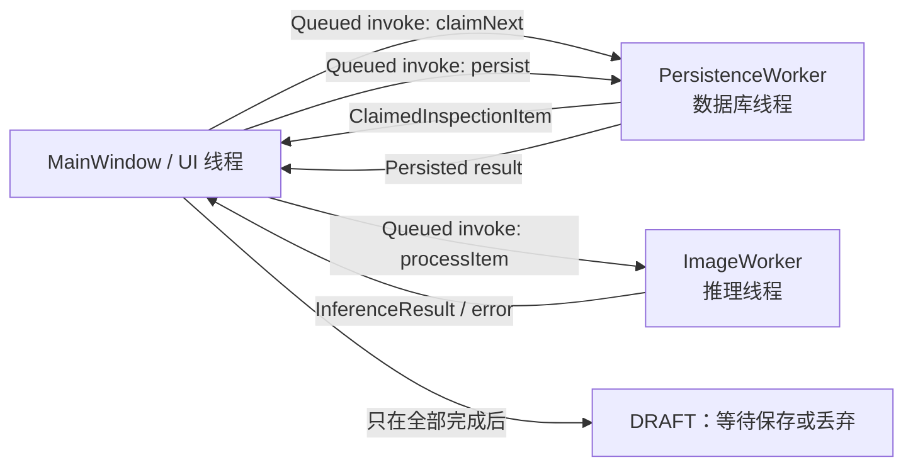

### 2.4.4 暂停、关闭和恢复

- 点击 Stop 不会立即终止 `infer()`，而是进入 `PAUSEREQUEST`。
- 当前图片推理并落盘后进入 `PAUSED`。
- 关闭正在运行的批次时，数据库把 `PROCESSING` 重置为 `PENDING`，批次改成 `INTERRUPTED`。
- 下次启动迁移完成后会执行恢复扫描，用户可继续处理。
- 恢复时重新加载批次保存的模型路径和阈值，防止用当前 UI 参数悄悄改变旧批次语义。

### 2.4.5 本模块面试问答

**问题：为什么批处理当前是串行，而不是开多个推理线程？**

参考答案：

> 当前实现选择可预测性：一次只领取、推理和提交一项，内存稳定，状态恢复简单，也避免多个 OpenVINO 请求抢 CPU。并行不是越多越好；如果 profile 证明吞吐不足，可以建立固定大小 worker pool，并让数据库原子 claim 多项，但必须保留结果幂等、提交顺序与取消语义。

可能追问：**怎么做并行 claim？**

参考回答：

> SQLite 单写线程内用 `BEGIN IMMEDIATE`，选择 PENDING 项并条件更新为 PROCESSING；一次领取 N 条或循环领取。每个 item 用唯一 `result_id`，完成更新要求原状态为 PROCESSING，受影响行数必须为 1。工作线程只拿值对象，数据库仍由一个线程提交，避免连接并发。

**问题：为什么暂停要等当前图片完成？**

参考答案：

> OpenVINO 同步 `infer()` 当前没有安全的中途取消点。强行杀线程会破坏对象和资源生命周期，也可能让数据库停在 PROCESSING。项目把暂停定义为“当前原子工作单元完成后停止领取下一项”，语义清晰且可恢复。

可能追问：**如果单张推理卡死怎么办？**

参考回答：

> 当前线程会一直等待，这是缺口。生产级方案可以使用异步 InferRequest 和 watchdog；超时后标记请求、重建推理 worker，必要时把推理隔离到独立进程，以进程级终止换取故障隔离。

---

## 2.5 模块：TCP 服务端、流解码与应用协议入口

### 2.5.1 分层不是“多写几个类”

Gluttony 的接收链按责任分成四层：

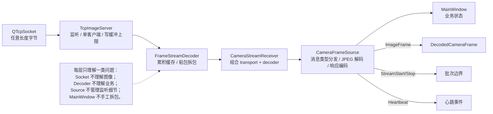

这种分层的好处是测试可以很精确：

- `TcpImageServerTest` 测连接和原始字节。
- `FrameProtocolTest` 测头部编码、长度和非法字段。
- `FrameStreamDecoderTest` 测半包、粘包和缓存。
- `ReceivedFrameImageDecoderTest` 测 JPEG 与声明尺寸。
- `CameraFrameSourceTest` 测从消息类型到业务信号。

### 2.5.2 TCP 为什么必须自己处理消息边界

TCP 只保证有序字节流，不保留发送端一次 `write()` 的边界：

- 一个协议包可能分多次到达，叫半包。
- 多个协议包可能一次到达，叫粘包。

`FrameStreamDecoder::appendBytes` 将字节追加到 `receiveBuffer_`，循环调用 `tryDecodePacket`：

```cpp
if (result == Complete) {
    emit sigFrameDecoded(frame);
    continue; // 缓冲里可能还有粘连的下一个包
}
if (result == InvalidData) {
    receiveBuffer_.clear();
    emit sigProtocolError(errorMessage);
    return;
}
return; // NeedMoreData
```

协议用 payload 长度确定完整包大小，并限制单 payload 最大 64 MiB，接收缓存也有限制，避免恶意长度导致无限内存增长。

### 2.5.3 图像负载的二次验证

有完整包不等于有合法图像。`ReceivedFrameImageDecoder` 继续验证：

- 消息类型必须是 `ImageFrame`。
- 像素格式必须是 `Jpeg`。
- payload、宽、高均有效。
- 像素总数不超过 1 亿。
- JPEG 内部尺寸必须与协议头声明尺寸一致。
- 最终统一转为 `QImage::Format_RGB888`。

“头部尺寸”和“JPEG 自身尺寸”交叉检查可以发现错误发送端或伪造数据。

### 2.5.4 服务端连接策略

`TcpImageServer` 当前只允许一个相机客户端。第二个连接会收到 `sigClientRejected` 并被关闭。它还限制返回方向待写数据不超过 1 MiB。

单客户端不是能力不足的同义词。当前 UI 和批次状态只有一个 `cameraRunId`，所以单客户端是与业务模型一致的显式限制。多相机版本需要把状态按 connection/camera ID 分区，而不是简单取消判断。

### 2.5.5 本模块面试问答

**问题：TCP 粘包和拆包是怎么解决的？**

参考答案：

> 使用固定 40 字节头部，其中包含 magic、版本、头长、消息类型、序号、时间戳、尺寸和 payload 长度。接收端先累计到至少一个完整头，再校验字段和最大长度；如果整个 payload 还没到就保留缓存，完整后切出一包并继续循环解析剩余字节。

可能追问：**遇到错误 magic 为什么不扫描下一个 magic 自动恢复？**

参考回答：

> 当前选择 fail closed：清空缓存并上报协议错误，上层断开连接，避免在不可信边界上继续误解析。扫描重同步适合丢字节的串口等场景，但 TCP 本身不丢中间字节，错误更可能表示双方版本不一致或数据被破坏，重连更安全。

**问题：为什么还要检查 JPEG 尺寸？**

参考答案：

> payload 长度只证明字节数量完整，不能证明业务语义可信。头部宽高可能被伪造，JPEG 也可能损坏。读取 JPEG 内部元数据并与头部交叉校验，可以阻止异常内存申请、错误显示和错误持久化。

可能追问：**协议还缺什么？**

参考回答：

> 缺少 CRC/哈希、认证与 TLS、压缩协商、能力协商、明确的错误码注册表、心跳超时策略和自动重连。局域网作品集可以先证明边界处理，生产落地要按威胁模型补齐。

---

## 2.6 模块：实时推理控制器与“最新帧”背压

### 2.6.1 为什么不能把每帧都排进 Qt 事件队列

假设相机 30 FPS，而 CPU 推理只有 8 FPS。若每帧都排队，队列长度会持续增加，几分钟后用户看到的还是很久以前的画面；最终还可能耗尽内存。

实时预览更关心“新鲜度”而不是“每帧必达”，因此项目采用：

- 正在推理：最多 1 帧。
- 待处理缓存：最多保留 1 帧，而且永远替换为最新帧。
- 被替换的帧：记录 dropped count，并按原 sequence 返回 `FRAME_DROPPED`。

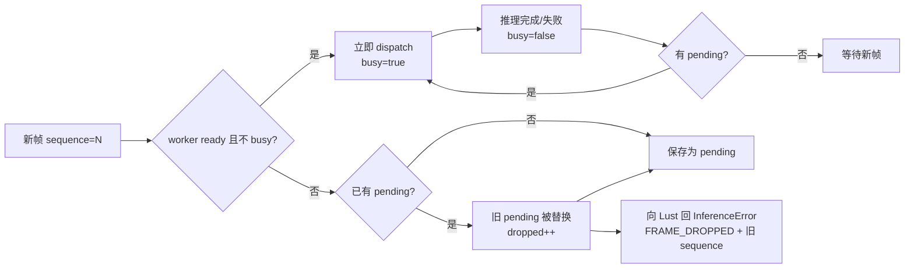

`LatestCameraFrameBuffer` 本身没有锁，因为它只在 `CameraInferenceController` 所在线程中访问；真正的 worker 在另一个线程，通过 queued invoke 接收值对象。

### 2.6.2 `sessionGeneration_` 解决什么问题

当重新加载模型时，旧 worker 的信号可能已经在事件队列中。`CameraInferenceController::start/stop` 增加 generation，连接 lambda 捕获创建时的 generation：

```cpp
if (generation != sessionGeneration_) {
    return; // 旧会话的迟到信号
}
```

这是一种轻量的 **代际令牌/取消令牌**。它不一定停止底层计算，但能阻止旧结果污染新会话。

### 2.6.3 为什么丢帧也要响应

Lust 为每个已发送 sequence 建立待处理请求。如果 Gluttony 静默丢帧，Lust 只能等到 5 秒超时。显式 `FRAME_DROPPED` 能更快释放请求并把背压变成可观测事件。

注意当前代码的业务含义：

- `cameraReceivedCount` 在模型就绪检查前增加。
- `cameraDroppedCount` 统计被最新帧替换的帧。
- 批次保存 `received_count` 和 `dropped_count`，可以用于产线吞吐分析。

### 2.6.4 本模块面试问答

**问题：为什么选择“丢旧留新”，而不是阻塞接收端？**

参考答案：

> 实时相机预览要求低延迟。阻塞接收会把压力传到 TCP 和采集端，最终展示旧帧；无限排队更糟。只保留最新待处理帧把内存固定在常数规模，并让结果尽量接近当前现场。对于必须逐件追溯的触发式检测，则应改成有界队列、硬件节拍控制或拒绝新触发，不能随意丢帧。

可能追问：**这个策略适合所有工业检测吗？**

参考回答：

> 不适合。连续预览、监控类适合 newest-wins；每个工件都必须有结论的质量门禁适合 lossless 或显式 reject。架构应把策略抽象成 `DropOldest/DropNewest/Block/Reject`，由业务模式配置，并记录每种丢弃原因。

**问题：generation token 与真正取消有什么区别？**

参考答案：

> generation 只让迟到结果失效，不保证旧计算立刻停止，因此释放资源和响应时间仍取决于 worker 正常结束。真正取消需要底层 API 支持 cancel，或把任务放进可终止进程。两者可以组合：先逻辑失效，再尽力取消。

可能追问：**旧任务一直不结束怎么办？**

参考回答：

> generation 不能解决永久阻塞，worker 仍要有 deadline、底层 I/O timeout 和 shutdown watchdog。超过期限后应隔离该 worker/session、标记 INTERRUPTED，并在安全边界重建线程或进程；不能只增加 generation 把资源泄漏隐藏起来。

---

## 2.7 模块：SQLite 连接、迁移与启动恢复

### 2.7.1 数据库路径和连接所有权

`DataBasePaths` 使用 `QStandardPaths::AppLocalDataLocation` 创建：

```text
<AppLocalData>/
└─ data/
   └─ persistence/
      ├─ gluttony.db
      └─ runs/
```

`DataBaseConnection` 是不可复制、可移动的 RAII 包装器。析构时关闭并移除命名 Qt SQL 连接。打开连接后配置并验证：

- `foreign_keys = ON`
- `busy_timeout = 5000`
- `journal_mode = WAL`
- `synchronous = NORMAL`
- SQLite 版本至少 3.37（使用 STRICT table）

重要规则：**Qt SQL connection 属于创建它的线程**。启动迁移连接在主线程使用后销毁；运行期持久化连接在 `PersistenceWorker` 线程创建、使用和销毁。

### 2.7.2 迁移流水线

SQL 文件通过 CMake 的 `qt_add_resources` 嵌入可执行文件，不依赖部署目录旁边存在松散 SQL 文件。

```mermaid
flowchart LR
    SQL["001_initial_schema.sql<br/>002_tcp_camera_persistence.sql"] --> QRC["Qt Resource<br/>:/database/migrations"]
    QRC --> Catalog["MigrationCatalog<br/>读取、规范化、拆语句、SHA-256"]
    Catalog --> Planner["MigrationPlanner<br/>对比 schema_migration + user_version"]
    Planner --> Pending{"有 pending?"}
    Pending -->|"是"| Exec["MigrationExecutor<br/>BEGIN IMMEDIATE"]
    Exec --> Statements["逐条执行 SQL"]
    Statements --> History["写 schema_migration<br/>更新 PRAGMA user_version"]
    History --> Commit["COMMIT"]
    Pending -->|"否"| Verify["再次构建 plan 验证"]
    Commit --> Verify
    Verify --> FK["foreign_key_check"]
    FK --> Recovery["recoverInterruptedRuns"]
```

迁移 checksum 防止“已经上线的 001 被悄悄修改”。数据库历史中的版本、名字和 SHA-256 必须与内嵌目录一致。

`MigrationStatementSplitter` 使用显式的：

```sql
-- gluttony:statement-break
```

作为复杂 DDL/trigger 的边界，避免用简单分号切分而破坏 trigger body。

### 2.7.3 启动恢复

`DatabaseBootstrapper` 在迁移和外键检查后调用 `recoverInterruptedRuns`：

- `PROCESSING` item 重置为 `PENDING`。
- 对应 `RUNNING` run 改为 `INTERRUPTED`。

运行期 `PersistenceWorker::initialize` 还会：

- 处理待清理文件任务。
- 丢弃上次遗留的 `DRAFT`。
- 对中断的 TCP camera run 自动收尾保存。
- 把其余中断批次通知 UI，询问用户是否恢复。

### 2.7.4 本模块面试问答

**问题：为什么既有 `schema_migration` 表，又有 `PRAGMA user_version`？**

参考答案：

> `user_version` 提供快速的单值当前版本；迁移历史表保存每个版本的名称、时间和 checksum，可审计并检测已发布迁移被修改。两者在每次迁移事务中一起更新，启动后再次核对，形成交叉验证。

可能追问：**为什么迁移要 `BEGIN IMMEDIATE`？**

参考回答：

> 它在事务开始时就获取写锁，避免执行到 DDL 中途才发现写竞争。迁移必须全有或全无，失败回滚后数据库仍保持旧版本。对正常业务写也能减少“先读后写”竞态。

**问题：WAL 的作用是什么？**

参考答案：

> WAL 让读者通常不阻塞一个写者，适合 UI 查询历史、后台线程写结果的桌面场景。SQLite 仍然是单写者，所以项目坚持一个持久化写连接；WAL 不是让无限多个写线程同时高吞吐。

可能追问：**`synchronous=NORMAL` 有什么取舍？**

参考回答：

> WAL + NORMAL 在性能与可靠性之间折中，应用崩溃通常不破坏数据库，但极端断电时最后少量事务的持久性弱于 FULL。质量追溯是否允许这个风险要由业务决定，不能把配置当普适答案。

---

## 2.8 模块：批次/条目 Repository 与文件持久化

### 2.8.1 为什么 SQLite 不直接存大图 BLOB

项目采用混合存储：

- SQLite：ID、状态、阈值、计数、路径、hash、时间和错误。
- 文件系统：相机原图、热力图、`manifest.json`、`items.json`。

这样数据库查询和备份更轻，图片可直接被 Qt/OpenCV 读取；代价是必须处理文件和数据库的一致性。

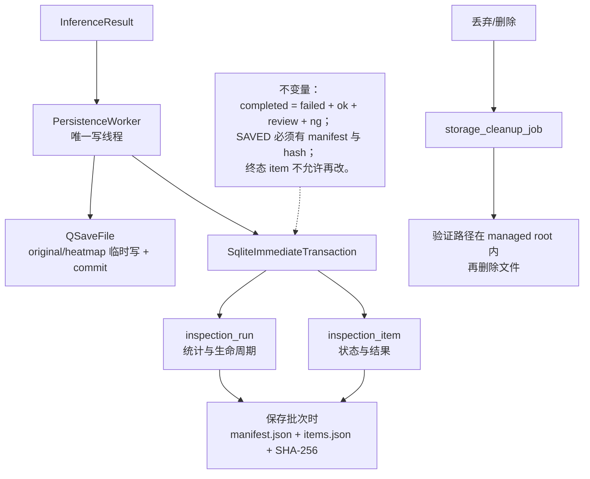

### 2.8.2 两级状态机

批次 `inspection_run.status`：

```text
RUNNING → DRAFT → SAVED
RUNNING → INTERRUPTED → RUNNING
DRAFT/SAVED → 删除数据库记录 + 清理任务
```

条目 `inspection_item.status`：

```text
PENDING → PROCESSING → SUCCESS
                     ↘ FAILED
崩溃恢复：PROCESSING → PENDING
```

SQL `CHECK` 和 trigger 不只依赖 C++ 自觉：

- 批次状态限定为 `RUNNING/DRAFT/SAVED/INTERRUPTED`。
- `completed_count = failed + ok + review + ng`。
- `DRAFT/SAVED` 必须全部完成。
- `SAVED` 必须有名称、manifest 路径和 hash。
- item 终态字段组合必须完整。
- 已保存批次和终态结果不可随意修改。

### 2.8.3 本地图片的提交顺序

成功结果采用：

1. `QSaveFile` 原子保存 heatmap。
2. 数据库事务把 item 从 `PROCESSING` 更新为 `SUCCESS`。
3. 同一事务更新 run 统计。
4. 数据库失败则删除刚写的 heatmap。
5. 发 `successPersisted`，UI 才增加计数和展示。

`claimNextPending` 也在事务中完成“选中第一条 PENDING + 条件更新 PROCESSING”，并检查受影响行数必须为 1。

### 2.8.4 TCP 相机结果与本地结果有什么不同

本地批次开始时，所有 item 已从目录枚举并处于 PENDING。TCP 流不知道未来会有多少帧，所以每次推理结束才动态插入终态 item：

- 保存原图 `originals/frame_<transportSequence>_<uuid>.png`。
- 保存热力图。
- 在一个事务里分配批次内 `sequence_no`，插入 SUCCESS/FAILED item，并递增 run 统计。
- 保存 `transport_sequence`、采集时间、像素格式、宽高。

流停止后，只有当推理控制器不 busy、没有 pending、且 `cameraPersistenceInFlight == 0` 才允许 finalize。这是典型的 **drain then close**。

### 2.8.5 Manifest 和清理任务

保存批次时：

- `items.json` 逐条流式写入并计算 SHA-256，避免构造巨大 JSON 数组。
- `manifest.json` 保存模型 hash、阈值、统计、items hash。
- 两者都用 `QSaveFile` 原子替换。
- 数据库状态最后从 DRAFT 改成 SAVED。

删除时不直接在事务里递归删目录，而是记录 `storage_cleanup_job`，事务提交后再处理。数据库事务不应该包含慢磁盘操作。

### 2.8.6 本模块面试问答

**问题：为什么先写文件再提交数据库？**

参考答案：

> 数据库成功记录一个不存在的热力图，会形成对用户可见的坏引用。当前顺序先原子写文件，再事务提交结构化记录；若数据库失败，尽力删除文件。反过来如果先写数据库，文件写失败时需要补偿数据库。混合存储无法获得真正跨资源 ACID，所以要选定顺序、补偿和启动清理策略。

可能追问：**还有什么不一致窗口？**

参考回答：

> 文件提交成功、数据库提交前进程崩溃，会留下孤立文件；manifest 写成功但 SAVED 更新失败，也可能留下未引用清单。应在启动清理中扫描 managed root 与数据库引用的差集，或先写带临时状态的资源记录，再由恢复任务完成/回滚。

**问题：为什么 Repository 和 Worker 要分开？**

参考答案：

> Repository 封装可复用的 SQL 状态转换和事务规则，Worker 负责线程所有权、文件 IO、业务流程和信号。这样 SQL 可以单测，Qt 线程和 UI 也不必知道查询细节。当前 `PersistenceWorker` 仍有不少直接 SQL，后续可继续把 camera append 和 manifest 查询下沉。

可能追问：**为什么不用 ORM？**

参考回答：

> 这个项目状态约束强、SQL 数量可控，并依赖 SQLite trigger、STRICT、PRAGMA 和精确事务边界，手写 SQL 更透明。ORM 可减少 CRUD 模板，但不能替代状态设计；选择应看团队维护成本，不是 ORM 一定高级。

---

## 2.9 模块：结果表、图像视图、参数、日志与辅助 UI

### 2.9.1 UI 模块怎样分工

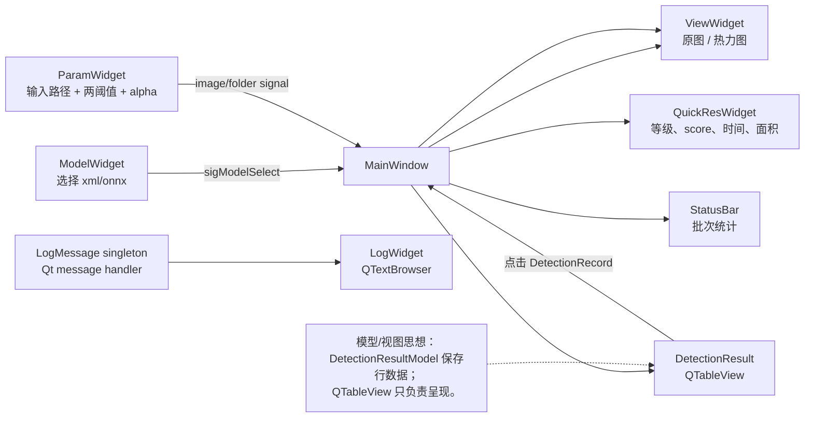

`DetectionResultModel` 正确使用 `beginInsertRows/endInsertRows` 和 `beginResetModel/endResetModel` 通知视图，不直接往 `QTableWidget` 一格一格塞主业务结果。

`GraphicsView` 使用 `QGraphicsScene + QGraphicsPixmapItem`，提供：

- 适应窗口、缩放、拖拽、旋转、居中。
- 鼠标悬停像素 RGB 信息。
- 原图文件名和 zoom footer。

`ParamWidget` 用 `QSignalBlocker` 同步 slider 与 spin box，并保持：

```text
0 ≤ reviewThreshold < ngThreshold ≤ 1
0 ≤ heatmapAlpha ≤ 1
```

### 2.9.2 日志系统的意图与缺口

`LogMessage` 安装全局 `qInstallMessageHandler`，把 Qt debug/warning/critical：

- 写入按日期目录下的文件。
- 转成带颜色 HTML 发给 `LogWidget`。

但当前 `outputLog` 每次调用都创建一个局部 `QMutex`，不同调用拿到的不是同一把锁，因此不能真正保护多线程日志写入。面试中应主动指出：

> 应改为函数静态 mutex 或成员 mutex，并设计可靠轮转、磁盘失败降级、递归日志保护和结构化字段。

其他可改进点：

- 部分 UI 包装类析构没有释放手工 `new` 的 UI 对象，虽然父对象可能接管部分 QWidget，但普通 helper 指针要明确所有权。
- `ImageItem::hoverMoveEvent` 应在取像素前检查 `x < width && y < height`。
- `MainWindow` 直接持有大量具体 Widget，使单元测试困难，可通过 view interface 或 presenter 降耦。

### 2.9.3 本模块面试问答

**问题：为什么结果表使用 `QAbstractTableModel`？**

参考答案：

> Model/View 把数据和展示分离。模型通过 role 提供文本、颜色、对齐等信息，视图负责选择、滚动和绘制；新增一行只需标准通知，不必让业务逻辑逐个操作 cell。以后可以增加代理排序、过滤或虚拟化。

可能追问：**当前模型能承受几十万行吗？**

参考回答：

> 不能直接假设。它仍把全部 `DetectionRecord` 存在 QVector 中，历史加载也会读完整批次。大数据量应使用分页模型或 `canFetchMore/fetchMore`，只缓存可见窗口，并让图片按点击加载。

**问题：跨线程日志怎么做才安全？**

参考答案：

> 全局 handler 可能从任意线程调用，所以共享文件和轮转状态必须由同一把 mutex 保护，或把日志记录放入 lock-free/有界队列，由专用线程写盘。handler 内要避免再次触发 Qt 日志导致递归，还要处理应用退出时 drain。

可能追问：**日志队列满了怎么办？**

参考回答：

> 不能让低级日志反向拖死检测链。Debug/Info 可采样或丢弃并累加 dropped counter，Warning/Error 尽量保留或同步降级到 stderr；队列和单条消息都有限长，磁盘满只产生一次受控告警，避免递归刷日志。

---

## 2.10 第二篇结束：Gluttony 章节面试官复盘

**问题：Gluttony 最完整的一条可靠性链是什么？**

参考答案：

> 本地批处理链最完整：输入先在事务中登记为 PENDING；每次原子 claim 为 PROCESSING；推理在线程执行；热力图用 QSaveFile 原子写；item 和 run 统计在同一 SQLite 事务提交；结束后形成 DRAFT，由用户保存成带 SHA-256 manifest 的 SAVED；崩溃时 PROCESSING 重置为 PENDING、RUNNING 变 INTERRUPTED，可以恢复。

可能追问：**这条链仍然不是严格 exactly-once，为什么？**

参考回答：

> exactly-once 跨文件系统、SQLite 和网络非常难。当前依靠状态条件、UUID 和事务实现数据库内的单次状态转换，但文件和响应存在补偿窗口，TCP 重连后也没有持久化的响应去重表。更准确的说法是“数据库内幂等状态推进 + 文件补偿 + at-most-one in-flight”，而不是夸大为严格 exactly-once。

**问题：如果只能选一个重构点，你选什么？**

参考答案：

> 我会先把 `MainWindow` 的本地 session 和 camera session 状态抽离，因为它们影响可测试性、并行演进和错误处理。协议、推理、Repository 已有较清楚边界，而顶层状态目前由大量 bool 组合表达，最容易出现非法组合。提取显式状态对象后，再做多相机或并行批处理更安全。

可能追问：**怎样渐进重构而不破坏现有 UI？**

参考回答：

> 先用 characterization tests 固定开始、暂停、恢复、远端停止和 finalize 行为；抽一个只包含状态/事件的 controller，MainWindow 槽先做薄转发；逐步把持久化和推理 signal 接到 controller，再让 UI 只订阅 view state。每一步保持 CTest 与端到端用例通过。

---

# 第三篇：Lust——相机采集、动态参数与请求侧可靠性

## 3. Lust 总览

Lust 是**图像生产者和检测请求客户端**。它不是另一个推理程序：它负责屏蔽相机差异、采集与显示图像、把帧编码成协议消息、维护请求状态，并接收 Gluttony 的结果。

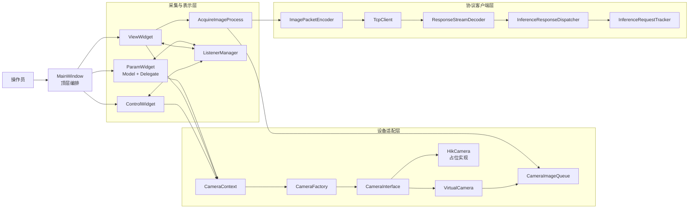

按依赖方向理解这张图：

1. 最底层是 `CameraInterface`，上层不应该知道海康 SDK 或虚拟相机怎样取图。
2. `CameraContext` 保存当前枚举到的相机，并把“连接、开始采集、读写参数”等动作路由到具体实例。
3. `ViewWidget` 启动 `AcquireImageProcess`，工作线程从有界队列取帧。
4. 同一帧一份用于 UI 显示，另一份编码后发给 Gluttony；返回结果再通过 sequence 与请求配对。

### 3.0.1 这一篇应怎样用于面试

不要只说“我做了一个相机界面”。更有含金量的叙述是：

> 我把厂商相机 SDK 适配、采集生产消费、Qt 动态参数 UI、二进制帧协议和请求生命周期拆成独立模块。当前虚拟相机让整条链在没有硬件时可重复测试，接入真实相机主要落在新的 `CameraInterface` 实现中。

### 3.0.2 本章总览面试问答

**问题：Lust 为什么值得单独做成一个进程？**

参考答案：

> 相机 SDK 往往有独立运行时、回调线程和崩溃风险。拆成采集进程后，Gluttony 不需要链接每个厂商 SDK，双方可独立升级；相机异常也不会直接污染模型和数据库进程。代价是增加网络序列化、进程间状态同步和部署复杂度，因此要用明确协议和超时机制补偿。

可能追问：**如果部署在同一台电脑，为什么不直接用共享内存？**

参考回答：

> TCP 更容易调试、跨机器和做故障隔离，适合先建立清晰边界；共享内存能减少 JPEG 编解码与拷贝，但必须自己处理环形缓冲、帧所有权、进程崩溃清理和通知机制。若性能数据证明编码或网络是瓶颈，可以保留控制协议不变，新增共享内存数据通道，而不是一开始就增加复杂度。

---

## 3.1 模块：应用壳、三栏界面与控制编排

### 3.1.1 顶层对象关系

`main.cpp` 创建 `QApplication`、加载资源中的 QSS，并显示 `MainWindow`。真正的业务装配发生在 `MainWindow`：

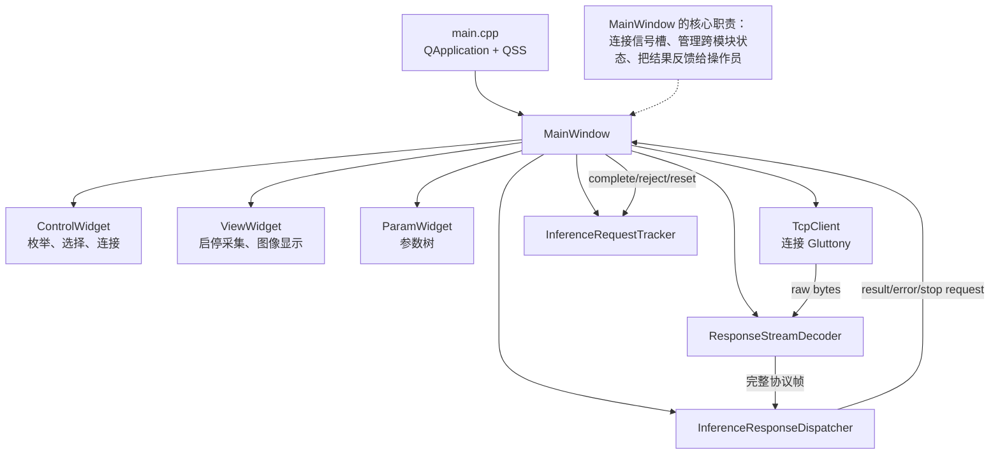

三栏界面不是三个孤立页面：

- `ControlWidget` 决定当前 serial 对应哪台相机、是否连接；
- `ViewWidget` 只有在相机可用时才能开始采集；
- `ParamWidget` 要随当前相机切换，读写对应参数；
- `MainWindow` 还要把 TCP 连接状态转换为“是否发布帧”，并在远端要求停止时协调采集收尾。

### 3.1.2 为什么网络对象放在主线程也可以

`QTcpSocket` 是异步事件驱动对象。只要槽函数不做重计算，连接、收发和状态变化都可以在 GUI 线程的事件循环中完成。真正昂贵的取图等待放在 `AcquireImageProcess`，数据库和推理则在另一个进程中。

这里要区分两个概念：

- **异步 I/O**：函数很快返回，数据就绪时由事件循环通知；
- **工作线程**：为了隔离阻塞或 CPU 密集工作而使用。

把每个 socket 都塞进线程不一定更快，反而会增加线程亲和性和销毁顺序问题。

### 3.1.3 远端停止如何形成闭环

当 Gluttony 收到操作员的 TCP 停止动作，它不会直接断连接，而是发 `StopAcquisitionRequest`。Lust 的 dispatcher 识别该消息，`MainWindow` 要求 `ViewWidget` 停止相机与采集线程，已经排入 Qt 事件队列的最后几帧处理完后，再发 `StreamStop`。

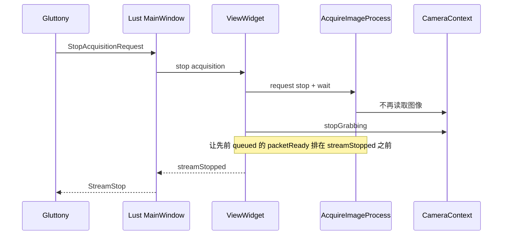

### 3.1.4 本模块面试问答

**问题：`MainWindow` 在你的架构里是什么角色？**

参考答案：

> 它是 composition root 加应用层协调器：创建具体模块、连接信号槽、把相机状态、采集状态和 TCP 状态组合成用户动作。相机实现、JPEG 编码、协议解析不应该放进去。当前它还承担了较多响应展示与流控制，后续可以抽成 `AcquisitionSessionController`，让窗口只实现 view 接口。

可能追问：**怎样证明这个重构值得做？**

参考回答：

> 当状态组合开始出现重复判断、无法在不创建 QWidget 的情况下测试远端停止、断线重置和重复响应时，就说明业务协调应脱离窗口。抽离后可用 fake camera、fake transport 驱动状态机单测，也能减少因 UI 生命周期导致的悬空回调。

**问题：为什么停止时要关注 queued signal 的顺序？**

参考答案：

> 跨线程 `AutoConnection` 会变成 queued connection。采集线程可能已经发出最后一个 `sigPacketReady`，但主线程尚未处理。如果先发送 `StreamStop`，服务端会认为批次结束，随后又收到图像，破坏协议状态。代码把 `streamStopped` 排到已入队帧之后，利用同一接收线程事件队列的 FIFO 顺序完成 drain。

可能追问：**FIFO 在任何情况下都保证吗？**

参考回答：

> 只能依赖同一发送者/接收者与同一事件队列中的有序投递，不能把它扩大成全局顺序保证。更稳妥的协议还可以在 `StreamStop` 中携带 `last_sequence`，服务端确认已经处理到该序号再结束。

---

## 3.2 模块：相机抽象、工厂与上下文

这是最接近用户示例图的模块。三个角色必须分清：

- `CameraInterface` 定义“相机能做什么”；
- `CameraFactory` 决定“根据厂商名创建谁”；
- `CameraContext` 决定“当前哪台相机执行动作”。

### 3.2.1 类关系图

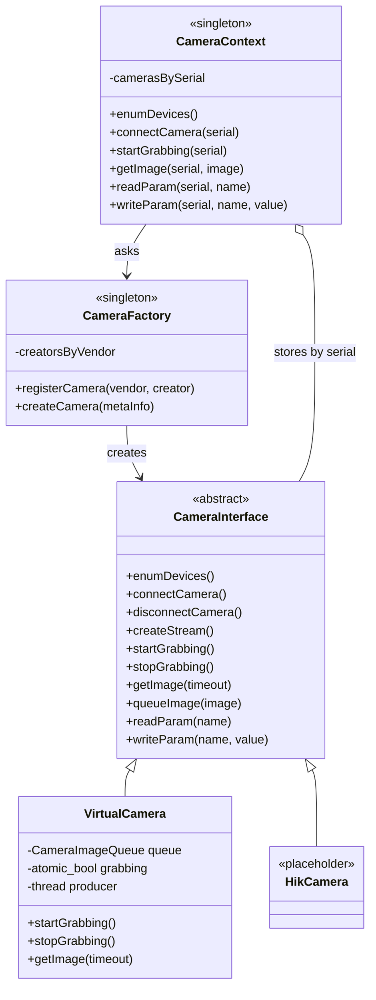

### 3.2.2 工厂注册表怎样工作

概念上，注册表保存的是“字符串到构造函数”的映射：

```cpp
using Creator = std::function<CameraInterface*(const CMCameraMetaInfo&)>;

// 概念化代码：不同 vendor 对应不同具体实现
creators_["Virtual"] = [](const auto& info) {
    return new VirtualCamera(info);
};
```

相比在 `CameraContext` 中写一长串 `if (vendor == "...")`，注册表有两个优势：

1. 创建规则集中，Context 只面对抽象；
2. 新厂商主要增加适配类和注册项，调用方不需要改变。

但它不是绝对的“零修改”：当前工厂仍需显式注册实现。若做成插件，可用 `QPluginLoader` 在运行时发现 DLL，进一步符合开闭原则。

### 3.2.3 `CameraContext` 为什么不是工厂

工厂创建对象后就完成主要职责；Context 还需要：

- 枚举设备并用 serial 建索引；
- 将 connect/start/read/write 路由给正确实例；
- 维护相机集合和跨 UI 模块共享的当前设备语义；
- 约束连接、流创建、采集的调用顺序。

所以它更像设备仓库加 facade。UI 不必到处传 `CameraInterface*`，只需使用稳定的 serial。

### 3.2.4 当前实现最重要的所有权问题

`CameraContext` 当前用 `QMap<QString, CameraInterface*>` 保存裸指针；重新枚举或析构时会停止、断开并 `clear()`，但没有看到对应 `delete`。这意味着“集合移除”不等于“对象销毁”，可能泄漏相机对象以及厂商 SDK 资源。

推荐的改法：

```cpp
QMap<QString, std::unique_ptr<CameraInterface>> cameras_;
```

如果 Qt 容器与 move-only 类型的版本兼容性不理想，可以使用 `std::unordered_map<std::string, std::unique_ptr<...>>`，或让相机继承 `QObject` 并明确 parent。但 SDK 句柄仍应由相机类内部 RAII 包装，不能只依赖 QObject 子树。

### 3.2.5 本模块面试问答

**问题：这里用了哪些设计模式？**

参考答案：

> `CameraInterface` 配合具体实现是策略/桥接式适配；`CameraFactory` 是注册式工厂；`CameraContext` 是 facade 加设备 repository；Factory 和 Context 当前都使用 singleton。关键不在背模式名，而在依赖方向：UI 依赖抽象和 serial，不依赖某个厂商 SDK。

可能追问：**为什么 Singleton 可能有问题？**

参考回答：

> 全局可访问会隐藏依赖、污染测试状态，并使并发与销毁顺序难以控制。生产代码可以在 composition root 创建一个 `CameraContext`，通过构造函数注入给控制器；测试时传 fake context。工厂本身也可以是普通对象或不可变 registry。

**问题：接入海康相机时你具体要做哪些事？**

参考答案：

> 实现枚举、句柄创建销毁、连接、流对象、开始停止采集、超时取图、像素格式转换和参数读写；把 SDK 错误映射为项目统一错误；用 RAII 管理 handle/buffer；注册 creator；再用契约测试验证接口状态和队列语义。`HikCamera` 当前只是占位，不能在简历中声称已经完成真实硬件接入。

可能追问：**厂商回调给出的图像 buffer 能直接放进队列吗？**

参考回答：

> 不能默认可以。SDK buffer 往往只在回调期间有效，离开回调就被复用。要么在回调内深拷贝到自有 `cv::Mat`，要么使用 SDK 提供的 retain/requeue 机制并建立明确所有权。当前虚拟相机队列走拷贝语义，是真实适配时应保持的安全契约。

---

## 3.3 模块：虚拟相机与有界图像队列

虚拟相机不是“为了凑一个假实现”。它让开发者在没有工业相机和厂商 SDK 的机器上，仍能验证线程、队列、显示、编码、网络、推理和持久化整条链。

### 3.3.1 虚拟相机的运行结构

`VirtualCamera` 枚举出固定的模拟设备。开始采集后，内部生产线程大约每 300 ms 生成一张 `512 × 512` BGR 图像，并推入 `CameraImageQueue`。

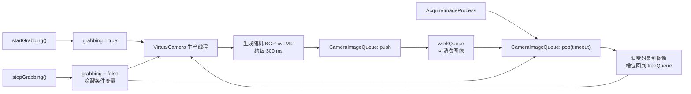

这里同时有两层循环：

- 虚拟相机生产循环：模拟真实 SDK 持续送帧；
- 采集工作线程消费循环：模拟业务从相机取出一帧。

把二者分开，才能真实暴露“生产速度大于消费速度”时的问题。

### 3.3.2 对象池式有界队列

`CameraImageQueue` 容量为 10，内部维护空闲槽和工作槽。核心不变量是：

```text
freeQueue.size() + workQueue.size() == maxQueueSize
```

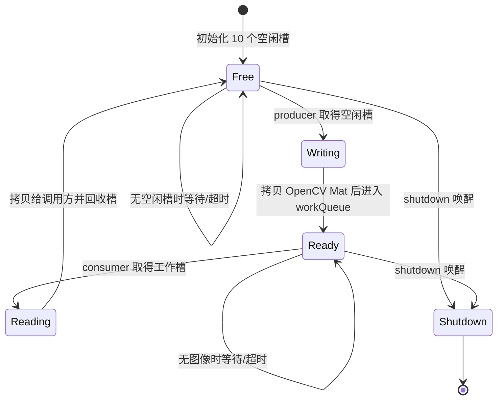

这不是无界 `std::queue<cv::Mat>`，因此内存上限可估算。若一帧为 `512 × 512 × 3 ≈ 0.75 MiB`，10 帧像素主体约 7.5 MiB，另加 Mat header 和对齐开销。

实现中 mutex 保护两个队列，两个 condition variable 分别通知“有空位”和“有图像”。`shutdown` 必须唤醒所有等待者，否则析构时线程可能永远卡在 `wait`。

### 3.3.3 当前策略是阻塞，不是丢帧

相机队列满时，生产者等待空槽；消费端以超时方式等待工作槽。这适合虚拟相机和可被背压的 SDK。真实工业相机常由硬件持续触发，回调线程不能长期阻塞，否则 SDK 内部缓存溢出。那时应根据业务选：

- 丢最旧帧，保留最新画面；
- 丢新帧，保留连续已接收序列；
- 扩大硬件 ring buffer；
- 降低触发频率；
- 给每个丢帧产生指标和原因码。

策略必须与检测目标匹配：外观预览偏向最新帧，流水线逐件追溯则不能静默丢帧。

### 3.3.4 本模块面试问答

**问题：为什么队列一定要有界？**

参考答案：

> 当生产速度长期高于消费速度时，无界队列只会把时间差转成内存增长和越来越旧的延迟，最终 OOM。有界队列把系统容量显式化，满时可以阻塞、丢帧或反馈上游，是背压的落点，也使长稳运行的内存上限可估算。

可能追问：**队列容量为什么是 10？**

参考回答：

> 当前值是实现参数，不应包装成科学结论。容量应由帧率、允许抖动、单帧内存和端到端延迟目标推导。例如 30 FPS、只允许 100 ms 缓冲时，3～4 帧可能更合适；还要通过压测观察 P99 消费延迟和丢帧率。

**问题：条件变量怎样避免丢失唤醒和虚假唤醒？**

参考答案：

> 修改队列与条件状态时持有同一 mutex；等待必须写成带谓词的 `wait`/`wait_for`，谓词检查“队列非空、存在空槽或 shutdown”。即使发生虚假唤醒也会重新检查，通知先于等待发生时，谓词已为真也不会继续睡眠。

可能追问：**能不能只用 atomic，不用 mutex？**

参考回答：

> atomic 可以表示 stop flag，但两个容器的一致修改和等待条件仍需要同步。无锁环形队列可以实现，但要解决内存序、ABA、单/多生产消费约束和对象生命周期；在当前吞吐量下，清晰正确的 mutex + condition variable 更合理。

---

## 3.4 模块：采集线程、图像显示与“一帧两用”

### 3.4.1 数据流

`AcquireImageProcess` 继承 `QThread`，循环从 `CameraContext` 取图。对每个 `cv::Mat`：

1. 转成 `QImage` 发给界面；
2. 如果发布开关开启，分配 sequence 和时间戳，JPEG 编码为协议包并发给主线程；
3. 主线程的 `TcpClient` 接收完整 `QByteArray` 并尝试写入 socket。

```mermaid
flowchart LR
    Queue["CameraImageQueue"] --> Acquire["AcquireImageProcess::run"]
    Acquire --> Mat["同一个 cv::Mat"]
    Mat --> Convert["ImageConver<br/>Mat → QImage"]
    Convert --> QueuedUI["queued signal"]
    QueuedUI --> Graphics["GraphicsView<br/>主线程显示"]

    Mat --> Gate{"publishing enabled?"}
    Gate -- 否 --> Next["取下一帧"]
    Gate -- 是 --> Meta["sequence++<br/>timestamp"]
    Meta --> JPEG["ImagePacketEncoder<br/>JPEG + 40B header"]
    JPEG --> PacketReady["sigPacketReady"]
    PacketReady --> TCP["TcpClient<br/>主线程异步发送"]
```

“一帧两用”的好处是显示与发送来自同一采集时刻。要注意 `cv::Mat` 和 `QImage` 都可能是浅拷贝视图，跨线程 signal 发出后原 buffer 可能已被回收，所以转换函数必须保证目标图像拥有有效存储；否则会出现随机花屏或 use-after-free。

### 3.4.2 为什么 `AcquireImageProcess` 可以继承 `QThread`

Qt 官方常见建议是把 worker `moveToThread`，因为 `QThread` 对象本身仍属于创建它的线程。不过若只重写 `run()`，不把业务 slot 误认为在工作线程执行，并且用原子 stop + `wait()` 管生命周期，继承也能正确使用。

本项目需要牢记：

- `run()` 中的循环在新线程；
- `AcquireImageProcess` 对象的普通 queued slot 未必在新线程；
- 任何 QWidget 更新都必须通过 signal 回主线程；
- 停止时先置标志并唤醒/等待阻塞取图，再 `wait()`，不能直接 `terminate()`。

### 3.4.3 `ViewWidget` 的控制职责

`ViewWidget` 不只是画图，它协调：

```mermaid
stateDiagram-v2
    [*] --> Idle
    Idle --> Starting: 用户点击开始
    Starting --> Grabbing: 相机 startGrabbing 成功<br/>采集线程启动
    Starting --> Idle: 任一步失败并回滚
    Grabbing --> Stopping: 用户/服务器/切换相机要求停止
    Stopping --> Draining: 采集线程退出
    Draining --> Idle: stopGrabbing<br/>发 streamStopped
    Idle --> [*]: 窗口销毁
```

正确的启动顺序要有失败回滚。例如相机已经开始 grabbing，但线程创建失败，就要停止 grabbing；不能让 UI 显示“未采集”而硬件仍在工作。

### 3.4.4 `GraphicsView` 的职责

图像视图基于 `QGraphicsScene/QGraphicsPixmapItem`，提供适应窗口、缩放、旋转和像素查看。它属于纯表示层：

- 不应该读取相机；
- 不应该决定是否发网络；
- 不应该保存检测业务状态；
- 输入是可显示的 `QImage/QPixmap`。

这样能单独用静态图片测试缩放和交互。

### 3.4.5 本模块面试问答

**问题：为什么不在相机回调里直接更新 QLabel？**

参考答案：

> 厂商回调通常不在 GUI 线程，而 QWidget 不是线程安全的；回调也不应做缩放、JPEG 编码等慢工作，否则会占住 SDK 线程。安全做法是快速取得自有帧、放入有界队列，再由采集 worker 发 queued signal 回主线程显示。

可能追问：**queued signal 传 `QImage` 前要做什么？**

参考回答：

> 类型要么是 Qt 已知类型，要么先 `qRegisterMetaType`；更重要的是确认数据所有权。若 QImage 引用 `cv::Mat::data`，Mat 释放后 QImage 会悬空，应调用 `copy()` 或用自有 buffer 与 cleanup 回调建立清晰生命周期。

**问题：停止采集时为什么不用 `QThread::terminate()`？**

参考答案：

> terminate 会在任意指令点强杀线程，mutex 可能永远锁住，SDK handle 和图像 buffer 无法释放，对象不变量也会破坏。协作式停止用 atomic flag、唤醒阻塞操作、退出循环、`wait()` join，资源由正常栈展开和 RAII 清理。

可能追问：**`getImage` 最多阻塞 500 ms 会有什么用户体验？**

参考回答：

> 如果停止只设置 flag 而没有唤醒队列，最坏要等超时后线程才退出，UI 会感觉卡顿。当前队列 shutdown 可主动唤醒；真实 SDK 还应使用可取消等待或短超时，并把停止动作做成非阻塞状态更新，完成后再恢复按钮。

---

## 3.5 模块：JSON 参数元数据、树模型与编辑代理

这一模块解决的是工业相机常见问题：不同厂商、不同型号有大量不同类型参数。如果为曝光、增益、触发源等逐个硬编码控件，扩展成本很高。

### 3.5.1 从 JSON 到相机写操作

资源文件 `resource/VirtualCameraParam.json` 描述参数的分组、类型、范围、枚举项和提示。运行时链路如下：

```mermaid
flowchart LR
    JSON["VirtualCameraParam.json<br/>参数元数据"] --> Parser["ParseUiJson<br/>解析/校验"]
    Parser --> Tree["CameraParamItem 树<br/>root → group → param"]
    Tree --> Model["CameraParamModel<br/>QAbstractItemModel"]
    Model --> View["QTreeView"]
    View --> Delegate["CameraParamDelegate"]

    Delegate --> Bool["Bool 编辑器"]
    Delegate --> Cmd["Cmd 按钮"]
    Delegate --> Double["DoubleSpinBox"]
    Delegate --> Enum["ComboBox"]
    Delegate --> Int["SpinBox"]
    Delegate --> String["LineEdit"]

    Bool --> SetData["Model::setData"]
    Cmd --> SetData
    Double --> SetData
    Enum --> SetData
    Int --> SetData
    String --> SetData
    SetData --> Context["CameraContext::writeParam"]
    Context --> Camera["当前 CameraInterface"]
```

这体现了 Qt Model/View/Delegate 分工：

- Model 保存层次数据和 role；
- View 管理树形展示与交互；
- Delegate 根据类型创建编辑器、把模型值写进编辑器、再把编辑结果提交回模型；
- CameraContext 执行真正设备写操作。

### 3.5.2 为什么 JSON 是元数据而不是业务数据

JSON 不是当前曝光值数据库，而是“怎样展示和校验参数”的 schema。例如：

```json
{
  "name": "ExposureTime",
  "type": "Double",
  "min": 10.0,
  "max": 100000.0,
  "step": 1.0,
  "tip": "曝光时间"
}
```

实际值仍由相机读取。这样 JSON 可以给虚拟相机或 SDK 参数套统一 UI，但必须防止元数据与真实设备能力漂移。成熟实现应在连接后查询设备节点信息，JSON 只做中文别名、排序和业务白名单。

### 3.5.3 参数树的索引心智模型

```mermaid
flowchart TB
    Root["不可见 root"]
    Root --> G1["Group：Acquisition"]
    Root --> G2["Group：ImageFormat"]
    G1 --> P1["ExposureTime : Double"]
    G1 --> P2["TriggerMode : Enum"]
    G1 --> P3["TriggerSoftware : Cmd"]
    G2 --> P4["Width : Int"]
    G2 --> P5["PixelFormat : Enum"]

    Index["QModelIndex<br/>内部指针指向 CameraParamItem"]
    Index -.-> G1
    Index -.-> P2
```

`rowCount(parent)` 返回 parent 的子项数；`index(row, col, parent)` 找到子项并创建 QModelIndex；`parent(child)` 返回父项在祖父项中的行。面试时能讲清这三个函数，就真正理解了树模型。

### 3.5.4 当前实现中的缺陷

源码中的 `ParseUiJson::getAllGroups` 使用了类似 `groups.contains(...)` 的检查，却没有把新 group `append` 进结果，可能导致返回空或不完整分组。这类缺陷适合在面试中说成：

> 我通过针对解析结果的单元测试发现集合构造遗漏，计划让 parser 成为无状态对象，对 JSON schema 做强校验，并覆盖重复组、未知类型、范围错误和缺字段。

另外 singleton parser 持有可变状态会让重复加载和并发测试互相影响，更适合改成纯函数/普通对象。

### 3.5.5 本模块面试问答

**问题：Delegate 为什么不是直接永久放一堆 QWidget？**

参考答案：

> 大量 cell 都常驻编辑控件会增加对象数量、布局和绘制成本。Delegate 通常按需创建 editor，并负责模型与 editor 间的数据交换；未编辑时由 paint 绘制。它还能让 Bool、Enum、数值等类型共享同一个 tree view。

可能追问：**参数写设备失败后 UI 怎么办？**

参考回答：

> 不能先永久修改模型再忽略设备错误。可以在 `setData` 中执行受控写入，成功后更新模型并发 `dataChanged`；失败则保留旧值、显示错误。若 SDK 写入异步，应引入 Pending 状态和 request id，设备确认后 commit，失败 rollback，并临时禁用冲突编辑。

**问题：怎样防止 JSON 中写 `Double`，设备实际只接受整数？**

参考答案：

> parser 只做第一层 schema 校验；连接设备后应把 JSON 元数据与 SDK 节点类型、可读写性、min/max/inc 交叉校验，以设备为真源。测试中用 fake camera 返回能力描述，验证不兼容参数被隐藏或标红，而不是把非法值传给 SDK。

可能追问：**这个模块体现了什么可扩展性？**

参考回答：

> 新增同类参数通常只增加 JSON；新增一种编辑类型需要增加一个 editor/delegate 分支；新增厂商不改变 View，只需提供统一读写接口和能力映射。扩展点分层，避免一次变化贯穿所有 UI。

---

## 3.6 模块：`ListenerManager` 相机事件通知

控制、显示和参数三个 Widget 都关心相机事件，但不应该互相直接调用。`ListenerManager` 用观察者思想广播“枚举、连接、断开、开始/停止采集、切换相机”等消息。

### 3.6.1 发布订阅关系

```mermaid
flowchart LR
    Control["ControlWidget"] -->|"publish：连接/断开/切换"| Manager["ListenerManager"]
    View["ViewWidget"] -->|"publish：开始/停止采集"| Manager

    Manager -->|"bitmask 匹配后 callback"| Control
    Manager -->|"bitmask 匹配后 callback"| View
    Manager -->|"bitmask 匹配后 callback"| Param["ParamWidget"]

    Mask["订阅掩码<br/>CONNECT | DISCONNECT | START | STOP ..."]
    Mask -.-> Manager

    Risk["当前保存裸 Listener*<br/>没有 unregister"]
    Risk -.-> Manager
```

位掩码让一个 listener 可订阅多个事件：

```text
interested = registeredMask & emittedMessage
```

但消息枚举必须是互不重叠的 bit（通常 `1 << n`），并且广播期间要考虑 listener 移除、嵌套广播和线程。

### 3.6.2 与 Qt signals/slots 的关系

项目已经使用 Qt，理论上可以直接用 signals/slots。自定义 Listener 的价值可能是：

- 非 QObject 类也能订阅；
- 位掩码集中表达关注事件；
- 接口形式与某些旧相机框架一致。

成本则是自己承担生命周期、线程和重入安全。当前实现没有注销接口，Manager 长期保存裸指针；Widget 先析构后再广播就可能调用悬空地址。此外 `CAMERA_CAMERASWICH` 虽然注册了关注者，`registerMessage` 的分支没有完整覆盖它，说明自制消息总线更容易产生协议漂移。

### 3.6.3 建议的修复路线

```mermaid
flowchart TB
    Current["当前：全局 Manager + raw Listener*"] --> Minimal["最小修复"]
    Minimal --> U1["register 返回 subscription token"]
    Minimal --> U2["析构时 RAII 自动 unregister"]
    Minimal --> U3["广播前复制稳定快照"]
    Minimal --> U4["补齐 switch 分支与测试"]

    Current --> QtWay["Qt 化重构"]
    QtWay --> Q1["Controller 发 typed signals"]
    QtWay --> Q2["QObject context 自动断连"]
    QtWay --> Q3["跨线程明确 connection type"]
```

若事件只在 GUI 模块间传播，优先 Qt signals/slots；若保留独立消息总线，应让订阅返回 move-only token，token 析构自动注销。

### 3.6.4 本模块面试问答

**问题：观察者模式解决了什么，又引入了什么？**

参考答案：

> 它把发布者与多个订阅者解耦，新增面板不必修改发布者；但控制流变隐式，事件顺序、重复订阅、对象销毁和异常隔离更难。当前最大风险是裸指针订阅无注销，会形成 use-after-free。

可能追问：**Qt 自动断开连接是否完全解决生命周期？**

参考回答：

> 当 sender 或 QObject receiver 析构时，Qt 会自动移除连接，这是明显优势；但 lambda 若捕获外部裸指针、没有提供 context object，仍可能悬空。queued 事件、线程退出和对象 `deleteLater` 顺序也要测试。

**问题：广播时 listener 自己注销怎么办？**

参考答案：

> 不能一边遍历原容器一边直接删除导致迭代器失效。可以复制订阅快照再回调，或使用稳定 token/id 并延迟删除；回调前还需校验订阅仍有效。并发场景要么规定仅单线程使用，要么加锁但绝不能持锁执行未知用户回调。

可能追问：**复制快照后对象已经析构怎么办？**

参考回答：

> 快照不能只复制裸指针。可让订阅 token 与 manager 在同一线程串行销毁，或快照保存 `QPointer<QObject>`/受控 weak handle，调用前判空；普通 C++ listener 则需共享控制块或严格 owner-thread 协议。GUI 事件通知最简单的修复是回到带 context 的 Qt QObject 连接。

---

## 3.7 模块：请求编码、帧协议与 TCP 客户端

### 3.7.1 一帧怎样变成网络字节

`ImagePacketEncoder` 先用 OpenCV `imencode(".jpg", ...)` 压缩图像，JPEG quality 被限制到 1～100；然后填写公共头部。`TcpClient` 只接受已经完整构造好的 `QByteArray`。

```mermaid
flowchart LR
    Mat["cv::Mat<br/>BGR8"] --> Validate["检查非空、尺寸、类型"]
    Validate --> JPEG["cv::imencode<br/>JPEG quality"]
    JPEG --> Header["FrameHeader<br/>type=ImageFrame<br/>format=Jpeg<br/>sequence/timestamp/W/H/length"]
    Header --> Serialize["大端序序列化<br/>40-byte header"]
    JPEG --> Serialize
    Serialize --> Packet["QByteArray packet"]
    Packet --> Limit{"socket connected?<br/>pending <= 16 MiB?<br/>write 接受完整包?"}
    Limit -- 是 --> Accepted["packetAccepted"]
    Limit -- 否 --> Rejected["packetRejected<br/>不进入 tracker"]
```

这里的责任边界很重要：

- Encoder 不连接网络，便于纯单元测试；
- TcpClient 不懂 JPEG 和 inference 语义，只做连接、写入容量与 socket 错误；
- 只有 socket 接受完整包后，`MainWindow` 才把 sequence 记入 tracker。

### 3.7.2 `bytesToWrite` 是什么背压

`QTcpSocket::write` 成功只代表数据进入 Qt/OS 发送缓冲，不代表 Gluttony 已经收到，更不代表推理完成。`TcpClient` 用 `bytesToWrite()` 和 16 MiB 上限防止发送缓冲无限增长，并要求一次 `write` 接受整个 packet。

但这个背压发生得偏晚：JPEG 已经编码，CPU 成本已经付出；如果 tracker 容量也已满，仍可能白做编码。更完整的做法是在采集线程编码前就查询一个线程安全的发送许可/credit：

```mermaid
flowchart LR
    Frame["新帧"] --> Credit{"tracker 空位<br/>且 send budget 足够?"}
    Credit -- 否 --> Drop["按策略丢帧<br/>记录原因"]
    Credit -- 是 --> Encode["JPEG 编码"]
    Encode --> Write["socket write"]
    Write --> Record["成功接受后 tracker.record"]
```

### 3.7.3 连接生命周期

连接成功后才能启用 publishing。断线时：

- 停止继续把新包当成有效请求；
- 清空 response decoder 的残留半包；
- 清空 tracker，向 UI 报告尚未完成的请求；
- 新连接开始时建立新的流边界。

当前没有自动重连。求职表达应是“有明确断线复位”，而不是声称“高可用重连”。生产增强应加入指数退避、抖动、最大间隔、用户主动断开标志和 session id。

### 3.7.4 本模块面试问答

**问题：为什么图片选择 JPEG，而不是把 `cv::Mat::data` 直接发出去？**

参考答案：

> JPEG 大幅减少网络带宽，且服务端容易验证和解码；代价是有损、编码 CPU 和不适合 16-bit/某些精密缺陷。原始帧则要明确 stride、channel、bit depth、endianness 和 buffer 长度。当前虚拟 BGR8 预览适合 JPEG；真实检测应通过实验评估压缩是否影响异常分数，必要时增加 PNG、Mono8 或原始格式。

可能追问：**JPEG header 里已有宽高，协议头为什么还要写宽高？**

参考回答：

> 协议宽高便于在完整解码前做资源限制和路由，但它是不可信的冗余字段。服务端必须把 JPEG 内部解码尺寸与协议头比对；当前代码正这样做，能阻止伪造小宽高配超大图和元数据不一致。

**问题：`write()` 返回完整长度就说明发送成功了吗？**

参考答案：

> 只说明 Qt 接受进本地缓冲。真正业务完成要经过服务端解析、推理、持久化并返回相同 sequence 的结果。网络断开前尚未确认的请求由 tracker 超时/重置处理；若要求可靠重试，还需 session id、幂等键和服务端去重。

可能追问：**为什么不循环 `write` 处理部分写入？**

参考回答：

> QTcpSocket 通常把数据排入内部 buffer，但 API 仍可能接受较少。当前策略拒绝部分接受，逻辑简单，却可能在极端情况下已经排入前缀后又报告失败，导致协议半包。更稳健的发送器应维护 outbound packet 队列和 offset，按 `bytesWritten` 继续发送，同时设置总字节上限。

---

## 3.8 模块：响应解码、类型分发与请求跟踪

这组类把“TCP 返回了一些字节”逐步转换成“第 N 帧检测成功/失败/超时”。

### 3.8.1 四层职责

```mermaid
flowchart LR
    Raw["TcpClient::rawBytesReceived"] --> Stream["ResponseStreamDecoder<br/>缓存、拆包、上限"]
    Stream --> Frame["完整 header + payload"]
    Frame --> Dispatch["InferenceResponseDispatcher<br/>按 messageType 分发"]
    Dispatch --> Codec["InferenceResponseCodec<br/>JSON schema/字段校验"]
    Codec --> Result["result(sequence, score, level, ...)"]
    Codec --> Error["error(sequence, code, message)"]
    Dispatch --> RemoteStop["StopAcquisitionRequest"]

    Result --> Tracker["InferenceRequestTracker::complete"]
    Error --> Tracker
    Tracker --> UI["在途数、RTT、超时、未知响应"]
```

分层的意义是错误可以被精确定位：

| 层 | 典型错误 | 处理 |
|---|---|---|
| Stream decoder | magic/version/header size/payload 长度非法 | 清缓存并报告协议错误 |
| Dispatcher | 不允许的 message type 或控制包带 payload | 拒绝帧 |
| Codec | JSON 无效、schema version 错、字段缺失、NaN | 返回解析错误 |
| Tracker | sequence 未登记、重复、超时 | 业务级告警，不污染其他请求 |

### 3.8.2 Tracker 的状态机

`InferenceRequestTracker` 默认最多 512 个在途请求、默认超时 5 秒。每项保存 sequence 与计时器；周期 timer 的检查间隔不会大于约 1000 ms。

```mermaid
stateDiagram-v2
    [*] --> NotTracked
    NotTracked --> Pending: packet 完整写入本地 socket buffer 后 record
    Pending --> Completed: 收到合法 result
    Pending --> Failed: 收到合法 error
    Pending --> TimedOut: elapsed > timeout
    Pending --> Reset: 断线/新 session
    NotTracked --> Rejected: 已达 512 或重复 sequence
    Completed --> DuplicateOrUnknown: 再收到同 sequence
    TimedOut --> DuplicateOrUnknown: 迟到响应
    Failed --> [*]
    Completed --> [*]
    Reset --> [*]
```

计时表使用 `QHash`，正常 record/complete 近似 O(1)。每次 timer 扫描 O(n)，但 n 有 512 上限，因此成本可控。若扩展到百万请求，应改最小堆或 timing wheel，而不是无限增大 QHash。

### 3.8.3 为什么 sequence 不等于全局唯一 ID

Lust 在新一次采集时 sequence 可从 0 重新开始。只要旧 tracker 和 decoder 在流/连接切换时被正确清空，单 session 内配对没有问题；但重连、延迟旧包或服务端重试后会存在歧义。

生产协议应把键升级为：

```text
(session_id, sequence)
```

其中 session id 是随机 UUID，`StreamStart` 明确建立，结果必须原样回传。若还要幂等重试，可再带 `request_id` 或以二元组为服务端唯一约束。

### 3.8.4 响应 JSON 契约

结果 payload 使用 versioned JSON，包含分级 `OK/REVIEW/NG`、有限浮点 score、非负的耗时和面积；错误 payload 包含受长度限制的 code/message。应用层使用 JSON 是有意的折中：

- 头部仍固定二进制，便于快速 framing；
- 结果字段少、演进频率高，JSON 可读、易调试；
- 图像大 payload 仍用二进制 JPEG，不承担 Base64 膨胀。

这是一种“二进制 envelope + JSON control/result payload”的混合协议。

### 3.8.5 本模块面试问答

**问题：Tracker 和 TCP ACK 有什么区别？**

参考答案：

> TCP ACK 只表示字节被对端 TCP 栈接收，应用不可直接看到每个业务帧 ACK；Tracker 等待的是 Gluttony 完成协议解析、推理和持久化后的业务响应。二者语义层级不同，只有业务 response 才能把 sequence 标记完成。

可能追问：**超时后能直接重发吗？**

参考回答：

> 当前不能安全地无脑重发，因为服务端可能已经持久化、只是响应丢失，重发会产生重复记录。先要引入 session/request 幂等键、服务端唯一约束和“查询已完成结果”能力，再做有上限、指数退避的重试。

**问题：为什么非法帧后 decoder 要清缓存？**

参考答案：

> 如果 header 本身不可信，就不知道 payload 边界，继续从当前位置解析会产生级联错位或内存攻击。当前做法清缓存并报告错误，简单安全；更高级的 resync 可以扫描下一个 magic，但必须限制扫描量并防止在 payload 中误识别。

可能追问：**迟到结果怎么处理？**

参考回答：

> tracker 超时后移除 sequence，迟到结果被归类为 unknown/late，不能重新改变已经对用户声明的状态。可记录指标并展示诊断。若业务允许最终一致，可以把超时展示为“状态未知”，随后用 request id 查询服务端，而不是直接判定失败。

---

## 3.9 第三篇结束：Lust 章节面试官复盘

**问题：请用生产者—消费者模型介绍 Lust。**

参考答案：

> 虚拟或真实相机是生产者，把拥有独立存储的 `cv::Mat` 放入容量固定的 `CameraImageQueue`；`AcquireImageProcess` 是消费者，超时取图并将同一帧分别转为 UI 图像和协议请求。发布前经过连接/容量门控，JPEG 编码后由主线程异步 socket 发送，成功接受才在最多 512 项的 tracker 中登记。返回字节再经 framing、dispatch、JSON 校验，用 sequence 完成请求。每一层都有容量或生命周期边界。

可能追问：**Lust 当前最危险的三个技术债是什么？**

参考回答：

> 第一，相机集合和 Listener 都使用缺少完整销毁协议的裸指针，存在泄漏和悬空风险；第二，动态参数 parser 有明确的分组集合缺陷且全局可变；第三，网络只有连接内 sequence，没有 session id、幂等重试和自动重连。此外海康实现仍为空，必须在简历中明确虚拟相机是可测试骨架而非量产 SDK 适配完成。

**问题：如果明天给你真实相机，你先做什么？**

参考答案：

> 先写最小探针确认 SDK 的枚举、回调线程、buffer 生命周期、像素格式和停止语义；然后用 RAII 包装 handle 与 stream，实现接口状态机和错误映射；再把回调帧深拷贝/安全 retain 后接入有界队列。先跑无网络长稳采集，再接显示，最后接编码和端到端协议，并采集丢帧率、队列水位、P95/P99 延迟和内存曲线。

可能追问：**为什么不是一开始就把所有参数都做完？**

参考回答：

> 先验证图像数据面和资源生命周期，因为它们决定稳定性；参数面可以从曝光、增益、触发模式等最小白名单开始。批量做参数 UI 而核心取图不稳定，会把问题混在一起，也无法建立可测的性能基线。

---

# 第四篇：两个进程之间的协议契约

## 4.1 模块：40 字节固定头部

Gluttony 与 Lust 各自保留一份 `FrameProtocol` 实现。协议常量一致：

- magic：ASCII `LUST`，数值 `0x4C555354`；
- version：1；
- 固定头部：40 字节；
- 字节序：Big Endian（网络序）；
- 最大 payload：64 MiB；
- Qt 数据流版本：`Qt_6_5`。

### 4.1.1 字节布局图

```mermaid
flowchart LR
    M["0..3<br/>magic<br/>4 B"] --> V["4..5<br/>version<br/>2 B"]
    V --> HS["6..7<br/>headerSize<br/>2 B"]
    HS --> MT["8..9<br/>messageType<br/>2 B"]
    MT --> PF["10..11<br/>pixelFormat<br/>2 B"]
    PF --> SQ["12..19<br/>sequence<br/>8 B"]
    SQ --> TS["20..27<br/>timestampMs<br/>8 B"]
    TS --> W["28..31<br/>width<br/>4 B"]
    W --> H["32..35<br/>height<br/>4 B"]
    H --> PS["36..39<br/>payloadSize<br/>4 B"]
```

换成普通表格：

|  偏移 | 字段          | 类型        | 作用                   |
| --: | ----------- | --------- | -------------------- |
|   0 | magic       | `quint32` | 快速判断是不是本协议           |
|   4 | version     | `quint16` | 不兼容升级时拒绝             |
|   6 | headerSize  | `quint16` | 检查结构布局               |
|   8 | messageType | `quint16` | 图像、心跳、结果或控制          |
|  10 | pixelFormat | `quint16` | JPEG/Mono8/Bgr8/Rgb8 |
|  12 | sequence    | `quint64` | 请求与响应关联              |
|  20 | timestampMs | `quint64` | 采集时间，不是处理完成时间        |
|  28 | width       | `quint32` | 图像元数据与资源限制           |
|  32 | height      | `quint32` | 图像元数据与资源限制           |
|  36 | payloadSize | `quint32` | TCP framing 的关键长度    |

字段宽度之和正好 40 字节。双方不是把 C++ struct 内存直接发出去，而是按固定次序用 `QDataStream` 序列化，避免编译器 padding、ABI 和本机字节序差异。

### 4.1.2 为什么解析顺序必须是“先头、再上限、再负载”

```mermaid
flowchart TD
    Bytes["接收缓存"] --> EnoughHeader{"至少 40 B?"}
    EnoughHeader -- 否 --> Wait["NeedMoreData"]
    EnoughHeader -- 是 --> Parse["只解析头部"]
    Parse --> HeaderValid{"magic/version/headerSize/type 合法?"}
    HeaderValid -- 否 --> Invalid["Invalid：清缓存/断言错误"]
    HeaderValid -- 是 --> SizeValid{"payloadSize <= 64 MiB?<br/>总长度无溢出?"}
    SizeValid -- 否 --> Invalid
    SizeValid -- 是 --> EnoughPacket{"缓存 >= 40 + payloadSize?"}
    EnoughPacket -- 否 --> Wait
    EnoughPacket -- 是 --> Consume["取出完整消息<br/>保留后续粘包"]
    Consume --> Bytes
```

先分配 `payloadSize` 再校验会给攻击者或损坏数据制造巨额内存申请；先检查最大值和加法溢出是安全边界。

### 4.1.3 本模块面试问答

**问题：为什么不用 `send(socket, &header, sizeof(header))`？**

参考答案：

> C++ struct 可能有 padding，字段在不同编译器/平台上的对齐不保证；整数还受本机字节序影响。显式序列化规定每个字段的宽度、顺序和字节序，跨进程、跨编译器可复现，也能逐字段校验。

可能追问：**`headerSize` 固定为 40，还有存在意义吗？**

参考回答：

> 它能发现双方结构版本错配，也为将来兼容扩展提供可能。但当前 parser 要求正好 40，所以它只做一致性检查，不支持扩展头。若 v2 允许尾部扩展，应规定最小头长、未知扩展跳过方式和校验覆盖范围。

**问题：为什么选择大端序？**

参考答案：

> 网络协议传统上使用 network byte order，跨架构一致。大小端本身不是性能或安全关键，关键是双方明确并测试；Qt 通过 `QDataStream::setByteOrder(BigEndian)` 避免手写位移错误。

可能追问：**Qt_6_5 数据流版本有什么作用？**

参考回答：

> 它固定 Qt 对某些复杂类型的序列化行为。不过本协议主要是固定宽度整数，仍应有语言无关的协议文档和 golden bytes 测试，不能把 wire contract 只托付给某个 Qt 版本。

---

## 4.2 模块：消息类型、方向与合法字段

### 4.2.1 消息矩阵

| 数值 | 消息 | 方向 | payload | sequence 语义 |
|---:|---|---|---|---|
| 1 | `ImageFrame` | Lust → Gluttony | JPEG/像素字节 | 新检测请求 |
| 2 | `Heartbeat` | 双向可扩展 | 通常空 | 可不参与推理 |
| 3 | `InferenceResult` | Gluttony → Lust | JSON result | 对应图像请求 |
| 4 | `InferenceError` | Gluttony → Lust | JSON error | 对应图像或系统错误 |
| 5 | `StreamStart` | Lust → Gluttony | 空 | 建立一批采集 |
| 6 | `StreamStop` | Lust → Gluttony | 空 | 表示发送端已经 drain |
| 7 | `StopAcquisitionRequest` | Gluttony → Lust | 空 | 请求采集端停止 |

```mermaid
sequenceDiagram
    participant L as Lust
    participant G as Gluttony

    L->>G: StreamStart
    loop 每个被接受的采集帧
        L->>G: ImageFrame(sequence=N)
        alt 推理且持久化成功
            G-->>L: InferenceResult(sequence=N)
        else 解码/推理/持久化失败
            G-->>L: InferenceError(sequence=N)
        else 实时背压替换旧待处理帧
            G-->>L: InferenceError(sequence=N, FRAME_DROPPED)
        end
    end
    L->>G: StreamStop
```

控制消息要求空 payload、`Unknown` 像素格式以及零宽高。图像消息则要求有效尺寸、受支持格式和负载。这个规则必须由 parser/dispatcher 校验，不能因为“自己写的客户端”就信任输入。

### 4.2.2 Stream 是业务批次边界

```mermaid
stateDiagram-v2
    [*] --> Connected
    Connected --> Streaming: StreamStart<br/>Gluttony 创建 TCP_CAMERA run
    Streaming --> Streaming: ImageFrame<br/>推理 + 持久化 + response
    Streaming --> Draining: StreamStop
    Streaming --> StopRequested: Gluttony 发 StopAcquisitionRequest
    StopRequested --> Draining: Lust 停采后回 StreamStop
    Draining --> Draft: busy/pending/persistence 全部为 0
    Draft --> Saved: 非空批次自动写 manifest
    Draft --> Discarded: 空批次删除
    Saved --> Connected
    Discarded --> Connected
    Connected --> [*]: disconnect
```

不能在收到 `StreamStop` 的瞬间就关闭 run，因为此时可能还有：

- 当前正在 OpenVINO 推理的帧；
- latest buffer 中的一帧；
- 已推理但数据库线程尚未提交的帧；
- 已排入事件队列、尚未处理的完成信号。

Gluttony 要等这些计数归零后才能 finalize。

### 4.2.3 错误码是可操作信息

错误不应只有 `"failed"`。当前链路已经区分协议、解码、推理、持久化和背压等原因。建议对错误进一步定义：

| 类别 | 是否可重试 | 客户端动作 |
|---|---|---|
| `FRAME_DROPPED` | 通常不重试实时帧 | 统计、显示丢帧率 |
| payload/图像格式非法 | 否 | 修复编码端或隔离输入 |
| 模型未加载/输出不匹配 | 否，先修配置 | 停止发布并告警 |
| 瞬时持久化繁忙 | 有条件 | 有幂等键后有限重试 |
| 磁盘满 | 否，等待运维 | 停止采集，保护数据 |
| timeout | 状态未知 | 先查询/幂等重试 |

### 4.2.4 本模块面试问答

**问题：`StreamStop` 为什么不是直接关闭 TCP？**

参考答案：

> TCP 连接是传输会话，stream 是业务批次。保持连接可以连续创建多个检测批次，避免反复握手；显式 Stop 还能让服务端 drain、生成 manifest 并返回最终错误。直接断线无法区分正常结束和网络故障。

可能追问：**断线时当前批次怎么办？**

参考回答：

> 应将它视为异常结束：停止接收新帧，drain 已接受帧，再把 run 标成 INTERRUPTED 或有明确原因的 DRAFT，而不是伪装成正常 SAVED。重连用新 session；若支持恢复，客户端要携带旧 session id 并协商服务端已完成 sequence。

**问题：为什么响应必须回传相同 sequence？**

参考答案：

> 网络和推理是异步的，UI 不能凭“第几个返回”猜对应帧。sequence 是关联键，让客户端完成正确 tracker 项，也便于日志把采集、推理、持久化串在一起。

可能追问：**如果将来并行推理导致乱序返回呢？**

参考回答：

> 协议无需保证响应顺序，只需保证关联键唯一；tracker 的 QHash 天然支持乱序完成。若业务展示要求帧顺序，可以在 UI 层按 sequence 重排，但要设置 reorder window，不能为缺失帧无限等待。

---

## 4.3 模块：协议一致性、演进与安全边界

### 4.3.1 当前“一式两份”的风险

Gluttony 与 Lust 仓库都有 `FrameProtocol`。优点是进程和项目可独立构建；风险是只改一边便产生 silent drift。

```mermaid
flowchart TB
    Spec["唯一协议规范<br/>字段、约束、错误码、示例字节"] --> GImpl["Gluttony parser/encoder"]
    Spec --> LImpl["Lust parser/encoder"]
    Golden["Golden vectors<br/>正常/截断/超限/未知类型"] --> GTest["Gluttony contract tests"]
    Golden --> LTest["Lust contract tests"]
    GImpl --> E2E["跨进程兼容测试"]
    LImpl --> E2E
```

推荐把共享协议做成以下三者之一：

1. 独立小型 CMake library/submodule；
2. 语言无关 schema + 两端生成代码；
3. 至少一份版本化规范和共同 golden test vectors。

不建议简单让一个 GUI 项目直接 include 另一个项目的内部目录，因为那会反向耦合构建与发布。

### 4.3.2 生产安全缺口

当前协议已有限长和强字段校验，但还没有：

- TLS：图像和检测结果可被窃听；
- 身份认证/授权：任何可达端口的客户端可能发送帧；
- 完整性校验：TCP 有传输校验但不是对抗性消息认证；
- 防重放/session nonce；
- 心跳超时和速率限制；
- 多客户端隔离。

这是求职中的加分点：能说清“已经做的防御”和“尚未做的安全边界”，比笼统说“协议很安全”可信。

### 4.3.3 版本演进路线

```mermaid
flowchart LR
    V1["v1<br/>固定 40B<br/>JPEG + JSON"] --> Negotiate["连接后 Hello/Capabilities"]
    Negotiate --> V2["v2 可选能力"]
    V2 --> Session["session_id / last_sequence"]
    V2 --> Formats["PNG/Mono8/Raw16"]
    V2 --> Integrity["CRC32 或 TLS AEAD"]
    V2 --> Flow["credit/window 流控"]

    Rule["旧端不认识 v2：明确拒绝<br/>不要按 v1 猜测"]
    Rule -.-> V2
```

如果只在 header 尾部随意加字段却不协商，会破坏旧端。更稳妥的是：

- 不兼容变更提升 version；
- 可选能力通过 Hello 协商；
- JSON 新增可选字段保持向后兼容；
- 删除/改义字段必须升 schema version；
- 每次发布做 N/N-1 互通测试。

### 4.3.4 本模块面试问答

**问题：为什么已经有 TCP checksum 还可能需要 CRC 或 TLS？**

参考答案：

> TCP checksum 主要发现偶然传输错误，不能防恶意篡改，也不是应用记录的端到端完整性凭据。CRC 可加强偶然损坏检测但仍不能认证；TLS 的 AEAD 同时提供机密性、完整性和对端认证，适合跨不可信网络。

可能追问：**内网就不需要认证吗？**

参考回答：

> 内网不是天然可信，仍可能有误连接、横向移动或测试程序发错数据。最少应绑定受控接口、限制防火墙、用设备身份或 mTLS，并在日志中记录 peer 与 session。安全强度应由威胁模型决定。

**问题：怎样验证两个仓库没有协议漂移？**

参考答案：

> 建立相同 golden byte vectors，双方分别验证 encode/decode；CI 再启动两个真实进程做 v1 握手、粘包、拆包、异常头、结果往返和停止流程。协议文档、测试向量与实现一起版本化，发布时做 N/N-1 兼容矩阵。

可能追问：**如果双方不能同一天发布怎么办？**

参考回答：

> 先定义兼容窗口。新增可选 JSON 字段让旧端忽略；不兼容 header 变更使用新 version/能力协商。CI 测新客户端对旧服务端和旧客户端对新服务端，部署顺序是先发布能兼容两版的一端，再升级另一端，最后才移除旧协议。

---

# 第五篇：按场景走读整套系统

## 5.1 场景：Gluttony 本地文件夹检测

### 5.1.1 完整时序

```mermaid
sequenceDiagram
    actor U as 用户
    participant MW as MainWindow
    participant DB as PersistenceWorker
    participant W as ImageWorker
    participant IE as InferenceEngine
    participant FS as 文件系统

    U->>MW: 选择模型、文件夹、阈值并开始
    MW->>DB: create run + enumerate items(PENDING)
    DB-->>MW: runId / item count
    loop 每一项
        MW->>DB: claimNext(PENDING → PROCESSING)
        DB-->>MW: item + source path
        MW->>W: process(item)
        W->>FS: 读取一张图
        W->>IE: infer(QImage)
        IE-->>W: score/level/map/mask/time
        W-->>MW: success 或 failure
        MW->>DB: persist terminal result
        DB->>FS: QSaveFile 写 heatmap
        DB->>DB: transaction 更新 item + run counters
        DB-->>MW: committed
    end
    MW->>DB: finalize RUNNING → DRAFT
    U->>MW: 保存批次
    MW->>DB: 写 items.json/manifest.json + hash
    DB->>DB: DRAFT → SAVED
```

### 5.1.2 失败点与恢复点

```mermaid
flowchart LR
    P["PENDING"] -->|"claim 事务"| X["PROCESSING"]
    X -->|"推理成功 + 提交"| S["SUCCESS"]
    X -->|"可记录错误 + 提交"| F["FAILED"]
    X -->|"进程崩溃"| R["下次启动恢复"]
    R --> P

    Heat["heatmap 临时文件"] --> Rename["QSaveFile::commit"]
    Rename --> Tx["SQLite item/run 事务"]
    Tx -- 失败 --> Cleanup["删除已提交 heatmap<br/>或进入清理任务"]
```

关键语义：

- 先登记输入，再处理，因此知道“还有哪些没做”；
- claim 在事务中改变状态，避免同一项被两个 worker 同时领取；
- SUCCESS/FAILED 都是终态，批次计数由同一事务更新；
- 用户暂停是“当前项做完后不再 claim”，避免强杀推理；
- crash 后 PROCESSING 重置为 PENDING，run 变 INTERRUPTED。

### 5.1.3 本场景面试问答

**问题：为什么不是遍历文件夹后直接把结果写 CSV？**

参考答案：

> CSV 适合导出，不适合运行中状态机、并发领取和崩溃恢复。SQLite 记录每项 PENDING/PROCESSING/终态并用事务维护计数，文件系统保存大图；最终 manifest/CSV 可以作为可移植输出。这样“运行时真源”和“交付格式”分开。

可能追问：**文件处理顺序重要吗？**

参考回答：

> 当前可按预登记 sequence 稳定处理，便于复现和 UI 展示。检测本身通常独立，未来可以并行，但提交结果仍要靠 item id/sequence 关联，不能假设完成顺序等于输入顺序。

---

## 5.2 场景：实时相机检测的成功路径

### 5.2.1 跨进程时序

```mermaid
sequenceDiagram
    participant VC as Virtual/Real Camera
    participant AQ as Lust Acquire Thread
    participant LT as Lust TCP + Tracker
    participant GS as Gluttony Server
    participant GI as Gluttony Inference Thread
    participant GP as Gluttony Persistence Thread

    AQ->>VC: getImage(timeout)
    VC-->>AQ: cv::Mat
    AQ->>AQ: JPEG + sequence N
    AQ-->>LT: packetReady(N)
    LT->>GS: ImageFrame(N)
    LT->>LT: record pending(N)
    GS->>GS: stream framing + JPEG validation
    GS->>GI: submit(N, QImage)
    GI->>GI: OpenVINO infer
    GI-->>GS: result(N)
    GS->>GP: persist original + heatmap + row
    GP->>GP: QSaveFile + SQLite transaction
    GP-->>GS: committed(N)
    GS-->>LT: InferenceResult(N)
    LT->>LT: complete(N), calculate RTT
```

这里有两个容易说错的点：

1. Lust 记录请求的时刻是 packet 被 socket 本地缓冲接受后，不是编码前；
2. Gluttony 回成功的时刻是持久化提交后，不只是推理后。

因此 UI 看见的 RTT 近似：

```text
排队 + 网络上行 + 解码 + 推理 + 文件/数据库提交 + 网络下行 + 事件调度
```

### 5.2.2 数据所有权沿途怎样变化

```mermaid
flowchart LR
    SDK["SDK/虚拟相机 buffer"] -->|"深拷贝或安全 retain"| Mat["Lust cv::Mat"]
    Mat -->|"imencode"| JPEG["Lust QByteArray packet"]
    JPEG -->|"TCP 字节复制/缓冲"| Rx["Gluttony receive buffer"]
    Rx -->|"imdecode + 转换"| QImg["Gluttony QImage"]
    QImg -->|"缩放/归一化/HWC→NCHW"| Tensor["float tensor"]
    Tensor -->|"OpenVINO 输出"| Maps["score/map/mask"]
    Maps -->|"绘制/编码"| Files["original + heatmap files"]
    Maps -->|"标量/路径"| Rows["SQLite rows"]
```

每一次边界都应问：“谁拥有内存？有效到什么时候？是否有容量上限？”

### 5.2.3 本场景面试问答

**问题：服务端为何保存原图和热力图，客户端只显示结果？**

参考答案：

> 服务端是检测记录的真源，模型、阈值、结果和输出文件在同一 run 下可追溯；客户端负责设备与实时交互，不应成为唯一审计存储。原图用于复核和重跑，热力图用于解释。但隐私、磁盘容量和保留周期要通过配置与清理任务治理。

可能追问：**如果只要最低延迟呢？**

参考回答：

> 可以先回 `InferenceResult`，持久化异步并再发 `PersistenceCommitted`；或写入顺序日志后回 ACK，再后台生成 PNG/manifest。必须改变成功语义并让 UI 区分“已推理”和“已落盘”，不能偷偷去掉可靠性步骤。

---

## 5.3 场景：推理跟不上相机时的背压

假设 Lust 每 33 ms 产生一帧，而 Gluttony 每帧推理和提交需 100 ms。若全部排队，1 秒后就积压约 20 帧，用户看到的结果越来越旧。

### 5.3.1 当前“忙帧 + 最新待处理帧”

```mermaid
sequenceDiagram
    participant L as Lust
    participant C as CameraInferenceController
    participant W as InferenceWorker

    L->>C: frame 10
    C->>W: process 10（busy）
    L->>C: frame 11
    C->>C: pending = 11
    L->>C: frame 12
    C-->>L: error 11 FRAME_DROPPED
    C->>C: pending = 12
    L->>C: frame 13
    C-->>L: error 12 FRAME_DROPPED
    C->>C: pending = 13
    W-->>C: result 10
    C->>W: process 13
```

容量严格为：

```text
1 个正在处理 + 1 个等待中的最新帧
```

这将服务端推理排队延迟限制在大约一个处理周期，同时明确告诉 Lust 哪些 sequence 被丢弃。它适合“实时看最新状态”，不适合“流水线上每件产品都必须检测”。

### 5.3.2 三种背压策略对比

| 策略 | 延迟 | 连续性 | 适用场景 |
|---|---|---|---|
| 无界全排队 | 持续增大 | 不丢，但最终 OOM/过期 | 不应采用 |
| 阻塞发送端 | 受控 | 可不丢 | 上游能减速/硬件触发可控 |
| 保留最新 | 低 | 明确丢中间帧 | 预览、状态监控 |
| 固定队列 + 丢新 | 有界 | 保留先到序列 | 短时突发、顺序优先 |

### 5.3.3 本场景面试问答

**问题：丢帧是否意味着系统不可靠？**

参考答案：

> 是否允许丢帧是业务语义，不是单纯技术好坏。实时预览中过期帧没有价值，显式丢弃并统计比无界延迟可靠；逐件质量检测则必须让触发/传送带与处理能力匹配，或用足够持久队列、产品 ID 和告警，不能用 latest-only。

可能追问：**怎样让 Lust 更早感知服务端能力？**

参考回答：

> 在协议加入 credit/window：服务端公布允许的在途数或建议帧率，客户端拿到 credit 才编码发送；完成响应归还 credit。还可动态调节相机触发或采样率。服务端仍保留本地上限，不能完全信任客户端遵守。

---

## 5.4 场景：服务端发起停止与正常收尾

### 5.4.1 双向控制状态

```mermaid
sequenceDiagram
    actor U as 操作员
    participant G as Gluttony
    participant L as Lust
    participant A as Lust Acquire
    participant P as Gluttony Persistence

    U->>G: 点击停止 TCP 检测
    G-->>L: StopAcquisitionRequest
    G->>G: 启动 5 秒等待超时
    L->>A: cooperative stop + drain
    A-->>L: stopped
    L-->>G: StreamStop
    G->>G: 不再接受新帧
    G->>P: 等 inference/persistence in-flight = 0
    P-->>G: all committed
    G->>G: finalize + auto-save nonempty run
    G-->>U: 批次结束
```

5 秒不是推理超时，而是**等待 Lust 确认停止采集**的控制超时。即使它超时，也要进入明确的异常收尾，不能让 UI 永远停在 `PAUSEREQUEST`。

### 5.4.2 本场景面试问答

**问题：为什么 Gluttony 不收到停止请求后立刻拒绝所有结果？**

参考答案：

> 已接受帧已经形成业务责任。停止只关闭新输入，已在推理或持久化的帧应 drain 并产生结果，否则 tracker 和数据库状态会悬空。这与服务 shutdown 的 graceful drain 相同。

可能追问：**如果 Lust 5 秒不回复怎么办？**

参考回答：

> 标记控制超时、停止本地接收/断开该连接、drain 已接受帧，将 run 标为 INTERRUPTED 或带原因的 DRAFT，并清理 UI 状态。还应记录 peer/session 和最后 sequence，便于诊断，不能把异常批次自动宣传为正常完成。

---

## 5.5 场景：崩溃、重启与数据恢复

### 5.5.1 启动恢复流程

```mermaid
flowchart TD
    Launch["Gluttony 启动"] --> Open["打开 SQLite<br/>foreign_keys/WAL/busy_timeout"]
    Open --> Migrate["检查 application_id<br/>迁移历史 + checksum<br/>执行待迁移版本"]
    Migrate --> Integrity["foreign_key_check<br/>schema 后置校验"]
    Integrity --> Recover["恢复运行时状态"]
    Recover --> Item["PROCESSING → PENDING"]
    Recover --> Run["RUNNING → INTERRUPTED"]
    Recover --> Cleanup["执行/重试 cleanup jobs"]
    Item --> UI["加载可恢复批次"]
    Run --> UI
    Cleanup --> UI
```

### 5.5.2 仍然存在的跨资源窗口

SQLite 事务不能把普通文件 rename 一起纳入 ACID：

```mermaid
flowchart LR
    Save["QSaveFile commit image"] --> CrashPoint["崩溃窗口"]
    CrashPoint --> DB["SQLite commit row"]

    CrashPoint -.-> Orphan["可能存在：文件已在，DB 尚无记录"]
    DB -.-> Missing["反向策略也可能：DB 有路径，文件写失败"]

    Reconciler["启动 reconciliation<br/>扫描 managed root 与 DB"] --> Orphan
    Reconciler --> Missing
```

当前代码通过写文件后数据库事务、事务失败删除文件、清理任务补偿来缩小窗口，但“进程在两步之间断电”仍会留下 orphan。严谨表述是**可补偿的一致性**，不是跨文件与 DB 的原子提交。

### 5.5.3 本场景面试问答

**问题：WAL 是否保证崩溃后文件和数据库都一致？**

参考答案：

> WAL 只保证 SQLite 自身事务的原子性和恢复，不管理 PNG/JSON 文件。跨资源一致性仍要靠写入顺序、原子 rename、状态字段、补偿任务和启动扫描。不能把数据库 ACID 扩大到整个文件系统。

可能追问：**怎样设计 reconciliation？**

参考回答：

> 所有托管文件使用可解析的 run/item 命名或记录 content hash；启动或后台任务遍历受控根目录，与 DB 中路径集合做差。无 DB 引用且超过安全时间的文件进入隔离/删除任务；DB 引用但文件缺失的项标记损坏并告警。扫描必须防路径穿越、限速，并避免删除正在提交的临时文件。

---

## 5.6 第五篇结束：场景化面试复盘

**问题：你怎样定位“相机画面正常，但一直收不到检测结果”？**

参考答案：

> 我按 correlation id/sequence 沿链路排查，而不是盯 UI：Lust 是否开启 publishing；encoder 是否成功；TcpClient 是否接受且 tracker 是否 record；Gluttony 是否收到并 decode；帧是否被 latest buffer 丢弃；InferenceEngine 是否输出；PersistenceWorker 是否提交；响应是否编码发送；Lust decoder/dispatcher 是否完成相同 sequence。每一跳看计数、错误码和时间戳，很快能定位是未发送、协议、推理、落盘还是返回问题。

可能追问：**你会增加哪些指标？**

参考回答：

> 相机 FPS、队列水位与丢帧；JPEG 编码耗时/大小；socket bytesToWrite；服务端 receive/decode/infer/persist/round-trip 的直方图；busy/latest 替换数；tracker in-flight/timeout/unknown；SQLite busy/事务耗时；磁盘剩余容量；按错误码计数。日志带 session、sequence、runId、itemId。

**问题：这个系统的瓶颈最可能在哪里？**

参考答案：

> 不能只凭代码猜。候选包括 JPEG 编码、单路 OpenVINO、PNG 热力图写盘、SQLite 单写者和 GUI 大表。先对阶段埋点并在目标分辨率/帧率下压测，看吞吐与 P95/P99；如果推理占主导再做多 infer request 或设备加速，如果持久化占主导则批量/流水化编码写盘，但保持容量上限。

可能追问：**优化后怎样防止准确率回归？**

参考回答：

> 性能 benchmark 与 golden accuracy regression 一起跑。预处理、量化、并行和压缩变更都用固定图集比较 score/map/mask 误差、最终等级和业务漏检；只有在约定误差内才接受性能收益，并记录模型、runtime 和硬件条件。

---

# 第六篇：测试、代码质量与求职前的改进路线

## 6.1 模块：构建系统与自动化测试

两个 C++ 项目都使用 CMake + Qt Test/CTest，把可独立的协议、队列、数据库与控制模块拆成测试可执行文件。

### 6.1.1 当前测试地图

```mermaid
flowchart TB
    subgraph LustTests["Lust：11 个测试目标"]
        L1["FrameProtocol / ImagePacketEncoder"]
        L2["TcpClient / ResponseStreamDecoder"]
        L3["ResponseCodec / Dispatcher / Pipeline"]
        L4["InferenceRequestTracker"]
        L5["CameraImageQueue / CameraContextImage"]
        L6["AcquireImageProcess"]
    end

    subgraph GluttonyTests["Gluttony：12 个测试目标"]
        G1["FrameProtocol / TcpImageServer"]
        G2["FrameStreamDecoder / CameraFrameSource"]
        G3["ReceivedFrameImageDecoder"]
        G4["CameraInferenceController"]
        G5["Migration / Bootstrap / Repository"]
        G6["PersistenceWorker / MainWindow persistence flow"]
    end

    Unit["快速单元测试"] --> L1
    Unit --> L4
    Unit --> G1
    Unit --> G2
    Integration["线程/网络/数据库集成测试"] --> L2
    Integration --> L5
    Integration --> L6
    Integration --> G4
    Integration --> G5
    Integration --> G6
```

测试策略中值得保留的点：

- 协议有正常、截断、粘包和非法字段测试；
- 图像编码/解码验证元数据；
- 有界队列测试 timeout、容量和 shutdown；
- tracker 测试重复、超时、上限与未知响应；
- 数据库测试迁移、约束、状态转换和恢复；
- controller 测试 latest-frame 替换与 generation 隔离。

### 6.1.2 本次文档审查时的验证状态

截至本文生成时（2026-07-30）：

- Lust Debug 构建的 CTest 本次运行通过 **11/11**，最新复核用时约 4.23 秒；
- Gluttony Debug 构建存在 12 个已登记测试，但本次从当前 shell 重跑时，第一个 `GluttonyTcpImageServerTest` 在约 5 秒后超时，因此**不能把当前状态写成 12/12 通过**；
- 该超时没有标准输出，可能涉及测试事件循环、端口/环境、Debug 运行时或弹窗，必须单独复现定位，不能为了简历忽略。

这段状态不是项目永久结论；修复后应把命令、编译器、Qt/OpenVINO 版本和 CI 链接更新为可复现证据。

### 6.1.3 还缺哪些测试层

```mermaid
flowchart TB
    T1["纯函数/单类单测<br/>毫秒级"] --> T2["组件集成<br/>线程/socket/temp SQLite"]
    T2 --> T3["跨进程契约测试<br/>Lust ↔ Gluttony"]
    T3 --> T4["硬件在环<br/>真实相机/断线/触发"]
    T4 --> T5["长稳与故障注入<br/>24h、磁盘满、断电、慢网络"]

    Current["当前覆盖较强"]
    Current -.-> T1
    Current -.-> T2
    Missing["求职前重点补齐"]
    Missing -.-> T3
    Missing -.-> T4
    Missing -.-> T5
```

最有求职价值的新增测试不是再测一个 getter，而是：

1. 启动两个真实进程，完成 Start → 多帧 → result/error → Stop；
2. 在 header/payload 每个字节边界拆包；
3. 故意让推理慢，验证丢帧响应与内存稳定；
4. 在文件 commit 与 DB commit 间故障注入，验证 reconciliation；
5. 真实相机拔线、超时、重连与 buffer 生命周期；
6. 长稳运行时采集内存、句柄、线程数、磁盘和 P99。

### 6.1.4 本模块面试问答

**问题：为什么网络测试容易偶发失败？**

参考答案：

> 常见原因是依赖固定 sleep、端口冲突、事件循环未运行、对象销毁时仍有 queued event、对连接建立时机假设过强，或测试环境缺运行时。应使用 `QSignalSpy::wait`/最终条件而非盲等，监听端口 0 获取系统分配端口，明确 teardown，并在失败时输出 socket state/error。

可能追问：**当前 5 秒超时你会怎么查？**

参考回答：

> 单独运行该 exe，开启 Qt fatal warnings 和详细 test output；确认是否出现 GUI/运行时弹窗；检查 `QTEST_*_MAIN` 类型和事件循环；为 listen/newConnection/readyRead/disconnected 加 QSignalSpy；使用动态端口；检查 teardown 是否 wait。再比较 Debug/Release 和 CI 环境，直到得到最小可重复用例。

**问题：单元测试通过为什么还要端到端测试？**

参考答案：

> 两端分别正确不代表组合正确：协议版本、默认端口、流控制顺序、模型路径、线程排队和持久化成功语义都只在集成时暴露。单测定位快，端到端验证契约和装配，两者互补。

可能追问：**端到端测试失败时怎样快速定位？**

参考回答：

> 每次测试生成唯一 session/run 目录，保留两端结构化日志和 sequence 时间线；先断言阶段性 readiness，再发送固定少量帧。失败报告最后成功阶段、在途表、DB 行和文件树，让问题落到 encoder、transport、inference 或 persistence，而不只显示“超时”。

---

## 6.2 模块：已发现问题与风险优先级

求职项目最忌讳“只展示功能，不承认边界”。下面把代码审查发现分为三档。优先级是建议，不代表已修复。

### 6.2.1 风险总图

```mermaid
flowchart LR
    P0["P0：正确性/安全<br/>会泄漏、悬空、数据错误"] --> FixFirst["求职前先修"]
    P1["P1：可靠性/可测性<br/>异常场景或规模问题"] --> FixNext["补测试后修"]
    P2["P2：演进/体验<br/>架构与性能增强"] --> Roadmap["诚实列入路线图"]
```

| 优先级 | 位置 | 问题 | 影响 | 建议 |
|---|---|---|---|---|
| P0 | Lust `CameraContext` | 相机裸指针清表不销毁 | 泄漏 SDK 资源/线程 | `unique_ptr` + RAII 状态析构 |
| P0 | Lust `ListenerManager` | 裸 listener 无 unregister | use-after-free | subscription token 或 Qt signal |
| P0 | Lust `ParseUiJson` | `getAllGroups` 未正确 append | 参数组缺失 | 修复并加解析测试 |
| P0 | Gluttony `LogMessage` | 每次调用创建局部 mutex | 多线程写日志竞态 | 共享 mutex/专用日志线程 |
| P0 | Gluttony 图像 hover | 边界检查不足 | 越界读像素 | 严格 `0 <= x < width` |
| P1 | 模型预处理 | C++ 仅 `/255`，可能与 Anomalib 导出契约不一致 | 分数错误 | 导出 preprocessing spec + golden image |
| P1 | 模型输出 | 硬编码 output names | 换模型即失败 | 元数据/可配置/按 shape+semantic 校验 |
| P1 | 热力图 | 每图 min-max | 跨图颜色不可比较 | 固定标定范围/图例 |
| P1 | 缺陷面积 | 只算 mask 像素 | 无物理含义 | 标定 mm/px 并保存单位 |
| P1 | 协议 | 无 session id/幂等键 | 重连/重试歧义 | `(session_id, sequence)` 唯一约束 |
| P1 | 文件+DB | 存在跨资源 crash window | orphan/missing file | reconciliation + 隔离区 |
| P1 | Gluttony 测试 | TCP server test 当前超时 | CI 可信度下降 | 复现并修稳定性 |
| P2 | 两端 `MainWindow` | 协调状态较重 | 难测试/扩展 | session controller/state machine |
| P2 | Lust TCP | 无自动重连、发送器不处理 partial offset | 弱网体验 | bounded outbound queue + retry policy |
| P2 | 结果表 | 全量 QVector | 大批次内存/UI 卡顿 | 分页/fetchMore |
| P2 | HikCamera | 占位 | 无真实硬件证据 | SDK adapter + HIL |
| P2 | 监控 | 指标体系缺失 | 长稳难定位 | structured log + metrics |

### 6.2.2 不要把“未来计划”说成“已完成”

```mermaid
flowchart LR
    Code["源码事实"] --> Claim["简历可证明的表述"]
    Tests["可复现测试/数据"] --> Claim
    Plan["设计建议/未来路线"] --> Roadmap["面试中的改进方案"]
    Roadmap -.->|"不能冒充"| Claim
```

例如：

- 可以说“实现虚拟相机与统一接口，可在无硬件环境跑通链路”；
- 不可以说“完成海康工业相机适配”，因为类还是占位；
- 可以说“SQLite 状态机支持崩溃恢复，并用 QSaveFile 降低文件损坏”；
- 不可以说“实现严格 exactly-once”；
- 可以说“实时服务端使用 latest-frame 背压”；
- 不可以说“所有帧零丢失”。

### 6.2.3 本模块面试问答

**问题：你为什么主动在项目说明里写缺陷？**

参考答案：

> 工程能力不仅是实现 happy path，还包括识别风险、排序和验证修复。公开已知边界能让面试讨论基于事实。我会区分当前代码、测试证据和改进设计，不把路线图包装为完成项。

可能追问：**你会先修哪个？**

参考回答：

> 先修能造成未定义行为或资源泄漏的裸指针生命周期，以及 parser/log mutex 的明确正确性 bug；同时稳定 Gluttony TCP 测试。它们改动可控、收益直接。模型预处理契约随后优先，因为它可能让“程序运行正常但结果科学上错误”，风险甚至高于崩溃。

---

## 6.3 模块：三阶段求职增强路线

### 6.3.1 路线图

```mermaid
flowchart LR
    S1["阶段 1：正确<br/>1～3 天"] --> S2["阶段 2：可证明<br/>3～7 天"]
    S2 --> S3["阶段 3：有亮点<br/>1～2 周"]

    S1 --> A["修裸指针、parser、日志锁、hover<br/>稳定全部 CTest"]
    S2 --> B["跨进程 E2E<br/>golden model input/output<br/>性能指标与故障注入"]
    S3 --> C["真实相机适配<br/>session/credit 协议<br/>reconciliation + 可观测面板"]
```

阶段 1 的“完成定义”：

- AddressSanitizer/基本静态分析不报主要生命周期错误；
- Lust 与 Gluttony 全部测试在同一命令下稳定重复 20 次；
- 已知明确 bug 有回归测试。

阶段 2 的“完成定义”：

- 一条命令启动 E2E，输出处理帧数、错误数和数据目录；
- 用固定测试图对 Python/ONNX/OpenVINO 的 score/map 做误差比对；
- 给出目标硬件上 FPS、P50/P95/P99、峰值内存、丢帧率；
- 模拟断线、慢推理、磁盘满和中途崩溃。

阶段 3 的“完成定义”：

- 真实相机长稳采集并给出运行小时数；
- 协议支持 session 与明确流控；
- 可扫描并修复/隔离数据库与文件不一致；
- README/本文中的所有简历数字都有脚本或日志可追溯。

### 6.3.2 本模块面试问答

**问题：如果面试只剩一周，你怎样取舍？**

参考答案：

> 不会先堆新 UI。我会完成阶段 1，再做一条可重复 E2E 和一组真实性能数据。面试官更看重闭环、证据和对失败语义的理解；一个稳定可演示的虚拟相机链路加诚实边界，通常优于半完成的多厂商功能。

可能追问：**怎样证明性能数据不是挑最好的一次？**

参考回答：

> 固定硬件、模型、分辨率、JPEG quality、帧数和预热规则，跑多轮，报告分位数而非只报平均；保留原始 CSV/日志和脚本，注明是否包含持久化。长稳测试同时报告内存斜率、错误率和丢帧策略。

---

## 6.4 第六篇结束：质量章节面试官复盘

**问题：你的测试体系最强和最弱的地方分别是什么？**

参考答案：

> 最强的是协议、流式拆包、请求跟踪、队列和数据库状态机已经按职责拆出测试，能验证很多边界；最弱的是跨进程真实装配、真实相机和长稳故障注入，且 Gluttony 当前网络测试有环境/稳定性超时需要修复。我会把下一阶段投入放在证据链，而不是再增加表面功能。

可能追问：**如果 CI 偶发红，你会直接重跑吗？**

参考回答：

> 重跑只能帮助收集频率，不能当修复。先保存 seed、端口、时间线、线程和 socket 状态，重复/并行运行放大问题；去除 fixed sleep 和共享外部状态。若暂时隔离 flaky test，要登记 owner、原因和期限，不能长期吞掉失败。

---

# 第七篇：把项目转化为求职竞争力

## 7.1 模块：简历项目描述

### 7.1.1 证据链

```mermaid
flowchart LR
    Problem["业务问题<br/>工业图像异常检测"] --> Design["你的设计决策<br/>分进程/分层/状态机/背压"]
    Design --> Code["具体类与代码"]
    Code --> Proof["测试、指标、演示、数据"]
    Proof --> Bullet["简历 bullet"]

    Warning["没有 Proof 的数字不要写"]
    Warning -.-> Bullet
```

简历标题建议：

> **Gluttony × Lust｜C++/Qt 工业视觉异常检测与相机采集系统**

可直接使用、但提交简历前应按真实测试结果替换括号内容：

- 基于 Qt 6/C++ 设计相机采集端与异常检测端两个独立进程，通过 40 字节大端固定头部协议传输 JPEG 帧、流控制与结构化推理结果，支持 TCP 粘包/拆包、长度上限和 sequence 关联。
- 将厂商差异封装为 `CameraInterface + 注册式工厂 + CameraContext`，实现虚拟相机、有界图像对象池及采集线程，使无硬件环境可完成显示—发送—推理—落盘端到端验证。
- 集成 Anomalib PatchCore 与 OpenVINO，完成 QImage 到 NCHW tensor 的预处理、异常分数分级、热力图叠加和 mask 面积统计；建立 Python 导出到 C++ 部署的模型契约检查。
- 设计 latest-frame 实时背压：服务端最多保留 1 个执行帧和 1 个最新等待帧，对被替换 sequence 返回明确错误，限制排队延迟和内存增长。
- 使用 SQLite WAL、版本化迁移、状态约束、Repository、`QSaveFile` 和 manifest hash 建立批次/条目持久化与崩溃恢复；实现本地批处理暂停恢复和 TCP 批次 drain。
- 为协议、队列、请求跟踪、数据库迁移与持久化建立 Qt Test/CTest；当前可证明结果为 Lust 11/11 通过，Gluttony 网络测试超时仍在修复，修复后再更新简历数字。

最后一条在真实投递时通常不写“仍在修复”，而是在修完后写可验证数字；本文保留它是为了防止你在当前状态下夸大。

### 7.1.2 本模块面试问答

**问题：这六条简历内容太多，怎样压缩成三条？**

参考答案：

> 第一条写系统边界和端到端协议；第二条写最有技术含量的异步背压与相机抽象；第三条写持久化可靠性和测试证据。PatchCore/OpenVINO 如果岗位偏算法部署就替换相机抽象，如果岗位偏 Qt/C++ 则保留线程、协议和生命周期。

可能追问：**可以写“高性能”吗？**

参考回答：

> 只有在固定硬件、分辨率、模型和持久化配置下测出吞吐、分位延迟和资源占用，才能写具体结果，例如“P95 端到端延迟 X ms”。没有数据时写“使用有界队列与 latest-frame 背压限制排队”，这是可从代码证明的设计，不使用空泛形容词。

---

## 7.2 模块：30 秒、2 分钟和 5 分钟项目介绍

### 7.2.1 介绍漏斗

```mermaid
flowchart TB
    S30["30 秒<br/>问题 + 边界 + 亮点"] --> M2["2 分钟<br/>数据流 + 两个难点 + 证据"]
    M2 --> M5["5 分钟<br/>架构图 + 失败语义 + 权衡 + 路线图"]
    M5 --> Drill["面试官选择协议/线程/数据库/模型继续深挖"]
```

**30 秒版本：**

> 这是一个用 C++/Qt 做的工业视觉异常检测系统，分为 Lust 相机采集客户端和 Gluttony 推理持久化服务端。Lust 用统一相机接口和有界队列采图，通过自定义 TCP 协议发送；Gluttony 用 OpenVINO 运行 PatchCore，并通过 latest-frame 背压、SQLite 状态机和原子文件写保证实时性与可恢复性。我的重点不是只把模型跑起来，而是把线程、协议和数据生命周期做成可测试模块。

**2 分钟版本：**

> 离线用正常样本建立 PatchCore memory bank 并导出模型。在线时 Lust 的相机生产线程把帧放入容量 10 的队列，采集线程取出同一帧用于显示和 JPEG 编码，添加 sequence、时间戳、尺寸和 payload 长度后发给 Gluttony。服务端处理 TCP 粘包拆包和图像二次校验，忙时只保留最新待处理帧；OpenVINO 输出 score、map 和 mask，再由独立持久化线程保存原图/热力图并更新 SQLite，提交后回传同 sequence 结果。
>
> 我重点解决了两个问题：一是异步链路不能无界排队，所以相机队列、socket buffer、tracker 和推理 pending 都有上限；二是结果不能只存在 UI，所以用批次/条目状态机、迁移、事务、QSaveFile 和启动恢复建立追溯。当前虚拟相机链路可测试，真实海康适配仍是下一阶段，并且我已经列出裸指针、预处理一致性和跨资源 crash window 等风险。

**5 分钟版本的顺序：**

1. 画第一篇的总体架构图；
2. 沿 sequence 走一遍成功路径；
3. 讲 latest-frame 背压为何是业务选择；
4. 讲持久化后响应与 crash window；
5. 给出测试事实、已知问题和一个最优先重构。

### 7.2.2 本模块面试问答

**问题：项目介绍为什么要主动讲一个缺点？**

参考答案：

> 因为高级工程面试一定会问边界。主动选择一个已分析、有修复路线的缺点，能展示判断力，也避免面试官发现后认为我不了解自己的代码。但不能把整个介绍变成缺陷清单，主线仍是解决的问题、设计和证据。

可能追问：**面试官中途打断怎么办？**

参考回答：

> 立即回答对方选择的分支，并用一句话保持上下文，例如“这个问题正好位于图中的实时背压层”。不要机械背完讲稿。答案结束时可问是否继续深入实现或回到整体数据流。

---

## 7.3 模块：三个可讲的 STAR 故事

### 7.3.1 故事地图

```mermaid
flowchart LR
    Story1["实时积压<br/>latest-frame 背压"] --> Skills["并发、容量、业务权衡"]
    Story2["结果追溯<br/>SQLite + 文件补偿"] --> Skills2["事务、状态机、崩溃恢复"]
    Story3["无真实硬件<br/>虚拟相机 + 接口"] --> Skills3["抽象、可测试性、增量交付"]
```

**故事一：实时推理积压**

- S：相机可能比模型快，逐帧排队会让结果越来越旧；
- T：保证 UI 看到较新结果，同时让内存有上限；
- A：把控制器设计为 busy + 一个 latest pending；新帧替换旧 pending，并对旧 sequence 返回 `FRAME_DROPPED`；
- R：排队空间固定，最旧延迟不会线性增长；实际丢帧率和 P99 仍需在目标硬件量化。

**故事二：结果持久化与恢复**

- S：仅在表格显示结果，崩溃后无法知道处理到哪；
- T：让本地批次可暂停、恢复、审计；
- A：预登记 item、事务 claim、终态提交、run counter 约束、QSaveFile、manifest hash、启动恢复；
- R：数据库内状态可恢复且文件损坏窗口缩小；跨资源仍用 reconciliation 补偿。

**故事三：没有真实相机也要开发**

- S：厂商硬件/SDK不总在开发机上；
- T：不阻塞 UI、网络、推理和测试；
- A：定义 CameraInterface，注册式工厂创建 VirtualCamera，用有界对象池模拟持续生产；
- R：链路可在普通开发机运行和自动测试；明确 HikCamera 尚未完成，后续按同一契约接入。

### 7.3.2 本模块面试问答

**问题：STAR 的 Result 没有业务百分比怎么办？**

参考答案：

> 不编数字。可以给结构性可验证结果，例如“在途容量从无界变成最多 2 帧”“run/item 状态可从 DB 恢复”“没有硬件也能运行 11 个 Lust 测试”。随后说明下一步怎样测真实 FPS、延迟和长稳数据。

可能追问：**你个人做了什么？**

参考回答：

> 明确用第一人称对应具体设计、类、测试和排查，不把整个仓库都归功于自己。如果某部分是现有代码或协作成果，就说我负责审查、集成或改进哪一段。面试官可通过追问源码细节验证。

---

## 7.4 模块：面试问题选择树

```mermaid
flowchart TD
    Q["面试官从项目发问"] --> Cpp{"偏 C++/Qt?"}
    Q --> System{"偏系统设计?"}
    Q --> CV{"偏视觉/部署?"}
    Q --> DB{"偏数据可靠性?"}

    Cpp --> C1["对象生命周期、QThread、queued signal"]
    Cpp --> C2["Model/View/Delegate、RAII"]
    System --> S1["TCP framing、背压、超时、幂等"]
    System --> S2["跨进程边界与可观测性"]
    CV --> V1["PatchCore、预处理、OpenVINO"]
    CV --> V2["颜色空间、resize、mask 面积"]
    DB --> D1["事务、WAL、迁移、触发器"]
    DB --> D2["QSaveFile、manifest、补偿一致性"]
```

你的准备原则：

- 每个分支至少能画一张本文中的图；
- 每个设计能说“为什么、代价、替代方案、验证方法”；
- 每个数字能说测量条件；
- 每个未完成项能准确划边界；
- 遇到不会的问题先建立假设和排查路径，不编造 API。

### 7.4.1 本模块面试问答

**问题：如果让你现场画架构，先画什么？**

参考答案：

> 先画边界与主数据流：Camera → Lust queue/acquire → TCP → Gluttony decode/infer/persist → response。然后标出线程和持久化点，再根据追问展开某个模块。不要一开始画几十个 Widget 类，面试官看不到决策。

可能追问：**怎样从架构图落到代码？**

参考回答：

> 每个方框给出一个入口类和一个核心方法，例如 `CameraInferenceController::submitFrame`、`FrameStreamDecoder::append`、`PersistenceWorker` 的提交槽；再说明数据类型和线程。这样图不是 PPT 概念，而能在源码中定位。

---

## 7.5 第七篇结束：投递前清单

- [ ] Gluttony 超时测试已定位，两个项目 CTest 连续重复通过；
- [ ] 至少一条跨进程 E2E 可一键运行；
- [ ] Python 与 C++ 预处理/输出有 golden image 对比；
- [ ] 简历性能数字有硬件、模型、分辨率和日志；
- [ ] 海康相机未完成时不声称完成；
- [ ] 能在白板画总体、工厂、线程、协议、背压、持久化六张图；
- [ ] 能解释本文每一个“为什么”和“代价”；
- [ ] 能展示一个已修复 bug 的测试前后证据；
- [ ] Demo 不依赖 IDE 内的绝对路径和手工点击顺序；
- [ ] README 中有构建、运行、模型和数据目录说明。

**问题：什么时候这个项目可以写进简历？**

参考答案：

> 现在已经可以作为学习/在研项目，但高质量投递前至少完成测试稳定、端到端脚本和预处理一致性三项。简历只写当前可证明部分；面试中把真实硬件、协议 v2 和 reconciliation 作为清晰路线图。

可能追问：**什么是最有辨识度的亮点？**

参考回答：

> 不是“用了 Qt 和 OpenVINO”，而是把实时图像系统的容量、失败和数据语义显式化：有界队列、latest-frame 背压、sequence 关联、持久化后响应、状态机恢复，以及对跨文件/DB 一致性边界的准确理解。

---

# 第八篇：项目知识点全解

这一篇不是孤立背八股，而是把知识点放回两个项目。每节都按：

```text
概念是什么 → 项目哪里用 → 为什么这样做 → 易错点 → 面试回答
```

来学习。

## 8.0 知识地图

```mermaid
mindmap
  root((Gluttony × Lust))
    C++ 对象模型
      生命周期与所有权
      RAII/智能指针
      move/const/value semantics
      多态与 std::function
    Qt
      QObject 对象树
      Event Loop
      Signal/Slot
      QThread 与线程亲和性
      Model/View/Delegate
    并发
      mutex/condition_variable
      atomic
      有界队列
      背压与协作停止
    网络
      TCP 字节流
      framing/大小端
      sequence/session
      timeout/idempotency
    图像与 AI
      cv::Mat/QImage
      颜色/stride/缩放
      PatchCore
      OpenVINO tensor
    数据可靠性
      SQLite/WAL/事务
      Migration/Trigger
      QSaveFile/Manifest
      恢复与补偿
    工程方法
      设计模式
      测试金字塔
      性能与可观测性
      安全边界
```

### 8.0.1 知识地图面试问答

**问题：学习这个项目时为什么先看数据流和生命周期？**

参考答案：

> 类名会变化，但一帧从相机到 tensor、文件、数据库和响应的路径决定了线程、所有权、容量与失败语义。先沿数据流问“谁拥有、在哪执行、何时完成”，再学习具体 API，能把 C++、Qt、网络和数据库知识连成一个系统。

可能追问：**你怎样判断自己真的学会了？**

参考回答：

> 能脱稿画主链，给每个箭头说出数据类型/线程/owner/失败状态；能在源码定位入口；能解释一个替代方案及代价；最后用测试或调试器验证，而不是只复述本文结论。

---

## 8.1 知识模块：C++ 生命周期、所有权与 RAII

### 8.1.1 对象生命周期是所有异步系统的地基

对象从构造完成到析构开始之间才可被正常使用。悬空指针的本质是：

```mermaid
sequenceDiagram
    participant Owner as 所有者
    participant Object as CameraInterface object
    participant Raw as raw pointer/listener

    Owner->>Object: construct
    Owner-->>Raw: 借用地址
    Raw->>Object: 正常调用
    Owner->>Object: destroy
    Raw->>Object: 再次调用
    Note over Raw,Object: use-after-free：未定义行为
```

项目中的典型位置：

- `CameraContext` 保存 `CameraInterface*`：目前所有权不清，清容器不会 delete；
- `ListenerManager` 保存 listener 裸指针：对象销毁后未注销会悬空；
- Qt queued signal：发送时 receiver 尚在，执行时可能已销毁；
- SDK 图像 buffer：回调结束后可能失效，`cv::Mat` 仍引用它。

必须能回答三问：

1. 谁创建？
2. 谁销毁？
3. 借用者能用到什么时候？

### 8.1.2 RAII

RAII 是“资源获取即初始化”：把资源绑定到对象生命周期，构造成功就代表资源有效，析构自动释放。

```mermaid
flowchart LR
    Scope["进入作用域"] --> Ctor["构造 RAII 对象<br/>获取 handle/lock/connection"]
    Ctor --> Work["正常执行或抛异常/提前 return"]
    Work --> Dtor["离开作用域自动析构"]
    Dtor --> Release["释放 handle/unlock/close"]
```

常见 RAII 类型：

- `std::unique_ptr<T>`：独占对象；
- `std::shared_ptr<T>`：共享所有权，最后一个引用销毁；
- `std::lock_guard/std::unique_lock`：锁；
- `QSaveFile`：临时文件提交/取消；
- 项目 `DataBaseConnection`：管理命名 Qt SQL 连接；
- 自定义 SDK handle wrapper：析构调用 vendor destroy。

一个推荐的相机句柄包装：

```cpp
class CameraHandle {
public:
    explicit CameraHandle(RawHandle h) : handle_(h) {}
    ~CameraHandle() { if (handle_) Vendor_Destroy(handle_); }

    CameraHandle(const CameraHandle&) = delete;
    CameraHandle& operator=(const CameraHandle&) = delete;

    CameraHandle(CameraHandle&& other) noexcept
        : handle_(std::exchange(other.handle_, nullptr)) {}

private:
    RawHandle handle_{};
};
```

### 8.1.3 `unique_ptr`、`shared_ptr` 与裸指针怎么选

```mermaid
flowchart TD
    Need["这个指针表达什么?"] --> Own{"拥有对象吗?"}
    Own -- 否 --> Borrow["T* / T&<br/>非 owning，注明生命周期"]
    Own -- 是 --> One{"只有一个 owner 吗?"}
    One -- 是 --> Unique["unique_ptr<T><br/>默认首选"]
    One -- 否 --> Shared{"确实共享寿命吗?"}
    Shared -- 是 --> SharedPtr["shared_ptr<T><br/>注意环"]
    Shared -- 否 --> Redesign["重设 owner<br/>其他模块只借用"]
```

不要为了“不崩”到处改 `shared_ptr`。它会隐藏销毁时机，双向引用造成环；线程对象、socket 和 QObject 还有线程亲和性，最后一个引用在哪个线程释放也重要。

### 8.1.4 move 语义

`std::unique_ptr` 和项目的 `DataBaseConnection` 是 move-only：资源不能复制，但所有权可以转移。

```cpp
auto camera = std::make_unique<VirtualCamera>(info);
auto moved = std::move(camera);
// camera 现在为空；moved 拥有对象
```

move 不是“把每个字节物理搬走”，而是允许类型把内部 handle/指针转交，并把源对象置为可析构状态。move 后对象只能执行其类型保证的操作，通常只安全析构或重新赋值。

### 8.1.5 多态、虚析构与工厂

通过基类指针销毁派生类，基类析构必须是 virtual：

```cpp
class CameraInterface {
public:
    virtual ~CameraInterface() = default;
    virtual CameraError startGrabbing() = 0;
};
```

否则 `delete CameraInterface*` 只调用基类析构，派生资源泄漏，行为可能未定义。工厂的 creator 用 `std::function` 保存可调用对象，lambda 捕获和生命周期也要审查。

### 8.1.6 `const`、值语义与引用

- `const T&`：不复制大对象且承诺不通过该引用修改；
- `T` 按值：小对象或需要拥有副本，编译器可 copy elision/move；
- `T&`：明确可修改的借用；
- `T*`：可空借用；
- `std::optional<T>`：有/无值，不让空值混入特殊数字；
- enum class：状态与消息类型，避免裸整数混用。

网络 `QByteArray` 和 `QImage` 使用隐式共享，按值传递通常先复制小 header、共享底层数据，修改时 detach；但跨线程 buffer 生命周期仍要按具体 API 保证。

### 8.1.7 本模块面试问答

**问题：RAII 和垃圾回收有什么区别？**

参考答案：

> RAII 的释放时机通常由确定的作用域/所有权结束决定，不只管理内存，也管理锁、文件、socket 和 SDK handle；垃圾回收主要回收不可达内存，时机不确定，不能自动知道怎样提交事务或释放业务资源。

可能追问：**析构函数里可以抛异常吗？**

参考回答：

> 通常不应。栈展开期间再抛会触发 `std::terminate`。析构释放失败应记录或提供显式 `close/commit` 返回错误，析构只做 noexcept 的兜底清理。

**问题：QObject 已有 parent，为什么还需要 RAII？**

参考答案：

> parent-child 解决 QObject 内存销毁传播，不自动表达 SDK handle、线程 join、事务 commit，也不保证在正确线程立即销毁。普通 C++ 资源仍应 RAII；QObject 可用 parent、栈对象、`QPointer` 或定制 deleter，按线程语义设计。

可能追问：**`QPointer` 是智能指针吗？**

参考回答：

> 它是 QObject 的 guarded non-owning pointer，对象析构时自动变 null，不拥有对象。它能降低悬空访问风险，但不决定谁销毁，也不能替代同步；检查后到使用前另一个线程仍可能销毁。

---

## 8.2 知识模块：Qt 对象模型、事件循环与信号槽

### 8.2.1 QObject 对象树

QObject 构造时指定 parent，parent 析构会删除 children：

```mermaid
flowchart TB
    Window["MainWindow (parent)"] --> Control["ControlWidget"]
    Window --> View["ViewWidget"]
    Window --> Param["ParamWidget"]
    View --> Scene["QGraphicsScene"]
    View --> Buttons["buttons/actions"]

    Rule["父对象析构 → 递归 delete children<br/>不要再用 unique_ptr 重复拥有同一 child"]
    Rule -.-> Window
```

常见错误：

- 栈上的 QObject 又设置一个会先析构的 parent，可能双删；
- parent 在 A 线程，child 却想 move 到 B 线程；
- 手工 deleteLater 后仍保存裸指针；
- 普通 helper 不是 QObject，却误以为 parent 会释放。

### 8.2.2 事件循环

`QApplication::exec()` 运行事件循环，依次处理：

- Windows 消息和用户输入；
- timer；
- socket notifier；
- posted event；
- queued signal；
- `deleteLater` 的 deferred delete。

```mermaid
flowchart LR
    OS["操作系统/网络/线程"] --> Queue["线程事件队列"]
    Timer["QTimer"] --> Queue
    QueuedSignal["queued signal"] --> Queue
    Queue --> Loop["event loop"]
    Loop --> Handler["slot/event handler"]
    Handler --> Return["必须尽快返回"]
    Return --> Loop
```

GUI 冻结通常不是 Qt “卡住”，而是某个 handler 没有返回，事件循环无法处理重绘和输入。推理、阻塞取图、PNG 编码和大事务因此要离开 GUI 线程。

### 8.2.3 线程亲和性

每个 QObject 有 thread affinity，决定 queued slot/事件在哪个线程执行。默认属于创建它的线程，可用 `moveToThread` 改变，但：

- 对象不能有 parent；
- children 随 parent；
- 不是对象里的每个普通函数都自动切线程；
- 直接调用仍在调用者线程执行。

```mermaid
sequenceDiagram
    participant GUI as GUI thread
    participant WorkerObj as Worker QObject<br/>affinity=worker thread
    participant WLoop as Worker event loop

    GUI->>WLoop: emit queued signal / invokeMethod
    WLoop->>WorkerObj: 执行 slot
    WorkerObj-->>GUI: emit result (queued)
    Note over GUI,WorkerObj: 直接调用 workerObj->doWork() 不会自动切线程
```

### 8.2.4 ConnectionType

| 类型 | 执行位置 | 使用注意 |
|---|---|---|
| `DirectConnection` | 发送 signal 的当前线程，立即调用 | receiver 代码必须可在该线程运行 |
| `QueuedConnection` | receiver 所属线程的事件循环 | 参数需可复制/注册；异步 |
| `AutoConnection` | 同线程 direct，跨线程 queued | 默认且常用 |
| `BlockingQueuedConnection` | receiver 线程执行，sender 阻塞等待 | 同线程会死锁，慎用 |

跨线程自定义类型需 `Q_DECLARE_METATYPE(T)`（让类型进入元类型系统），并在需要时 `qRegisterMetaType<T>()`（运行时注册名称/queued 传递）。

### 8.2.5 `deleteLater`

QObject 往往必须在所属线程销毁。`deleteLater()` 不是立即 delete，而是向其线程事件循环投递 deferred delete。典型 worker 生命周期：

```mermaid
sequenceDiagram
    participant Owner as GUI/controller
    participant Thread as QThread
    participant Worker as Worker QObject

    Owner->>Thread: start
    Thread->>Worker: queued work
    Owner->>Worker: queued stop
    Worker-->>Thread: finished
    Thread->>Worker: deleteLater
    Owner->>Thread: quit + wait
    Owner->>Thread: delete
```

若线程事件循环已经停止后才 `deleteLater`，事件可能不再处理。要设计连接顺序并测试 shutdown。

### 8.2.6 Model/View/Delegate

项目中的 `DetectionResultModel` 和 `CameraParamModel` 都体现 Model/View：

```mermaid
flowchart LR
    Data["业务数据/树节点"] --> Model["QAbstractItemModel"]
    Model -->|"rowCount/index/data/flags"| View["QTableView/QTreeView"]
    View -->|"编辑请求"| Delegate["QStyledItemDelegate"]
    Delegate --> Editor["临时编辑控件"]
    Editor -->|"commitData"| Delegate
    Delegate -->|"setModelData"| Model
    Model -->|"dataChanged/rowsInserted/reset"| View
```

模型修改数据前后要发正确通知：

- 插入：`beginInsertRows` → 修改容器 → `endInsertRows`；
- 重置：`beginResetModel` → 重建 → `endResetModel`；
- 单元变更：发 `dataChanged`；
- role 区分显示文本、颜色、对齐、用户数据。

### 8.2.7 本模块面试问答

**问题：signal/slot 是线程安全的吗？**

参考答案：

> 不能一句话概括。建立/断开连接通常是线程安全的，跨线程 queued delivery 能安全排队已复制的参数；但 slot 内访问的共享对象仍要同步，direct connection 会在发送线程执行，receiver 生命周期和事件循环也必须正确。信号槽不是自动的数据竞争消除器。

可能追问：**为什么 `QThread` 对象不在它代表的线程？**

参考回答：

> QThread 是管理线程的 QObject，通常在 GUI 线程创建，所以其 affinity 留在 GUI；`run()` 创建的执行流是另一个线程。把业务 QObject moveToThread，queued slot 才在工作事件循环执行。若继承 QThread，只应明确哪些代码在 run 中。

**问题：什么时候用 `beginResetModel`，什么时候插入行？**

参考答案：

> 全量替换且旧 index 全失效时 reset 简单，但会丢选择/滚动并重绘；增量新增用 begin/endInsertRows，性能和用户体验更好。大量历史数据还应分页，而不是一次 reset 填几十万行。

可能追问：**queued signal 的参数何时复制？**

参考回答：

> 投递事件时按元类型复制/移动进事件，slot 之后读取该副本。隐式共享类型可能共享底层直到 detach，但引用外部 raw buffer 的自定义 QImage 仍需确保底层存活或深拷贝。

---

## 8.3 知识模块：线程、互斥、条件变量与原子变量

### 8.3.1 并发问题的三类根因

```mermaid
flowchart TB
    Concurrent["多个执行流"] --> Race["Data race<br/>至少一个写且无同步"]
    Concurrent --> Order["顺序错误<br/>合法访问但先后不符业务"]
    Concurrent --> Liveness["活性问题"]
    Liveness --> Deadlock["死锁"]
    Liveness --> Starvation["饥饿"]
    Liveness --> Livelock["活锁"]
```

- Data race 在 C++ 中会导致未定义行为；
- 业务顺序错误例如 StreamStop 先于最后帧，即使没有数据竞争也错；
- 死锁例如 A 持数据库锁等 B，B 持队列锁等 A。

线程安全不只是“加一把锁”，还要定义状态、不变量和停止协议。

### 8.3.2 mutex 保护不变量

`CameraImageQueue` 的 mutex 不是只保护某个整数，而是同时保护：

```text
freeQueue、workQueue、shutdown 状态以及它们的总容量关系
```

```cpp
std::unique_lock lock(mutex_);
notEmpty_.wait_for(lock, timeout, [&] {
    return shutdown_ || !workQueue_.empty();
});

if (shutdown_ || workQueue_.empty()) {
    return false;
}
```

执行未知回调、磁盘 I/O 或 socket write 时不要长期持有容器锁。常用结构是锁内取出任务/更新状态，解锁后做慢工作。

### 8.3.3 条件变量

condition variable 让线程在条件不满足时睡眠，并原子地：

1. 释放 mutex；
2. 进入等待；
3. 被唤醒后重新拿 mutex；
4. 检查谓词。

```mermaid
sequenceDiagram
    participant C as Consumer
    participant CV as condition_variable
    participant P as Producer

    C->>C: lock + predicate false
    C->>CV: wait（原子 unlock + sleep）
    P->>P: lock，push item，unlock
    P->>CV: notify_one
    CV-->>C: wake + re-lock
    C->>C: 再检查 predicate，pop
```

`notify_one` 唤醒一个等待者，`notify_all` 用于 shutdown 或多个不同条件都可能成立。通知可以在解锁后发，减少被唤醒线程马上争同一锁。

### 8.3.4 atomic

`std::atomic_bool stop` 适合单一独立标志：

```cpp
while (!stopRequested_.load(std::memory_order_acquire)) {
    // work
}
```

但多个字段的联合不变量不能靠分别 atomic 自动保证。例如：

```text
busy == false 时 currentRequest 必须为空
```

要么一把锁保护组合状态，要么用单个原子状态机/CAS 精心设计。默认 sequential consistency 最易理解；只有有测量和严格推导时才调整 memory order。

### 8.3.5 happens-before

happens-before 是 C++ 判断跨线程写是否对读可见的核心关系。mutex 的 unlock synchronizes-with 后续同 mutex 的 lock；release store 与读到该值的 acquire load 建立同步；线程 start/join 也建立边界。

```mermaid
flowchart LR
    Write["线程 A 写 image/state"] --> Unlock["mutex unlock<br/>或 release store"]
    Unlock --> Sync["synchronizes-with"]
    Sync --> Lock["线程 B mutex lock<br/>或 acquire load"]
    Lock --> Read["线程 B 看到先前写入"]
```

仅仅“实际运行时 A 好像先执行”不构成语言层保证。

### 8.3.6 协作停止

一个健壮 worker 的停止协议：

```mermaid
stateDiagram-v2
    [*] --> Running
    Running --> StopRequested: atomic flag / queued stop
    StopRequested --> Woken: notify CV / cancel SDK wait
    Woken --> Draining: 完成或取消当前安全单元
    Draining --> Exited: run loop return
    Exited --> Joined: owner wait/join
    Joined --> Destroyed: 释放资源
```

销毁顺序反过来会出错：先删 queue/camera，工作线程还在访问，就 use-after-free。

### 8.3.7 本模块面试问答

**问题：mutex 和 atomic 的区别？**

参考答案：

> atomic 保证单个原子对象的读改写不可分割并提供内存序，适合计数/标志；mutex 建立临界区，可共同保护多个对象和复杂不变量，也允许配合条件变量睡眠。atomic 不等于整个算法 lock-free，也不自动让容器线程安全。

可能追问：**`volatile` 能代替 atomic 吗？**

参考回答：

> 不能。C++ volatile 主要阻止某些编译器优化，用于内存映射 I/O 等，不提供跨线程原子性或 happens-before。stop flag 应使用 atomic 或锁。

**问题：怎样避免死锁？**

参考答案：

> 固定锁顺序；缩短临界区；避免持锁调用外部代码、发可能 direct 的 signal 或等待线程；多个 mutex 用 `std::scoped_lock`；shutdown 设计单向依赖。必要时记录锁等待并用 ThreadSanitizer/调试器分析。

可能追问：**为什么持锁 emit signal 危险？**

参考回答：

> 同线程 AutoConnection 是 direct，slot 可能重入并尝试同一锁，造成死锁；slot 还可能耗时或修改容器。通常锁内复制要发送的数据和更新状态，解锁后 emit。

---

## 8.4 知识模块：队列、对象池、背压与容量规划

### 8.4.1 队列解决解耦，不解决过载

队列允许生产者与消费者短暂速度不一致，但如果平均到达率 `λ` 长期大于处理率 `μ`：

```text
积压速度 ≈ λ - μ
```

无论队列多大，最终都会满。系统必须选择限流、降级、扩容或丢弃。

```mermaid
flowchart LR
    Producer["生产率 λ"] --> Buffer["有界 Buffer 容量 K"]
    Buffer --> Consumer["处理率 μ"]
    Buffer --> Policy{"K 已满"}
    Policy --> Block["阻塞/反馈上游"]
    Policy --> DropOld["丢最旧"]
    Policy --> DropNew["丢最新"]
    Policy --> Spill["落盘队列"]
```

### 8.4.2 对象池

频繁为大图分配/释放内存会产生开销和碎片。`freeQueue + workQueue` 是固定槽位对象池：

```mermaid
flowchart LR
    Free["空闲槽池"] -->|"acquire slot"| Producer["生产者填充"]
    Producer -->|"publish"| Ready["就绪槽池"]
    Ready -->|"consume"| Consumer["消费者读取"]
    Consumer -->|"recycle"| Free
```

对象池的难点：

- 槽位归还必须发生在最后读者完成后；
- 异常/早退也必须归还，可用 RAII lease；
- shutdown 要处理已借出槽；
- 若 `cv::Mat` push/pop 都深拷贝，池只减少 header/容器分配，像素容量是否复用要看实现中的 `copyTo/create`。

### 8.4.3 latest-only buffer

latest buffer 不是普通 FIFO：

```text
submit(frame):
  if idle: 立即执行
  else:
    如果已有 pending：用新 frame 替换，返回旧 frame 被丢弃
    pending = new frame
```

它把等待集合从 N 限为 1，优化 freshness 而不是 completeness。必须给被替换项完成某种终态，否则 Lust tracker 会一直等到超时。

### 8.4.4 Little 定律

稳定系统中：

```text
L = λ × W
```

- L：系统平均在途数量；
- λ：平均吞吐（项/秒）；
- W：平均逗留时间（秒）。

例如每秒 20 帧、平均端到端 0.2 秒，则平均约 4 个请求在途。若 tracker 上限 512 但正常只有 4，突然增长到数百通常表示服务端停滞或网络异常。

Little 定律要求长期稳定、边界一致，不能用它证明瞬时峰值。

### 8.4.5 容量怎样定

```mermaid
flowchart TD
    SLA["延迟/不丢数据业务 SLA"] --> Policy["先定满载策略"]
    Rate["峰值 FPS"] --> K["队列容量 K"]
    Jitter["可吸收抖动秒数"] --> K
    FrameSize["单帧字节"] --> Memory["K × frame size"]
    K --> Memory
    Memory --> Test["压测 P99、内存、丢帧"]
    Test --> Tune["调 K/帧率/worker 数"]
```

不能只把 10、512、16 MiB 当魔法数。把它们集中进配置、记录生效值，并对越界动作埋点。

### 8.4.6 本模块面试问答

**问题：队列越大吞吐越高吗？**

参考答案：

> 不一定。队列只吸收突发，不提升消费者服务率；过大会增加内存和尾延迟，掩盖过载。吞吐由最慢阶段决定，需并行化/加速或减少工作；容量由可接受抖动与延迟决定。

可能追问：**怎样判断该增加 worker 还是丢帧？**

参考回答：

> 先看业务是否要求每件处理，再看瓶颈能否并行以及资源余量。OpenVINO/磁盘可能通过流水和多 request 提升，但顺序和 SQLite 单写者有限制；实时预览可丢旧帧，逐件检测应反馈上游减速或持久排队。用压力测试验证，不凭线程数猜。

**问题：latest-only 怎样测试？**

参考答案：

> 用可控 fake worker 阻塞 frame 1，依次提交 2、3、4；断言 2、3 各收到一次 dropped，完成 1 后只执行 4，任何时刻最多一个 busy 和一个 pending；重启 session 后旧 generation 的完成信号被忽略。

可能追问：**如果完成 frame 1 与提交 frame 4 同时发生呢？**

参考回答：

> 用 barrier 构造两种交错并循环压力测试，断言状态转移在线性化点上仍满足不变量：每个 accepted sequence 恰有 result/error 之一、无重复执行、容量不超过 2。共享 busy/pending/generation 必须在同一线程串行或同一锁下更新。

---

## 8.5 知识模块：TCP、应用层 framing 与可靠请求语义

### 8.5.1 TCP 提供什么

TCP 提供：

- 面向连接的双向**有序字节流**；
- 丢包重传、拥塞控制；
- 字节不重复、不乱序地交给应用（连接未失败的前提下）。

TCP 不提供：

- 消息边界；
- 一次 `write` 对应一次 `readyRead`；
- 业务请求已经处理；
- 断线后自动恢复应用状态；
- 加密和身份认证。

```mermaid
flowchart LR
    W1["write(header+payload A)"] --> Stream["TCP byte stream"]
    W2["write(header+payload B)"] --> Stream
    Stream --> R1["readyRead: 半个 A"]
    Stream --> R2["readyRead: A 剩余 + 完整 B"]

    Rule["应用必须缓存并按长度循环拆包"]
    Rule -.-> Stream
```

### 8.5.2 粘包与拆包

“粘包”不是 TCP bug，而是应用误把字节流当消息。正确 decoder 算法：

```text
append new bytes
loop:
  if buffer < header size: return NeedMore
  parse and validate header
  if payload too large: return Invalid
  if buffer < header + payload: return NeedMore
  extract one full frame
  continue loop for possible next frame
```

每次从 QByteArray 头部 remove 可能造成 O(n) 搬移。高吞吐时可维护 read offset，达到阈值再 compact，或使用 ring buffer。

### 8.5.3 大小端

数值 `0x12345678`：

```mermaid
flowchart LR
    Value["0x12345678"] --> Big["Big Endian bytes<br/>12 34 56 78"]
    Value --> Little["Little Endian bytes<br/>78 56 34 12"]
    Big --> Wire["本项目 wire order"]
```

发送端和接收端按同一序列化规则即可。JPEG payload 本身是一段格式化字节，不对其中内容做整数端序转换。

### 8.5.4 sequence、session 与幂等

```mermaid
flowchart TB
    Request["(session_id, sequence) request"] --> Server{"服务端是否见过?"}
    Server -- 未见过 --> Work["处理并持久化结果"]
    Work --> Store["以幂等键保存 response"]
    Server -- 已完成 --> Replay["返回已有 response<br/>不重复处理"]
    Server -- 正在处理 --> Pending["返回 pending/等待"]
```

幂等是“同一请求执行多次，业务结果等价”。网络重试要安全，服务端必须识别重复。只靠 sequence 但每次连接都从 0 开始，不足以跨连接幂等。

### 8.5.5 timeout、retry 与状态未知

超时表示**在期限内没收到答案**，不证明对方没执行：

```mermaid
sequenceDiagram
    participant C as Client
    participant S as Server
    C->>S: request 42
    S->>S: persist success
    S--xC: response 在断线中丢失
    C->>C: timeout
    Note over C,S: 服务端成功，客户端状态未知
```

因此重试三要素：

1. 幂等键；
2. 指数退避 + jitter + 次数/总时限上限；
3. 错误分类：格式错不重试，瞬时网络可重试，磁盘满先处理资源。

### 8.5.6 心跳、重连与半开连接

网络断开不总能立刻被双方感知。心跳应包含：

- 间隔；
- 超时阈值；
- 最近发送/接收时间；
- session；
- 超时后的状态迁移。

自动重连使用指数退避，用户主动断开则不应重连。重连后 decoder 清半包、tracker 结束旧请求、stream 用新 session 开始。

### 8.5.7 TLS、认证和反序列化安全

```mermaid
flowchart LR
    Peer["远端 peer"] --> TLS["TLS/mTLS<br/>机密性 + 完整性 + 身份"]
    TLS --> Limit["连接/速率/长度上限"]
    Limit --> Parse["严格 parser"]
    Parse --> Semantic["JPEG/JSON 语义校验"]
    Semantic --> Business["推理与持久化"]
```

即使有 TLS，仍要限制 payload、像素乘法溢出、JSON 字段长度和在途数量；认证过的客户端也可能有 bug。

### 8.5.8 本模块面试问答

**问题：TCP 为什么可靠，业务还会重复？**

参考答案：

> TCP 在单连接内可靠传字节，但连接断开时客户端可能不知道最后请求是否已被应用处理。客户端重连重发会形成业务重复。幂等需要应用层 session/request id 和服务端去重结果，不是 TCP 自动提供。

可能追问：**如何防止慢速客户端占用资源？**

参考回答：

> 设置 header/payload 读取截止时间、最大缓存和最大连接/在途数；超过速率或时间断开；发送侧也限制 pending bytes。不要在收到长度后无条件分配，必要时分块读取和全局内存预算。

**问题：为什么协议头不用 JSON？**

参考答案：

> 固定二进制头能在少量字节内确定边界和资源上限，不必先扫描不可信 JSON；结果字段适合 JSON 的可读与可扩展。混合设计让大图不 Base64，同时保留控制面的调试性。

可能追问：**什么时候会换 gRPC/Protobuf？**

参考回答：

> 多语言、多服务、schema 演进和工具生态需求变强时值得评估；但相机大帧仍要流控和内存上限，gRPC 也不自动解决业务幂等与实时丢帧策略。当前小型 Qt 双端固定协议更直接，前提是规范和 contract tests 完整。

---

## 8.6 知识模块：OpenCV、QImage 与像素内存

### 8.6.1 `cv::Mat` 是 header + 像素存储

一个 Mat header 主要包含：

- rows、cols；
- type（depth + channels）；
- data 指针；
- step/stride；
- 引用计数。

```mermaid
flowchart LR
    Mat1["cv::Mat A<br/>header"] --> Pixels["共享 pixel buffer"]
    Mat2["cv::Mat B = A<br/>浅拷贝 header"] --> Pixels
    Clone["A.clone()<br/>新 header"] --> Pixels2["独立 pixel buffer"]
```

`cv::Mat b = a` 通常是浅拷贝；`clone()` 或 `copyTo()` 才复制像素。ROI 也可能非连续，不能默认 `bytes = rows * cols * channels`；应检查 `isContinuous()` 或逐行使用 `step`。

### 8.6.2 图像 type 与通道

`CV_8UC3` 表示：

- `8U`：每通道 unsigned 8-bit；
- `C3`：3 通道。

OpenCV 彩色默认 BGR，QImage `Format_RGB888` 语义是 RGB。转换必须交换通道：

```text
BGR [B,G,R] → RGB [R,G,B]
```

否则红蓝颠倒。Mono8 是单通道，Raw16 还涉及 bit depth、端序和归一化，不能硬当 JPEG/BGR8。

### 8.6.3 QImage 的存储与隐式共享

QImage 是 CPU 图像，QPixmap 更偏 GUI 显示资源。QImage 也有 `bytesPerLine()`，行可能 padding。用外部 buffer 构造 QImage 时：

```cpp
QImage view(mat.data, mat.cols, mat.rows,
            static_cast<qsizetype>(mat.step),
            QImage::Format_BGR888);
```

这只是 view；Mat buffer 必须活得比 QImage 久。跨线程发出前最简单安全的做法常是 `.copy()`，代价是一次像素复制。是否值得零拷贝要用性能数据决定。

### 8.6.4 JPEG 编解码

```mermaid
flowchart LR
    Raw["原始 BGR<br/>W×H×3"] --> Encode["JPEG DCT/量化/熵编码"]
    Encode --> Bytes["压缩字节<br/>有损"]
    Bytes --> Decode["imdecode"]
    Decode --> BGR["重建 BGR<br/>不等于逐像素原图"]
```

JPEG quality 越高通常文件越大、失真越少，但不是线性关系。小划痕/纹理异常可能被压缩平滑，必须用同一模型对原图与多质量 JPEG 做 score、像素 AUROC/PRO 或业务漏检对比。

### 8.6.5 resize 与插值

Gluttony 当前输入缩放使用忽略宽高比：

- 好处：输出一定匹配模型 NCHW；
- 风险：物体形状被拉伸。

常用插值：

| 场景 | 插值 |
|---|---|
| 图像缩小 | `INTER_AREA` 常较合适 |
| 图像放大 | `INTER_LINEAR/CUBIC` |
| 离散 mask | `INTER_NEAREST`，防止类别被插值 |

保持宽高比可 letterbox，但训练和部署必须一致，且 anomaly map 映射回原图要去除 padding。

### 8.6.6 NCHW 与 HWC

图像常以 HWC 存：

```text
pixel(0,0): R,G,B
pixel(0,1): R,G,B ...
```

模型 NCHW 要求：

```text
all R plane → all G plane → all B plane
index = c*H*W + y*W + x
```

```mermaid
flowchart LR
    HWC["H × W × C<br/>interleaved RGB"] --> Normalize["float /255<br/>可选 mean/std"]
    Normalize --> Transpose["HWC → CHW"]
    Transpose --> Batch["N=1<br/>1×3×H×W"]
```

除 `/255` 外，很多模型还需：

```text
x[c] = (x[c] / 255 - mean[c]) / std[c]
```

漏掉 mean/std 时程序不会崩，但模型结果可能完全错误，这是部署最危险的 silent bug。

### 8.6.7 mask 面积

`countNonZero(mask)` 得到缺陷像素数。物理面积需要标定：

```text
area_mm2 = defect_pixels × mm_per_pixel_x × mm_per_pixel_y
```

若透视明显，mm/px 随位置变化，应先做相机标定与平面单应变换，或在矫正图上计算。面积还需说明 mask threshold 和形态学处理。

### 8.6.8 本模块面试问答

**问题：`cv::Mat` 跨线程传递一定安全吗？**

参考答案：

> 引用计数本身支持安全复制，但多个线程若同时修改共享像素仍有数据竞争；外部 SDK buffer 也不受 Mat 引用计数管理。最安全契约是发布后不可变且拥有独立/可共享存储，修改者先 clone。

可能追问：**为什么 mask resize 用最近邻？**

参考回答：

> mask 是离散标签，线性插值会产生不存在的中间值并改变边界面积；最近邻保留类别。anomaly map 是连续分数，可以线性插值。

**问题：怎样证明 Python 和 C++ 预处理一致？**

参考答案：

> 选固定 golden images，在 Python 导出预处理后的 tensor 或 hash/统计，在 C++ 保存同一 tensor，逐元素比较；再对同一 ONNX/OpenVINO 模型比较 score/map 误差。检查颜色、resize、通道序、除数、mean/std、dtype 和 layout，每项写入模型 manifest。

可能追问：**QImage 和 QPixmap 怎么选？**

参考回答：

> QImage 适合 CPU 像素访问、跨线程数据和编码；QPixmap 适合 GUI 线程高效显示，底层可能是平台图形资源。worker 产 QImage，主线程再转 QPixmap 是常见边界。

---

## 8.7 知识模块：PatchCore、模型导出与 OpenVINO 推理

### 8.7.1 异常检测和普通分类有什么不同

普通二分类常需要大量“正常/异常”标注，输出整图类别。工业缺陷往往异常样本少、类型不断变化，因此 PatchCore 主要从**正常图像的局部特征分布**学习“正常长什么样”。

```mermaid
flowchart LR
    Normal["正常训练图"] --> Backbone["预训练 CNN 特征提取器"]
    Backbone --> Patch["多尺度 patch embeddings"]
    Patch --> Coreset["Coreset subsampling"]
    Coreset --> Bank["Normal memory bank"]

    Test["待测图"] --> TestFeat["patch embeddings"]
    TestFeat --> NN["查 memory bank 最近邻距离"]
    Bank --> NN
    NN --> Map["anomaly map"]
    Map --> Score["image score"]
    Map --> Mask["threshold → pred mask"]
```

所以 PatchCore 的“训练”通常不是从头反向传播一个分类器，而是：

1. 用预训练 backbone 抽取正常 patch 特征；
2. 聚合/对齐特征；
3. 用 coreset 保留代表性子集，降低内存和最近邻计算；
4. 推理时根据到正常 memory bank 的距离生成异常程度。

### 8.7.2 image score、anomaly map 和 mask

- `pred_score`：一张图的异常分数，标量；
- `anomaly_map`：每个位置的连续异常程度；
- `pred_mask`：对 map 阈值化后的二值区域。

```mermaid
flowchart LR
    Map["anomaly_map<br/>连续值"] --> ImgAgg["聚合/校准"]
    ImgAgg --> Score["pred_score"]
    Map --> Threshold["pixel threshold"]
    Threshold --> Mask["pred_mask"]
    Score --> Grade{"review/ng thresholds"}
    Grade --> OK["OK"]
    Grade --> Review["REVIEW"]
    Grade --> NG["NG"]
```

Gluttony 又在 image score 上设置两个业务阈值：

```text
score < reviewThreshold           → OK
reviewThreshold <= score < ngThreshold → REVIEW
score >= ngThreshold             → NG
```

这两个阈值是业务决策，不一定等于模型内部 pixel threshold。要分别命名和版本化。

### 8.7.3 数据集准备

异常检测数据最重要的不是数量名词，而是覆盖正常变化：

- 不同光照、批次、位置、材质纹理；
- 相机曝光/增益和镜头变化；
- 合理 ROI，避免背景成为捷径；
- 训练正常集不混入缺陷；
- 验证/测试按生产批次切分，避免近重复泄漏。

```mermaid
flowchart TB
    Raw["原始采集"] --> QC["去模糊/重复/错误曝光<br/>确认标注"]
    QC --> Split["按批次/时间/产品切分"]
    Split --> Train["Train：正常为主"]
    Split --> Val["Val：正常 + 已知异常<br/>定阈值"]
    Split --> Test["Test：隔离评估"]
    Test --> Metrics["image AUROC/F1<br/>pixel AUROC/PRO<br/>业务漏检/误报"]
```

如果同一连拍序列被随机拆进 train/test，指标会虚高。

### 8.7.4 Coreset 的意义

假设正常集产生百万 patch，全部保留会使内存与最近邻搜索很重。Coreset 选一个代表性子集，目标是在较小 bank 中覆盖原特征空间。

权衡：

- 太小：正常多样性覆盖不足，误报增加；
- 太大：模型/内存/延迟增加；
- 应在目标硬件上同时比较准确率和 P95 latency。

不能简单说 coreset 百分比越大越准，因为噪声、冗余和搜索实现都会影响。

### 8.7.5 导出契约

Python → C++ 的边界至少应生成一个 manifest：

```json
{
  "model_sha256": "...",
  "input": {
    "name": "input",
    "layout": "NCHW",
    "shape": [1, 3, 256, 256],
    "dtype": "f32",
    "color": "RGB",
    "resize": "stretch",
    "scale": 0.0039215686,
    "mean": [0.0, 0.0, 0.0],
    "std": [1.0, 1.0, 1.0]
  },
  "outputs": ["pred_score", "anomaly_map", "pred_mask"]
}
```

上面数值只是格式示例，必须由真实导出配置填写。Gluttony 当前从模型 shape/name 推断部分契约，但预处理信息不足，应让 Python 导出脚本一同生成并在加载时验证 hash。

### 8.7.6 OpenVINO 的运行对象

```mermaid
flowchart LR
    XML["OpenVINO IR .xml/.bin<br/>或支持的模型"] --> Core["ov::Core"]
    Core --> Read["read_model"]
    Read --> Validate["检查 input/output"]
    Validate --> Compile["compile_model(device=CPU)"]
    Compile --> Compiled["CompiledModel"]
    Compiled --> Request["create_infer_request"]
    Tensor["ov::Tensor<br/>1×3×H×W f32"] --> Request
    Request --> Infer["infer()"]
    Infer --> Outputs["get_tensor by output name"]
```

- `Core` 是运行时入口；
- `Model` 是图；
- `CompiledModel` 是针对 CPU/GPU 等设备编译优化后的可执行表示；
- `InferRequest` 持有一次推理的输入/输出和执行状态；
- `Tensor` 是类型、shape 和内存。

当前 `InferenceEngine` 每张图创建 InferRequest，结构简单。高吞吐时可复用 request 或建立固定数量 request pool，但同一 request 不能被未同步地并发复用。

### 8.7.7 同步与异步推理

```mermaid
flowchart TB
    Sync["同步 infer"] --> S1["线程等待完成"]
    Sync --> S2["易实现、时序清楚"]

    Async["多个 async InferRequest"] --> A1["preprocess N+1 与 infer N 重叠"]
    Async --> A2["可能提升吞吐"]
    Async --> A3["需要有界 request pool<br/>回调生命周期/乱序关联"]
```

实时单路 latest-only 未必需要大量并发：并发增加吞吐也可能增加每帧延迟和 CPU 争用。应在目标设备测 latency/throughput 曲线。

### 8.7.8 热力图可视化

当前 anomaly map 每图 min-max 后上色：

```text
display = (map - min(map)) / (max(map) - min(map))
```

好处是每张图对比鲜明；缺点是绝对很低的噪声也可能被拉成鲜红，跨图不可比较。更科学的展示：

- 使用训练/验证集固定分位数范围；
- 图例标注原始 anomaly value；
- saturation 但不改变判定值；
- 保存原始/量化 map 或统计，保证可复核；
- alpha 只影响显示，不影响 score/mask。

### 8.7.9 模型版本与可复现

一个检测结果至少应关联：

- model SHA-256/version；
- preprocessing manifest；
- review/ng/pixel thresholds；
- OpenVINO/runtime 版本和 device；
- 输入原图 hash；
- 推理时间与输出字段版本。

否则几个月后无法回答“为什么同一张图判定不同”。

### 8.7.10 本模块面试问答

**问题：PatchCore 的优势和局限？**

参考答案：

> 优势是只需正常样本就能建立强基线，局部特征可同时给整图分数和定位图；无需为每种未来缺陷收集大量标签。局限是 memory bank 带来内存/最近邻开销，对 domain shift、背景和预处理敏感，阈值仍需异常验证集与业务代价校准。

可能追问：**为什么不用普通分类模型？**

参考回答：

> 若缺陷类别稳定且有大量代表性标注，监督分类/分割可能更准确；PatchCore 适合异常稀缺、类型开放的场景。选择应由数据条件和误报/漏检目标决定，不是异常检测永远更好。

**问题：模型加载成功，为什么结果还可能错？**

参考答案：

> shape 和 dtype 对上只保证程序能执行。RGB/BGR、resize、mean/std、layout、量化、输出语义或 threshold 任一不一致都会 silent wrong。要用 golden tensor 和跨框架 output 对比验证数值契约。

可能追问：**如何设 REVIEW 和 NG 阈值？**

参考回答：

> 在独立验证集上画 score 分布/ROC/PR，以漏检和误报业务成本选 NG 阈值；REVIEW 可划出人工复核区，控制复核产能。按产品/批次监控漂移，阈值与模型一起版本化，不能凭两张样图拍脑袋。

**问题：为什么 OpenVINO 编译到 CPU？**

参考答案：

> 当前代码明确选择 CPU，部署简单、兼容开发机。生产应基于目标设备比较 CPU/GPU/NPU 的准确性、warm-up、P95 延迟、吞吐和功耗；不能仅因有 GPU 就更快，数据传输和模型算子支持也影响。

可能追问：**怎样优化推理？**

参考回答：

> 先 profile 区分 JPEG decode、resize/transpose、infer、postprocess 和持久化；再考虑复用 InferRequest、并行异步 request、预分配 tensor、SIMD/并行预处理、设备插件和模型压缩。保持 bounded in-flight，并用相同模型与图像验证数值不回归。

---

## 8.8 知识模块：SQLite、事务、迁移与文件一致性

### 8.8.1 为什么桌面项目适合 SQLite

SQLite 是嵌入式关系数据库：

- 无独立服务进程，部署简单；
- 支持 SQL、索引、事务、外键和触发器；
- 单文件易备份；
- 适合单机中等写入并发。

它不是“只能存几个配置”。限制主要是同一数据库单写者，海量并发远程访问或跨机器集群不适合。

### 8.8.2 ACID 放到项目里理解

| 属性 | 项目例子 |
|---|---|
| Atomicity 原子性 | item 变 SUCCESS 与 run 计数一起成功/回滚 |
| Consistency 一致性 | CHECK/trigger 保证状态与计数约束 |
| Isolation 隔离性 | claim 事务避免并发 worker 领取同一 PENDING |
| Durability 持久性 | commit 后 SQLite 按 journal/synchronous 设置落盘 |

```mermaid
sequenceDiagram
    participant W as PersistenceWorker
    participant DB as SQLite

    W->>DB: BEGIN IMMEDIATE
    W->>DB: UPDATE item PROCESSING → SUCCESS
    W->>DB: UPDATE run counters
    alt 所有约束通过
        W->>DB: COMMIT
        Note over DB: 两项同时可见
    else SQL/constraint 失败
        W->>DB: ROLLBACK
        Note over DB: 两项都不生效
    end
```

### 8.8.3 WAL

传统 rollback journal 写时会阻挡更多读场景；WAL 把新事务追加到 `-wal`：

```mermaid
flowchart LR
    Writer["单个 writer"] --> WAL["db-wal<br/>追加页面"]
    Reader1["reader snapshot A"] --> DB["main db"]
    Reader2["reader snapshot B"] --> DB
    WAL --> Checkpoint["checkpoint"]
    Checkpoint --> DB
```

优势：读写更容易并行、提交快。注意：

- 仍然只有一个 writer；
- WAL/SHM 文件是数据库的一部分，复制备份要一致；
- 长读事务会阻碍 checkpoint；
- `synchronous=NORMAL` 在 WAL 模式是性能/断电耐久的折中，不等于任何断电都零损失；
- `busy_timeout=5000` 让短暂锁冲突等待，而不是立即 `SQLITE_BUSY`。

### 8.8.4 Qt SQL 的线程规则

`QSqlDatabase` 是到一个命名连接的 handle，连接应只在其创建/所属线程使用。不要把一个连接跨线程共享后只靠 mutex。

```mermaid
flowchart TB
    GUI["GUI thread"] --> GUIConn["connection_gui"]
    Persist["Persistence QThread"] --> PConn["connection_persist"]
    Test["Test thread"] --> TConn["connection_unique_test"]

    Rule["每线程独立连接<br/>同一 SQLite 文件协调事务"]
    Rule -.-> GUIConn
    Rule -.-> PConn
    Rule -.-> TConn
```

关闭时：

1. 让 query/`QSqlDatabase` 临时 handle 离开作用域；
2. `close()`；
3. 调 `QSqlDatabase::removeDatabase(connectionName)`；
4. 确保没有残存 handle，否则 Qt 警告并可能留下不确定行为。

项目的 move-only `DataBaseConnection` 正是在封装这一协议。

### 8.8.5 Migration

schema 会演进，不能启动时只 `CREATE TABLE IF NOT EXISTS`。迁移系统需要：

```mermaid
flowchart LR
    Resources["CMake 嵌入 001.sql/002.sql"] --> Catalog["读取版本/名称/SQL"]
    Catalog --> Hash["normalize + SHA-256"]
    Hash --> Planner["对比 migration_history<br/>与 user_version"]
    Planner --> Pending["待执行迁移"]
    Pending --> Tx["BEGIN IMMEDIATE"]
    Tx --> Statements["按显式 statement-break 执行"]
    Statements --> Record["写 history/checksum<br/>PRAGMA user_version"]
    Record --> Verify["后置校验"]
    Verify --> Commit["COMMIT"]
```

为什么 checksum：

- 已执行的 `001.sql` 被人改写时，checksum 不同；
- 若静默继续，不同用户的“version 1”实际 schema 不同；
- 正确做法是永不改历史迁移，新建 `003` 修正。

迁移 parser 不应天真按 `;` split，因为 trigger body 和字符串中也可能有分号。项目使用显式 `-- gluttony:statement-break` 边界，是可控方案。

### 8.8.6 `application_id` 与 `user_version`

- `PRAGMA application_id` 标识这个 DB 文件属于 Gluttony，防止误打开其他 SQLite 文件；
- `PRAGMA user_version` 保存当前 schema 版本；
- 自建 migration_history 保存每一版 checksum、名称、应用时间。

三者共同提供身份、当前版本和完整历史，而不是互相替代。

### 8.8.7 外键、CHECK 与触发器

外键默认需每连接开启：

```sql
PRAGMA foreign_keys = ON;
```

项目的 run/item 关系用 FK cascade；CHECK 限制 enum 字符串和非负计数；trigger 限制状态转换和保存后不可修改。

```mermaid
stateDiagram-v2
    [*] --> RUNNING
    RUNNING --> DRAFT: 正常结束
    RUNNING --> INTERRUPTED: 崩溃/异常
    INTERRUPTED --> RUNNING: 恢复
    DRAFT --> SAVED: manifest 成功
    DRAFT --> [*]: 丢弃
    SAVED --> SAVED: 只读
```

把规则放 DB 的价值是无论哪个 Repository 写，都不能绕过；代价是业务错误可能以 SQL constraint 文本出现，需要映射为清晰 domain error，并在迁移测试覆盖。

### 8.8.8 Repository

Repository 把 SQL 与业务分开：

```mermaid
flowchart LR
    Service["MainWindow/session service"] --> RunRepo["InspectionRunRepository"]
    Service --> ItemRepo["InspectionItemRepository"]
    RunRepo --> SQL["QSqlQuery/transactions"]
    ItemRepo --> SQL
    SQL --> Schema["SQLite tables/triggers"]
```

Repository 不应只是一层无意义 getter。它应该封装有业务原子性的操作，例如：

- `claimNextPending`；
- `commitSuccessAndUpdateCounters`；
- `recoverProcessingItems`；
- `finalizeRun`；
- `saveManifestMetadata`。

事务边界若留在 UI，多个 Repository 调用之间容易漏回滚。

### 8.8.9 QSaveFile

直接写最终文件时崩溃，会留下半个 PNG/JSON。QSaveFile：

```mermaid
flowchart LR
    Final["target.png"] --> Temp["同目录临时文件"]
    Temp --> Write["写全部内容"]
    Write --> Flush["flush/close"]
    Flush --> Commit["原子 rename 替换 target"]
    Write -- 失败 --> Cancel["取消并删除 temp"]
```

rename 的原子性通常要求同一文件系统/目录。它保护“一个文件不半写”，不把多个文件和 DB 合成单事务。

### 8.8.10 Manifest 与 hash

`items.json` 列出批次条目，`manifest.json` 描述批次、模型、阈值和 items 文件 hash。SHA-256 用来发现内容被改或损坏，不等于数字签名：

- hash 能检测内容变化；
- 攻击者若能同时改文件和 hash，仍可伪造；
- 要证明来源需签名/HMAC 和安全密钥。

流式写 items 能避免把几十万条 JSON 一次放内存，边写边更新 hash。

### 8.8.11 混合存储和补偿事务

```mermaid
flowchart TB
    Result["检测结果"] --> DBPart["SQLite<br/>状态、分数、路径、hash、计数"]
    Result --> FilePart["文件系统<br/>原图、heatmap、manifest"]
    DBPart --> Query["查询/筛选/恢复"]
    FilePart --> Large["大对象/人工复核"]

    Crash["跨资源失败"] --> Job["storage_cleanup_job"]
    Job --> Retry["后台重试/隔离/删除"]
```

这接近 Saga/补偿思路：先完成一个局部原子动作，后续失败则记录补偿任务。补偿也可能失败，所以任务自身要持久化、幂等、有重试次数和最后错误。

### 8.8.12 本模块面试问答

**问题：为什么 run counter 要存，而不是每次 `COUNT(*)`？**

参考答案：

> 存 counter 让 UI/列表查询 O(1)，但产生冗余一致性责任。项目在 item 终态与 run counters 同一事务更新，并用总数不变量检查。也可只在小数据量实时 COUNT，或用物化汇总；选择由查询频率和规模决定。

可能追问：**怎样验证 counter 没漂？**

参考回答：

> 定期/启动维护查询按 item 终态 GROUP BY 重算，与 run 字段比较；不一致则告警并在受控事务修复。测试随机执行成功/失败/恢复序列，断言每步不变量。

**问题：`BEGIN IMMEDIATE` 为什么适合 claim/migration？**

参考答案：

> 它在事务开始就获取保留写锁，尽早暴露写竞争，避免先读到 PENDING 后升级写锁失败；迁移也必须排他地推进 schema。代价是更早阻挡其他 writer，所以事务内不能做图像编码或文件扫描。

可能追问：**数据库连接能放在 PersistenceWorker 构造函数里创建吗？**

参考回答：

> 如果 worker 在 GUI 线程构造后再 moveToThread，构造时创建的连接属于错误线程。应在线程启动后的 slot 中打开连接，或在目标线程构造 worker；销毁也在该线程完成。线程归属要以实际创建/使用时机验证。

**问题：QSaveFile commit 成功、DB commit 失败怎么办？**

参考答案：

> 当前可立即尝试删除文件，删除失败写 cleanup job；崩溃窗口由 reconciliation 扫描 orphan。另一方向若先写 DB 会出现 DB 指向缺失文件，所以无分布式事务时必须选择顺序、明确中间状态并补偿。

可能追问：**为什么图片不直接存 SQLite BLOB？**

参考回答：

> BLOB 可让事务边界更统一、备份单文件，但大图会放大 WAL、checkpoint、备份和查询 I/O；文件系统更适合流式大对象与人工访问。项目采用 DB 元数据 + 文件，代价是补偿一致性。应根据单文件、数量、备份和查询模式测量选择。

---

## 8.9 知识模块：分层、依赖方向与设计模式

### 8.9.1 先看依赖，不要先背模式名

好的分层让高层业务规则不依赖低层细节：

```mermaid
flowchart TB
    UI["UI / 操作员交互"] --> App["Application Service<br/>session/流程编排"]
    App --> Ports["抽象接口<br/>Camera / Inference / Repository / Transport"]
    SDK["厂商 SDK adapter"] --> Ports
    OV["OpenVINO adapter"] --> Ports
    SQLite["SQLite Repository"] --> Ports
    TCP["Qt TCP adapter"] --> Ports

    Rule["依赖箭头指向稳定抽象<br/>具体实现由 composition root 注入"]
    Rule -.-> Ports
```

当前项目并非完全实现依赖注入，但已有可识别边界。求职重构方向不是“为模式而模式”，而是让 session 状态可在没有 QWidget、真实相机、真实 DB 时测试。

### 8.9.2 Factory

**意图：**封装创建，让调用方只知道抽象。

项目：`CameraFactory` 按 vendor creator 创建 `CameraInterface`。

适用：具体类型由配置/设备元数据决定，构造复杂或有多实现。

风险：全局注册顺序、字符串 typo、返回裸指针。可返回 `unique_ptr`，未知 vendor 返回明确 error。

### 8.9.3 Strategy / Adapter

**Strategy：**同一任务有可替换算法；**Adapter：**把不兼容外部接口转换为内部接口。

真实相机类同时带有 adapter 味道：把厂商 SDK 适配成 `CameraInterface`。如果有多种丢帧策略/预处理策略，也可以显式 Strategy。

```mermaid
classDiagram
    class CameraPort {
        <<interface>>
        +getImage()
        +readParam()
    }
    class VirtualAdapter
    class HikSdkAdapter
    class BaslerSdkAdapter
    CameraPort <|.. VirtualAdapter
    CameraPort <|.. HikSdkAdapter
    CameraPort <|.. BaslerSdkAdapter
    AcquisitionService --> CameraPort
```

### 8.9.4 Facade

Facade 提供更简单的统一入口。`CameraContext` 把“按 serial 找实例 + 调接口”封装起来，上层不遍历 map。

Facade 不应成为 God Object。若同时承担枚举、所有权、状态机、参数缓存、线程、日志和 UI，就需要拆 service/repository。

### 8.9.5 Observer

发布者不知道有多少订阅者。项目的 Listener 和 Qt signals/slots 都是 observer。

适合状态广播；不适合需要明确请求返回、强顺序和事务语义的命令。命令更适合直接 service 调用或 request/response。

### 8.9.6 Repository

Repository 隔离持久化细节并提供聚合操作。不是“每张表一个 CRUD 类”就结束，而是围绕业务不变量设计方法和事务。

### 8.9.7 State

当大量 bool 组合时，显式状态机减少非法组合：

```mermaid
flowchart LR
    Bools["tcpOn, clientConnected, streamActive,<br/>runReady, stopRequested, busy, pending..."] --> Explosion["2^N 组合<br/>大量非法"]
    Enum["SessionState enum + transition(event)"] --> Legal["只允许定义过的边"]
    Legal --> Test["表驱动 transition tests"]
```

项目已有 enum 状态和数据库触发器，但 `MainWindow` 仍有多个 bool，可进一步抽 `CameraInspectionSession`。

### 8.9.8 MVC/MVP 与 Qt Model/View

- Model：检测记录/参数树；
- View：QTableView/QTreeView/Widget；
- Controller/Presenter：响应用户动作、调用 service、更新 view。

Qt 的 Model/View 名称不完全等于经典 MVC：delegate 负责编辑和绘制，业务 controller 仍需另设。把所有业务放 QWidget 槽函数会变成 Smart UI anti-pattern。

### 8.9.9 Singleton

Factory、Context、Parser、Listener 使用 singleton。优点是访问简单；问题：

- 隐藏依赖；
- 全局状态污染测试；
- 初始化/销毁顺序；
- 并发保护；
- 无法同时创建两个隔离上下文。

composition root 创建普通对象并注入，通常更可测。Singleton 不是永远错误，但要能说明生命周期和替换方式。

### 8.9.10 Generation token

`CameraInferenceController` 的 generation 是一种异步失效令牌：

```mermaid
sequenceDiagram
    participant C as Controller
    participant Old as Old Worker gen=7
    participant New as New Worker gen=8

    C->>Old: stop
    C->>New: start
    Old-->>C: late result(gen=7)
    C->>C: current=8，忽略
    New-->>C: result(gen=8)
    C->>C: 接受
```

它不取消已经发生的工作，但阻止旧 session 的迟到回调污染新 session，常用于搜索、页面加载、相机切换。

### 8.9.11 本模块面试问答

**问题：你项目里最有价值的模式是哪一个？**

参考答案：

> 与其选名字，我会选“显式状态 + Repository 事务边界”。相机工厂解决扩展，但状态机和持久化决定异常时数据是否可信。实时控制器的 generation/latest buffer 也直接解决异步迟到与过载。

可能追问：**用了这么多 Singleton，算不算设计不好？**

参考回答：

> 它在原型阶段降低装配成本，但测试和生命周期代价已经显现，尤其 parser/listener 的全局可变状态。我会保留接口，改为 MainWindow/composition root 持有普通实例并构造注入；这样迁移渐进，不需一次推翻。

**问题：工厂和依赖注入是什么关系？**

参考答案：

> 工厂负责创建，依赖注入负责把已选实现提供给使用者。composition root 可以调用工厂，再把 `unique_ptr<CameraInterface>` 注入 service；业务对象本身不应到处调用全局工厂，这会把 service locator 隐藏依赖带回来。

可能追问：**什么时候不该抽接口？**

参考回答：

> 只有一个稳定、简单实现且没有测试替身/替换需求时，接口可能只是转发层。应围绕真正变化轴抽象：厂商 SDK、持久化、transport 和 inference 都有明确替换/测试价值；每个小 QWidget helper 不必都加 interface。

---

## 8.10 知识模块：可靠性、状态机、超时与优雅关闭

### 8.10.1 可靠性来自明确失败语义

```mermaid
flowchart TB
    Operation["一次图像请求"] --> Accepted["是否被系统接受?"]
    Accepted --> Processed["是否推理完成?"]
    Processed --> Persisted["是否落盘?"]
    Persisted --> Responded["客户端是否收到响应?"]

    Accepted -.-> E1["ENCODE/REJECT"]
    Processed -.-> E2["DECODE/INFERENCE error"]
    Persisted -.-> E3["PERSISTENCE error"]
    Responded -.-> E4["TIMEOUT/UNKNOWN"]
```

若只用一个 `bool success`，就无法决定重试、补偿和用户提示。项目的 message type、错误 code、item 状态和 run 状态正是在表达阶段。

### 8.10.2 状态机设计步骤

1. 列状态，不用多个 bool 代替；
2. 列事件；
3. 画合法转移；
4. 每条边定义 guard、动作和失败回滚；
5. 定义终态；
6. 对每个状态定义 crash 后恢复；
7. 表驱动测试所有合法/非法转移。

```mermaid
stateDiagram-v2
    [*] --> Idle
    Idle --> Starting: Start
    Starting --> Running: ResourcesReady
    Starting --> Failed: SetupError
    Running --> StopRequested: Stop
    Running --> Failed: FatalError
    StopRequested --> Draining: InputClosed
    Draining --> Completed: InFlightZero
    Draining --> Interrupted: DeadlineExceeded
    Failed --> Interrupted: PersistRecoveryState
```

### 8.10.3 timeout 分层

项目至少有：

- 相机 `getImage` timeout；
- Lust tracker 业务 response timeout（默认 5 秒）；
- Gluttony 等 Lust 停采 timeout（约 5 秒）；
- SQLite busy timeout（5 秒）；
- TCP 心跳 timeout 尚待补。

这些都叫 5 秒不代表同一语义。配置名、错误码和指标要带上下文，不能用一个全局 timeout。

### 8.10.4 retry

```mermaid
flowchart TD
    Error["操作失败"] --> Classify{"错误分类"}
    Classify -- 永久/输入错误 --> Fail["立即失败，给可操作信息"]
    Classify -- 瞬时且幂等 --> Backoff["指数退避 + jitter"]
    Backoff --> Budget{"次数/总时限/容量仍允许?"}
    Budget -- 是 --> Retry["重试"]
    Budget -- 否 --> Fail
    Classify -- 状态未知 --> Query["用 request id 查询状态"]
```

重试会放大过载；系统慢时所有客户端立即重试会形成 retry storm。必须有 jitter、budget 和 server backpressure。

### 8.10.5 优雅关闭

正确关闭顺序沿依赖反向：

```mermaid
flowchart LR
    StopInput["1. 停止接受新输入"] --> Drain["2. drain 已接受工作"]
    Drain --> Flush["3. flush response/文件/DB"]
    Flush --> StopWorkers["4. 请求 worker 退出并 join"]
    StopWorkers --> CloseIO["5. 关闭 socket/DB/SDK"]
    CloseIO --> DestroyUI["6. 销毁 owner/UI"]
```

超时后仍要有强制阶段，但强制不是 `terminate`：可以标记 INTERRUPTED、关闭 socket 使阻塞 I/O 返回、丢弃尚未开始的工作，然后 join。每个阶段记录剩余 in-flight。

### 8.10.6 exactly-once、at-least-once 和 at-most-once

- at-most-once：不重试，可能丢但不重复；
- at-least-once：重试，可能重复，消费者需幂等；
- exactly-once：通常是在限定事务/幂等语义下实现的效果，不是网络魔法。

当前项目更准确：

- 单连接内每个 accepted frame 有唯一 sequence；
- latest 丢弃有显式 error；
- DB 内状态转换用事务与 guard 减少重复；
- 跨连接重试、文件+DB+响应尚非严格 exactly-once。

### 8.10.7 本模块面试问答

**问题：超时、取消和失败有什么区别？**

参考答案：

> 失败表示收到明确错误；超时表示期限内未知；取消是调用方不再需要结果，但底层工作可能已完成或无法立即停止。状态机应分别表达，尤其超时/取消后的迟到结果和持久化要有策略。

可能追问：**取消推理后能马上释放 tensor 吗？**

参考回答：

> 只有运行时确认 request 已停止/完成后才能释放它仍引用的输入内存。最安全是协作式忽略结果但让 infer request 正常完成，generation token 防止污染新 session；若 OpenVINO 提供 cancel，也要按 API 同步完成。

**问题：怎样测试优雅关闭？**

参考答案：

> 在每个阶段注入阻塞：队列等待、推理 busy、DB 慢、socket 未写完；触发 stop，断言不接受新项、已接受项按策略完成、线程在 deadline 内退出、run 状态正确、无悬空 callback。重复随机时机并用 sanitizer 检查。

可能追问：**什么时候可以丢尚未处理的任务？**

参考回答：

> 由业务契约决定。实时 latest 帧可返回 dropped；已对应产品 ID 的质量检测通常必须持久化 pending/failed 并告警，不能静默丢。关闭策略应对每种队列明确“drain、cancel 还是持久化待恢复”。

---

## 8.11 知识模块：性能、延迟预算与可观测性

### 8.11.1 Latency 和 throughput

- Latency：单项从开始到完成多久；
- Throughput：单位时间完成多少项。

增加并行可能提高吞吐，却因为争用增加单项延迟。实时系统应同时看二者。

```mermaid
flowchart LR
    Capture["capture"] --> Encode["JPEG encode"]
    Encode --> Up["network up"]
    Up --> Decode["JPEG decode"]
    Decode --> Infer["OpenVINO infer"]
    Infer --> Persist["file + SQLite"]
    Persist --> Down["response down"]
    Down --> UI["dispatch/UI"]

    Budget["端到端 latency = 各阶段处理 + 排队之和"]
    Budget -.-> Infer
```

### 8.11.2 分位数

平均值会掩盖尾部：

```text
99 次 10 ms + 1 次 1000 ms → 平均约 19.9 ms
```

但 1% 用户体验极差。至少报告：

- P50：中位；
- P95/P99：尾延迟；
- max：受样本量影响，但有助排错；
- 样本数、预热、时间窗口。

直方图的 bucket 要匹配 SLA，不能只用日志后算平均。

### 8.11.3 阶段埋点与关联字段

```mermaid
sequenceDiagram
    participant L as Lust
    participant G as Gluttony
    participant DB as Persistence

    Note over L: session=S, seq=42<br/>capture_ts, encode_ms, packet_bytes
    L->>G: frame(S,42)
    Note over G: receive_ts, decode_ms,<br/>queue_ms, infer_ms
    G->>DB: persist(S,42)
    Note over DB: image_write_ms, tx_ms
    DB-->>L: result(S,42)
    Note over L: rtt_ms, level, error_code
```

推荐日志字段：

```text
timestamp, level, process, thread, session_id, sequence,
run_id, item_id, stage, duration_ms, queue_depth,
error_code, model_hash
```

结构化字段比拼接自然语言更易聚合。

### 8.11.4 指标四类

```mermaid
flowchart TB
    Metrics["系统指标"] --> Rate["Rate<br/>FPS、requests/s、bytes/s"]
    Metrics --> Errors["Errors<br/>按 code 计数"]
    Metrics --> Duration["Duration<br/>P50/P95/P99"]
    Metrics --> Saturation["Saturation<br/>queue、in-flight、CPU、磁盘"]
```

这是 RED + saturation 思路。相机侧另加丢帧、曝光/触发状态；数据库侧加 busy、WAL 大小、checkpoint；模型侧加 score 分布漂移。

### 8.11.5 Profiling

优化顺序：

1. 建立可复现 workload；
2. 测端到端和阶段时间；
3. 用 CPU profiler/采样找热点；
4. 改一个变量；
5. 验证准确性和资源回归；
6. 保留 benchmark。

常见误优化：

- 未测就改成 lock-free；
- 队列加大掩盖慢消费者；
- 减少图像复制却引入 buffer 悬空；
- 并行 InferRequest 导致尾延迟变差；
- 去掉持久化却仍声称相同成功语义。

### 8.11.6 拷贝预算

一张 1920×1080×3 原始图约 5.93 MiB。30 FPS 的一次全图复制约：

```text
5.93 MiB × 30 ≈ 178 MiB/s
```

多次颜色转换/深拷贝会叠加内存带宽。优化前要画出：

```mermaid
flowchart LR
    SDK["SDK buffer"] -->|"copy #1"| Mat["owned Mat"]
    Mat -->|"copy/convert #2"| QImage["display QImage"]
    Mat -->|"JPEG read"| Encoded["compressed bytes"]
    Encoded -->|"network + decode"| ServerMat["server image"]
    ServerMat -->|"float conversion #3"| Tensor["NCHW f32<br/>约原 4×"]
```

有些拷贝是正确性边界。可以用 buffer pool、直接写预分配 tensor、避免重复 color conversion 优化，但先保证所有权。

### 8.11.7 日志轮转与降级

日志系统要：

- 共享同步；
- 大小/时间轮转；
- 保留数量/总容量；
- 磁盘满时丢低级日志但保留计数；
- 防递归；
- 退出 drain；
- 不在全局 handler 做昂贵 HTML/磁盘阻塞（可队列化）。

项目当前局部 mutex 不能同步，是明确修复点。

### 8.11.8 本模块面试问答

**问题：你会怎样测端到端延迟？**

参考答案：

> Lust 在 packet 被接受并 tracker record 时用 monotonic timer 起点，结果完成时算 RTT；同时以 sequence 记录各阶段 monotonic duration。跨机器不能直接减 wall clock，除非时钟同步；采集 timestamp 用于业务时间，duration 用单机 monotonic clock。

可能追问：**为什么不用 `QDateTime` 测耗时？**

参考回答：

> 系统墙钟可能被 NTP/用户调整而跳变；耗时用 `QElapsedTimer`/steady clock。QDateTime 用于日志时间和跨系统可读时间，两者用途不同。

**问题：怎样判断 SQLite 是瓶颈？**

参考答案：

> 单独记录 QSaveFile/PNG 编码、等待 writer、BEGIN 到 COMMIT、checkpoint 时间和 busy 次数；比较关闭图像存储、批次大小或不同 synchronous 设置的实验。若 infer 100 ms 而 tx 1 ms，先优化 DB 没意义。

可能追问：**能不能一批 100 帧一个事务？**

参考回答：

> 可降低 commit 开销、提升吞吐，但崩溃重做窗口和响应延迟增大，且持久化后响应要等整批。可以小批量或 group commit，并为每项定义 accepted/durable 语义；实时单帧可能仍按项提交。

---

## 8.12 知识模块：输入安全、路径安全与通信安全

### 8.12.1 威胁模型

先问资产、攻击面和信任边界：

```mermaid
flowchart TB
    Assets["资产<br/>原图、模型、检测结果、设备控制"] --> Threats["威胁"]
    Net["TCP 9000"] --> Threats
    Files["用户路径/模型/JSON"] --> Threats
    SDK["相机 SDK/DLL"] --> Threats
    DB["SQLite/manifest"] --> Threats

    Threats --> T1["资源耗尽"]
    Threats --> T2["路径穿越/覆盖文件"]
    Threats --> T3["恶意/损坏图像"]
    Threats --> T4["未授权停采/篡改"]
    Threats --> T5["敏感信息泄漏"]
```

### 8.12.2 网络输入验证

校验顺序：

1. 固定头部长度；
2. magic/version/type；
3. payload 上限与加法溢出；
4. 控制消息字段约束；
5. 图像宽高非零、像素数乘法无溢出且 ≤ 100M；
6. JPEG 解码成功；
7. JPEG 内部尺寸与 header 一致；
8. JSON schema、类型、有限数值和字符串长度；
9. 业务状态允许该消息。

```mermaid
flowchart LR
    Untrusted["不可信 bytes"] --> Structural["结构校验"]
    Structural --> Resource["资源上限"]
    Resource --> Decode["安全解码"]
    Decode --> Semantic["语义/状态校验"]
    Semantic --> Trusted["内部 domain object"]
```

永远不要让网络整数直接进入 `width * height * channels` 的窄整数乘法；先提升到足够宽类型并检查上限。

### 8.12.3 路径穿越

若外部输入能控制 `../../Windows/...`，可能写出托管目录。正确做法：

```mermaid
flowchart LR
    Input["外部文件名/id"] --> Generate["服务端生成 UUID/白名单文件名"]
    Generate --> Join["managedRoot / runId / file"]
    Join --> Canon["规范化绝对路径"]
    Canon --> Check{"仍位于 managedRoot 内?"}
    Check -- 是 --> Write["允许写/删"]
    Check -- 否 --> Reject["拒绝"]
```

删除尤其危险：不能对未验证路径递归操作。项目 cleanup 已检查 managed root，应该对所有文件 API 统一复用。

### 8.12.4 SQL injection

所有值用 prepared statement/bind，不拼接：

```cpp
query.prepare("SELECT * FROM inspection_item WHERE run_id = ?");
query.addBindValue(runId);
```

表名/列名不能通过 bind 参数替代，若动态选择必须白名单。Migration SQL 来自内嵌可信资源，性质不同。

### 8.12.5 模型和 DLL 信任

加载外部模型、Qt plugin 或相机 SDK DLL 是代码/资源信任边界：

- 只从受控目录加载；
- 校验 SHA-256/签名；
- 固定依赖版本；
- 最小权限运行；
- 模型解析器仍可能有漏洞，及时更新；
- 不把用户路径加入任意 DLL search path。

### 8.12.6 TLS 与设备身份

跨设备网络至少考虑 mTLS：

- server certificate 证明 Gluttony；
- client certificate 证明 Lust/设备；
- AEAD 防窃听与篡改；
- certificate rotation 和过期告警；
- session 与证书身份写日志。

仅在 `localhost` demo 可简化，但简历应表述“当前明文单客户端，生产需 TLS/认证”，不要声称安全部署完成。

### 8.12.7 日志与隐私

不要记录：

- 图片原始字节；
- 个人路径中的用户名（对外日志可脱敏）；
- 密钥、证书私钥、数据库敏感内容；
- 无上限的网络 payload。

错误日志记录 hash、大小、sequence、run id 和受控文件相对路径即可。

### 8.12.8 本模块面试问答

**问题：协议已经限制 64 MiB，为什么还限制 100M pixels？**

参考答案：

> 压缩炸弹可能用很小 JPEG 解出超大像素，payload 上限不代表解码后内存上限。两者分别限制 wire size 和 expanded resource；还应限制宽高、通道、总在途解码内存和解码时间。

可能追问：**100M pixels 安全吗？**

参考回答：

> 它只是当前硬上限，100M RGB 已约 300 MB，转 float NCHW 约 1.2 GB，仍可能过大。生产应按模型预期分辨率设更小上限，并有全局内存预算；元数据异常直接拒绝，不等到分配失败。

**问题：SHA-256 能防止模型被恶意替换吗？**

参考答案：

> 如果期望 hash 存在同一可写目录，攻击者可同时替换二者，只能发现偶然损坏。要防恶意替换需用受信任位置中的期望 hash、数字签名或受控发布系统，并保护验证代码/密钥。

可能追问：**Qt SQL bind 是否就完全安全？**

参考回答：

> 它能阻止值注入，但权限、路径、动态 identifier 白名单、迁移来源和业务越权仍需控制。SQLite 文件本身若可被任意替换，也要 application_id、checksum、文件权限和备份。

---

## 8.13 知识模块：测试设计、测试替身与故障注入

### 8.13.1 测试金字塔

```mermaid
flowchart TB
    E2E["少量 E2E<br/>真实两个进程/模型/文件"]
    Integration["适量组件集成<br/>QThread/socket/temp SQLite"]
    Unit["大量单元/契约测试<br/>parser/state/queue/codec"]
    Unit --> Integration --> E2E
```

- 单元测试快、定位精确；
- 集成测试验证 Qt 事件循环、线程、数据库和 socket 的真实交互；
- E2E 验证装配与两个仓库的契约；
- 硬件在环是工业相机不可替代的一层，但数量少、调度成本高。

金字塔不是要求固定比例，而是避免所有测试都依赖 GUI 点击和真实硬件。

### 8.13.2 Fake、Stub、Mock、Spy

| 类型 | 作用 | 项目例子 |
|---|---|---|
| Fake | 有简化但可工作的实现 | `VirtualCamera`、内存 repository |
| Stub | 返回预设数据 | 固定输出的 fake inference |
| Mock | 验证交互次数/参数 | 断言 `stopGrabbing` 被调用一次 |
| Spy | 记录真实/近真实交互 | `QSignalSpy` 记录 signal |

不要过度 mock Qt 内部细节。测试行为和状态，例如“stop 后不再接受帧且最终 run INTERRUPTED”，而不是断言每个私有函数调用顺序。

### 8.13.3 异步测试

错误写法：

```cpp
QThread::msleep(500);
QCOMPARE(resultCount, 1);
```

机器快慢会造成 flaky。更好：

```cpp
QSignalSpy spy(&object, &Object::finished);
QVERIFY(spy.wait(1000));
QCOMPARE(spy.count(), 1);
```

或者用 `QTRY_COMPARE_WITH_TIMEOUT` 轮询最终条件。仍要有总体 deadline，失败输出当前状态、队列深度和错误。

```mermaid
flowchart LR
    Trigger["触发动作"] --> Wait["等待可观察条件<br/>signal/state"]
    Wait --> Assert["断言 payload + final state"]
    Wait -- deadline --> Dump["输出诊断后失败"]
```

### 8.13.4 可控时钟

Tracker timeout 若使用真实 5 秒，测试慢且偶发。抽象 clock/timer：

```mermaid
flowchart LR
    Tracker["InferenceRequestTracker"] --> ClockPort["IClock / timer scheduler"]
    Real["QElapsedTimer/QTimer"] --> ClockPort
    Fake["FakeClock::advance(5001ms)"] --> ClockPort
```

测试可瞬间推进时间并精确验证边界。若不抽象，至少把 timeout 配置到很小并用 QSignalSpy，但仍更依赖调度。

### 8.13.5 协议契约测试

Golden vector 应写明十六进制字节和预期对象：

```mermaid
flowchart TB
    HeaderObject["字段对象"] --> GEnc["Gluttony encode"]
    HeaderObject --> LEnc["Lust encode"]
    GEnc --> Same["相同 golden bytes"]
    LEnc --> Same
    Same --> GDec["Gluttony decode"]
    Same --> LDec["Lust decode"]
    GDec --> HeaderObject
    LDec --> HeaderObject
```

边界用例：

- 0～39 字节每个截断位置；
- header + payload 每个分段组合；
- 两个/多个粘包；
- magic/version/type/headerSize 错；
- payloadSize 64 MiB 临界和加一；
- 宽高乘法溢出；
- JSON NaN/Infinity（JSON 标准本身不允许）、负数、超长字符串；
- 控制消息携带 payload。

### 8.13.6 Property/Fuzz testing

Parser 特别适合 fuzz：

```text
任意输入都必须满足：
  不崩溃
  不越界/超额分配
  Complete 时消费长度正确
  NeedMore 时保留必要字节
  Invalid 后进入定义状态
```

随机分块同一个合法 packet，解码结果必须相同；encode 后 decode 应 round-trip。可接 libFuzzer/AFL，配合 ASan/UBSan。

### 8.13.7 数据库测试

每个测试使用独立临时目录和唯一 connection name：

```mermaid
flowchart LR
    Temp["QTemporaryDir"] --> DB["new SQLite file"]
    DB --> Migrate["apply all migrations"]
    Migrate --> Arrange["insert run/items"]
    Arrange --> Act["claim/commit/recover/save"]
    Act --> Assert["rows + counters + files + constraints"]
    Assert --> Teardown["close/remove connection<br/>temp cleanup"]
```

还要从每个历史版本升级到最新，而不是只测空库；修改历史迁移应被 checksum 测试拒绝。

### 8.13.8 故障注入

给文件系统、repository、inference、socket 建可控失败点：

- 第 N 次文件 commit 失败；
- DB item 成功前/后失败；
- response write 返回部分长度；
- inference 阻塞或抛 error；
- 断线发生在 header 中间；
- stop 发生在 pending 替换时；
- 磁盘剩余空间不足。

```mermaid
flowchart LR
    Normal["正常链路"] --> Hook["Failpoint N"]
    Hook --> Crash["模拟错误/中止"]
    Crash --> Restart["重启/恢复"]
    Restart --> Invariant["检查无重复终态<br/>计数正确<br/>orphan 被处理"]
```

### 8.13.9 Sanitizer 与静态分析

- AddressSanitizer：越界、use-after-free；
- UndefinedBehaviorSanitizer：部分 UB；
- ThreadSanitizer：数据竞争（Qt/平台可能需抑制和兼容配置）；
- LeakSanitizer：泄漏；
- clang-tidy/cppcheck：静态规则；
- compiler warnings：启用高警告并尽量 warnings-as-errors；
- Qt fatal warnings：测试期把关键 QObject/thread warning 变失败。

MSVC 可用其 ASan；不同 sanitizer 可能需 Clang/Linux CI 补充。工具通过不代表无 bug，但对当前裸指针/日志竞态很有价值。

### 8.13.10 本模块面试问答

**问题：如何测试一个私有函数？**

参考答案：

> 优先通过公共行为测试；若私有逻辑复杂到需要大量直接测试，通常可提取为独立纯函数/类，例如 FrameProtocol parser 或 state transition table。不要轻易把 private 改 public 或把测试设 friend，这会把实现细节锁死。

可能追问：**Mock 太多有什么问题？**

参考回答：

> 测试会复制实现调用顺序，重构即碎；mock 契约可能与真实 Qt/SQLite/SDK 不同，产生虚假信心。核心 domain 用 fake/纯函数，边界保留组件集成和 contract test，少量 mock 只验证重要副作用。

**问题：怎样测竞态 bug？**

参考答案：

> 先把并发时序变可控，用 barrier/latch 让两个线程卡在目标点，再同时释放，循环数千次；配合 TSan/ASan。仅靠 sleep 不能证明没有 race。日志 handler 可让多线程同时写固定数量记录，验证行完整、总数和轮转。

可能追问：**11/11 通过能说明什么？**

参考回答：

> 说明这些已定义用例在该构建环境通过，不代表覆盖所有输入、真实相机或长稳。应同时说明测试层、边界、重复次数、sanitizer 和当前未覆盖风险。

---

## 8.14 最终知识清单与综合面试题

### 8.14.1 术语速查

| 术语                    | 一句话解释                             | 本项目落点                             |
| --------------------- | --------------------------------- | --------------------------------- |
| RAII                  | 对象析构自动释放资源                        | DB connection、锁、SDK handle 改造     |
| Thread affinity       | QObject 的事件/queued slot 所在线程      | worker、socket、DB 连接               |
| Event loop            | 分发 UI、timer、socket 和 queued event | GUI/worker QThread                |
| Backpressure          | 下游满时限制上游                          | queue、bytesToWrite、tracker、latest |
| Framing               | 在 TCP 字节流恢复消息边界                   | 40B header + payloadSize          |
| Correlation ID        | 把异步响应关联到请求                        | sequence；未来 session+sequence      |
| Idempotency           | 重复请求不重复产生业务效果                     | DB guard；跨连接仍待完善                  |
| WAL                   | SQLite 追加写日志模式                    | 读写并行与恢复                           |
| Migration             | 可追踪 schema 增量升级                   | embedded 001/002 + checksum       |
| Repository            | 隔离 SQL 并封装事务操作                    | run/item repositories             |
| Atomic file replace   | 临时文件完成后 rename                    | QSaveFile                         |
| Manifest              | 描述批次内容与 hash 的清单                  | items.json/manifest.json          |
| NCHW                  | 模型张量 layout                       | OpenVINO input                    |
| PatchCore memory bank | 正常 patch 的代表特征集合                  | Anomalib 训练/导出                    |
| Anomaly map           | 空间异常连续分数                          | heatmap/mask                      |
| Coreset               | memory bank 代表性子集                 | 准确率/内存权衡                          |
| P99                   | 99% 样本不超过的延迟                      | 性能验收                              |
| Generation token      | 使旧异步回调失效                          | CameraInferenceController         |
| Graceful drain        | 停新输入，完成已接受工作                      | StreamStop/run finalize           |
| Compensation          | 跨资源失败后的可重试修复                      | cleanup job/reconciliation        |

### 8.14.2 从零复述的十步图

```mermaid
flowchart LR
    A["1 正常样本"] --> B["2 PatchCore/OpenVINO"]
    B --> C["3 CameraInterface"]
    C --> D["4 有界队列"]
    D --> E["5 采集/显示/JPEG"]
    E --> F["6 TCP framing"]
    F --> G["7 latest 背压"]
    G --> H["8 score/map/mask"]
    H --> I["9 QSaveFile + SQLite"]
    I --> J["10 response/tracker/恢复"]
```

如果你能在不看文档时对每个箭头回答以下四件事，就已经真正理解项目：

1. 传的是什么数据类型；
2. 在哪个线程/进程；
3. 谁拥有它；
4. 失败后进入什么状态。

### 8.14.3 综合面试题一：请完整设计“每个产品都不能漏检”的版本

参考答案：

> 先改变当前 latest-only 的业务语义。每个产品由 PLC/触发器提供不可复用的 product_id，Lust 将 `(line_id, session_id, product_id, frame_index)` 写入请求。相机侧有受控硬件 ring buffer，处理能力不足时通过 PLC interlock 降速/停线，而不是静默丢帧。Gluttony 以 request id 唯一约束，accepted 后先写持久队列/日志，再用固定 worker pool 推理；重试返回已存结果。状态包括 RECEIVED/PROCESSING/SUCCESS/FAILED/MANUAL_REVIEW，每个产品必须有终态，否则报警。服务重启从持久队列恢复，响应与查询接口都幂等。通过峰值节拍压测、断线/断电故障注入和账实核对证明零静默丢失。严格物理世界的 exactly-once 仍依赖传感器/PLC 与产品跟踪，不能只靠 TCP。

可能追问：**这会牺牲什么？**

参考回答：

> 延迟、存储和复杂度上升；必须协调产线节拍，持久队列可能产生积压。需要明确最大恢复时间、磁盘容量和人工处理流程。若业务只需实时抽检，当前 latest 策略反而更合适。

### 8.14.4 综合面试题二：如何把 Gluttony 改成 4 路相机并行

参考答案：

> 协议先加入 camera_id 和 session_id；Tcp server 从单客户端扩展为每连接 session，或一个连接多 logical stream。每路有独立有界 latest/FIFO 策略，中央 scheduler 按公平或优先级从固定 InferRequest pool 取 credit，不能每路无限建线程。持久化 schema 对 `(run_id, camera_id, sequence)` 建唯一约束，文件目录按 camera 分层；响应原样携带键。性能上测设备并发 sweet spot、内存、SQLite 单写者和磁盘带宽，必要时批量提交但保持 per-item durable 状态。UI 模型按相机过滤，关闭一路不影响其他 session。

可能追问：**一个模型还是四个模型？**

参考回答：

> 由产品和视角决定。相同模型可共享 immutable `CompiledModel` 并创建多个 InferRequest；不同模型需 model registry、每路绑定 hash 和资源配额。不能在请求执行中热替换同名模型，应用 generation/version 保证结果关联正确模型。

### 8.14.5 综合面试题三：出现“误报突然升高”怎样排查

参考答案：

> 先区分软件回归和数据漂移。用保存的原图、model hash、preprocessing manifest 和 threshold 重放；比较 Python 与 C++ golden output，确认颜色、resize、mean/std 和 output name。再看相机曝光/增益、光源、焦距、产品批次和 JPEG quality 是否变化；比较 score 分布、正常样本 embedding 距离和热力图区域。若是 drift，隔离新批次、更新正常训练覆盖并在独立验证集重新定阈值；不能直接把 NG 阈值调高掩盖漏检。

可能追问：**如何防止下次再发生？**

参考回答：

> 把相机参数、光源配置、模型/预处理 hash 和 score 分布纳入监控；发布模型做 golden/E2E 回归；设置正常分数漂移告警；保留可复核原图并建立受控再训练/灰度发布/回滚流程。

### 8.14.6 综合面试题四：这个项目你真正学到了什么

参考答案：

> 我学到视觉模型只是链路中的一个阶段。一个能用于生产和面试深挖的系统必须同时回答数据所有权、线程执行位置、网络边界、过载策略、结果何时算成功、崩溃后怎样恢复以及怎样用测试证明。Gluttony 和 Lust 最有价值的部分，是把这些隐含问题变成接口、状态、容量、协议字段和持久化约束；下一步则是用真实相机、端到端测试和量化指标把设计证明完整。

可能追问：**如果重做一次，第一步会不同吗？**

参考回答：

> 我会先写一页可执行契约：成功语义、session/sequence、线程所有权、最大容量、模型预处理 manifest 和 run/item 状态；然后用 fake camera + fake inference 完成端到端骨架和故障测试，再替换真实 OpenVINO/SQLite/SDK。这样可以更早发现跨模块语义问题，也减少 MainWindow 逐渐承担所有状态。

---

到这里，本文从总体架构、模块实现、端到端场景、测试与求职表述，最后回到了 C++/Qt/视觉部署/数据可靠性的知识底座。学习时不要追求一次背完：选一张图，在源码中找到每个节点，用调试器走一遍，再脱稿回答对应面试题。能解释“为什么这样做、代价是什么、失败时怎样、如何证明”，就比只记类名更接近真正的工程理解。
